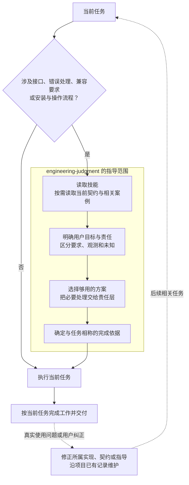

# engineering-judgment skill 计划

2026 年 11 月 10 日。用户最新决定：保留独立 skill 并直接接入；“不要测试他，他没法用简单的办法测试，只能在长期使用中逐渐感受它的效果”。本轮据此完成编写与接入，旧计划的小样本对照、触发探针、测试项目发现试验及收益门槛取消。当前交付见[结果](result.md)，工作状态见[进度](progress.md)。

## 目标与依据

将“简洁、避免防御性”落实为设计、编码和使用文档中的取舍方法：围绕用户目标选择够用的方案，让限制与错误处理有依据、职责明确、失败可见，减少使用和维护负担。案例提供契约、事实与责任依据，让 agent 能区分多余负担和必要处理。

[项目纲领](../../project-charter.md#适用于所有项目的要求)同时要求避免防御式编程和防御式写作；[整改分析](../20261110-rectification/research/integration-notes.md#采用与更正)保留复发样本及合理反例。产品问题沿[整改计划](../20261110-rectification/plan.md)修复，本任务交付可独立使用的指导能力。上下文干扰、取舍偏移仍是机制推测，不当作模型内在动机的结论。

[现成方案与有效性复核](research/feasibility.md)保留当时的调查及建议，其中先试验再决定保留的建议已由用户最新决定覆盖。现有材料不能给出长期效果概率；后续维护依据真实任务中的使用感受、问题和用户纠正。

## 交付与接入

| 位置 | 职责 |
| --- | --- |
| `skills/engineering-judgment/SKILL.md` | 使用条件、核心判断与按需案例入口；主体可独立读懂 |
| `skills/engineering-judgment/references/cases.md` | 字段契约、恢复、资源责任、兼容性、操作文档和完成尺度的自包含案例 |
| `.agents/skills/engineering-judgment` | 沿本机现有 junction 方式指向源码的宿主入口；不随源码分发 |
| 根 `AGENTS.md` 与 `README.md` | 条件化入口与独立使用说明，由主 agent 整合 |

技能不依赖 Python、数据库、basePack 配置或其它 skill。完整复制技能目录到宿主支持的 skills 位置即可独立使用；项目契约、授权和产品状态由使用项目提供。案例只依赖其自身说明的情境，本项目原证留在开发材料。

编写应用 `skill-creator`、`writing-for-agents`（含 `SKILL-MECHANICS.md`）和 `file-structure` 约定。主体维护共享判断，案例按当前情境读取；不增加工具、固定复审表单或额外反馈台账。

## 使用方式与核心判断

在形成方案前，任务涉及接口与职责设计、校验与恢复、兼容要求、安装或操作流程时读取；用户也可显式调用 `$engineering-judgment`。常规文字修正等没有这些取舍的工作沿原流程完成。

- **目标与负担：** 选择满足当前需求的简单方案，计入使用者和维护者的负担；额外抽象、状态、兼容和审阅应有当前职责。
- **契约与责任：** 边界按用途建立契约，内部按契约调用；合法缺省与必需字段缺失分别处理。有明确恢复动作的一层处理已知异常，其余保留原错。
- **事实与未知：** 区分能力要求、实测样本、已知冲突和未知范围；只追查会改变当前决定的缺口。限制按功能与证据落位。
- **读者与完成：** 用户文档交付必要条件、操作、成功结果与失败后动作；研发观测回到研发记录。完成依据与所做主张相称，沿用户指定方式判断结果。

这些判断在当前工作中完成，最终按任务需要说明结果、实际检查和余项。

## 应用逻辑

## 本轮完成条件与后续

本轮交付正文、案例、本机入口及根指针，核对相关路径、相对链接、UTF-8 和 diff 格式。以上是编辑与接入核对，不证明指导效果；本轮不运行技能行为、对照或触发试验，也不以代理指标决定是否保留。

主 agent 统一整合、检查差异与提交。项目记忆 `source_scope` 由所属维护分支登记新技能及本任务材料，不为此延长技能交付。长期使用遇到问题时先修真正的维护源，指导有缺口时再定向修改技能；不新建长期评测流程。

前序已读参考包括 OpenAI 技能机制、`karpathy-guidelines`、`simple-engineering` 和 `avoid-overdefensive-programming`，采用其按需读取、范围、最小实现和责任判断，未采用固定阶段审批或逐项报告。来源与外推限制见[复核记录](research/feasibility.md)。