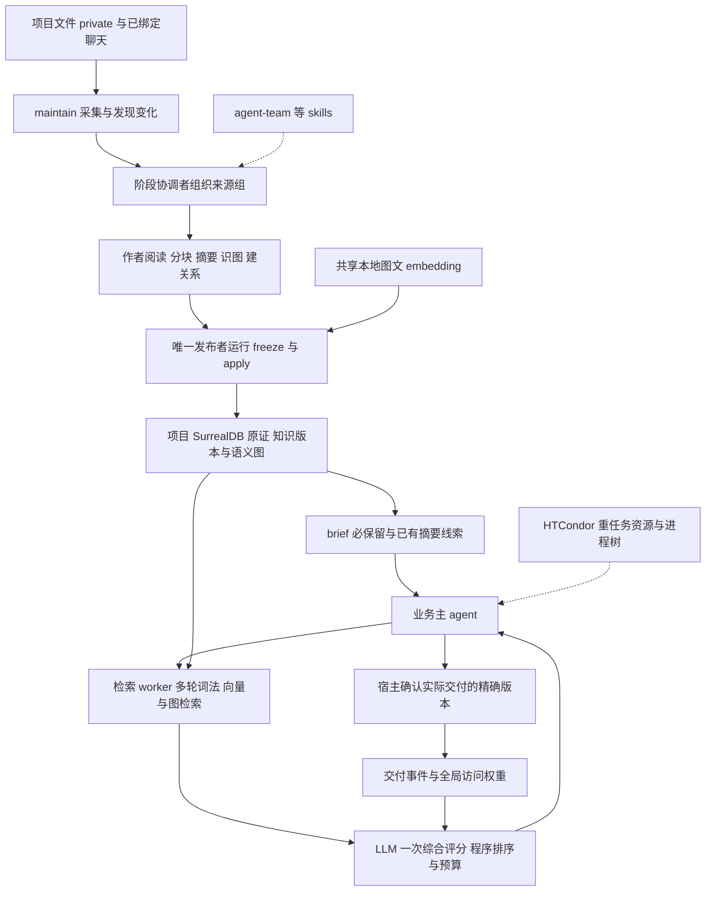
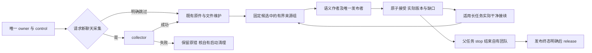

# 当前basePack总体逻辑

以下两张流程图记录0.16.0历史基线；当前0.18系列合同见[实现概览](overview.md)与[记忆模块](modules/memory.md)。实际安装版本、wheel及验收状态以[部署合同](deployment.md)为唯一维护源，维护范围与余项沿[进度](../tasks/20261115-real-use-rectification/progress.md)，推广历史见[迁移结果](../tasks/20261115-real-use-rectification/migration-result.md)。当前实现与验收不改写旧图的历史含义。

2026-11-17的[修改前/修改后完整系统图](../tasks/20261115-real-use-rectification/forgetting-options.md#修改前后的完整系统)是方案图，图源及生成说明在[任务图目录](../tasks/20261115-real-use-rectification/diagrams/README.md)；它们不证明0.17已安装、迁移或完成长期效果验收。本页不重绘该批SVG/PNG。0.16验收见[整改结果](../tasks/20261115-real-use-rectification/result.md)和[完整维护观察](../tasks/20261115-real-use-rectification/maintenance-20261116-result.md)，实际路径与服务入口见[部署合同](deployment.md)及[环境记录](environment.md)。

## 0.16总体流程

brief不按当前问题搜索；mandatory独立保留。检索worker回源、展开图并给综合分，rank仅按分数排序、去重与预算，不第二次乘访问权重。交付必须由宿主确认实际收到的知识版本；search/read/rank不是交付。

图示0.16访问偏好只按真实非空交付事件计算，没有日历衰减；全项目G意味着持续做A仍可能改变B的访问提示。该历史基线当时没有行为向量、自动视角或局部钟。行为重要性不控制语义有效性，也不删除冷材料。

## 0.16维护与生命周期

0.16的`--skip-codex-collection`只跳过本轮新聊天采集，`--scope`未对所有已登记来源和历史pending真实限域。0.17已替代这两项合同，具体见[记忆模块](modules/memory.md)。0.16阶段接续保持同轮receipt/owner/control，已实际验证；全队成本与组内机械往返仍有局限。普通维护在作者处置和程序接受后结束，审计只在用户明确要求时执行。

## 代码、项目数据与共享设施

| 层次 | 当前归属与职责 |
| --- | --- |
| 公共源码与产品文档 | 唯一active工程`experiments/20261106-basepack/`；普通wheel安装后运行，不依赖另一项目工作区 |
| 通用指导 | 根`skills/`的file-structure、agent-team、engineering-judgment由宿主读取；发现联接不复制维护源 |
| 项目实例 | 每项目`.basepack/config.toml`定位身份、凭据、数据库及资源入口；项目知识不跨项目共享 |
| 项目记忆 | SurrealDB保存来源/知识版本、依据、语义图、反馈及交付；assets、control和恢复材料沿其实际配置保留 |
| 限制分发资料 | 根`private/`独立本机Git；另可配置原位private_scope；覆盖隐私、机密和版权/许可边界 |
| 共享embedding | 本地模型与HTTP服务按机器设施复用，向量身份独立于部署及等待；服务不在普通Condor作业树内 |
| 其他重任务 | HTCondor负责容量、准入、排队、时限与作业进程树；调用者声明实际并行和资源，不增加第二套共享锁 |
| 临时与选留原证 | 根`tmp/`可清除；必要原证选留`artifacts/runs/`，不把活跃控制、数据库或唯一原件放临时区 |

公开安装、构建、测试与运行不依赖private原件；原生数据库导出仍可能包含受限内容。完整合同分别见[记忆模块](modules/memory.md)、[资源模块](modules/resources.md)、[本机数据布局](project-data-layout.md)与[文档约定](../documentation.md)。
