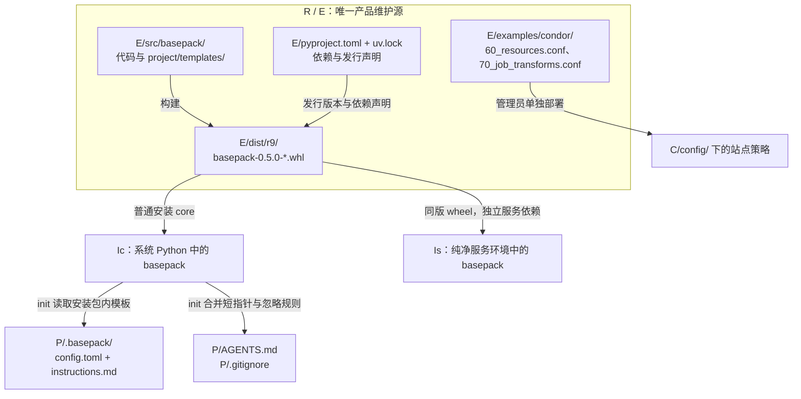
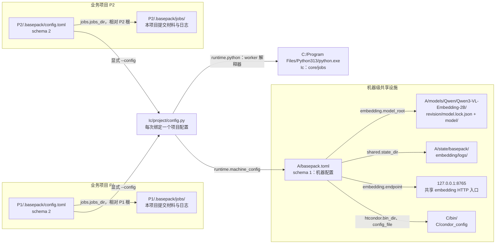
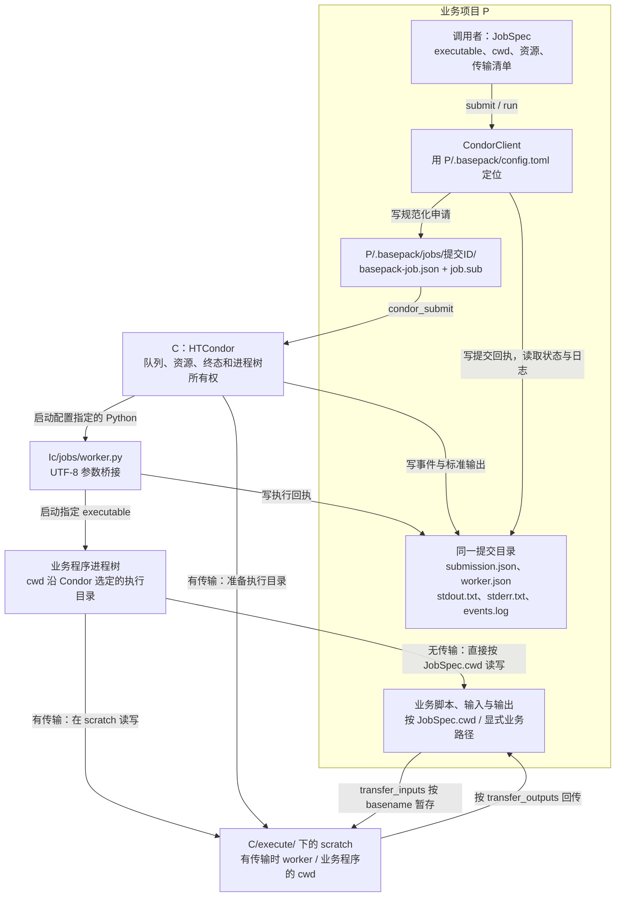
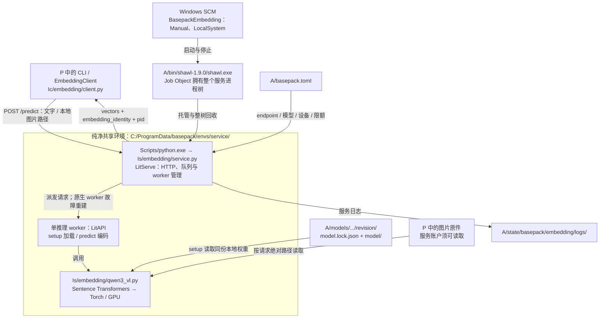
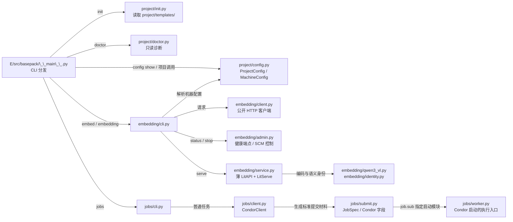
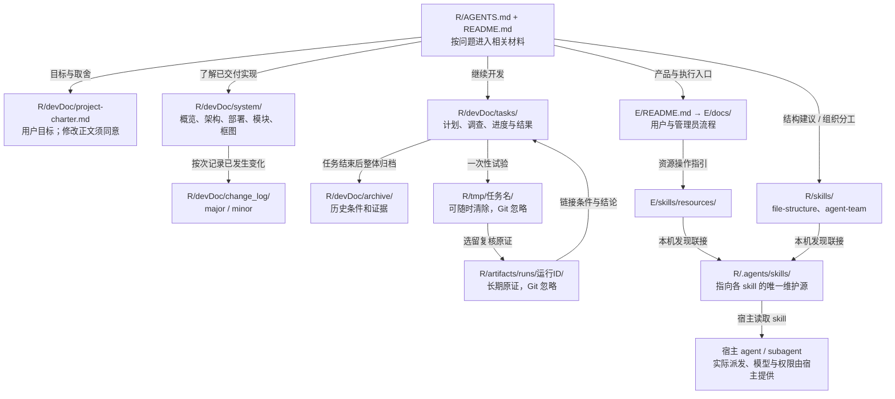

# 当前文件与运行逻辑框图

按 2026 年 11 月 9 日的 0.5.0 实现、普通安装和本机部署绘制，核对基线为 main `6685c87`。沿用[参考 chat](codex://threads/01a1bb3f-4db8-7c10-8d71-c951aba18aa2) 按文件位置分层的方法；旧版服务与迁移机制以当前代码为准更新。图描述已交付关系，不表示服务此刻正在运行。[记忆方案图](../tasks/20261106-memory-system/diagrams.md) 单独维护。

## 路径与读图约定

| 代号 | 位置与含义 |
| --- | --- |
| R | 本源码仓库：`D:/project/20261106 memsys` |
| E | 当前 active 工程：`R/experiments/20261106-basepack` |
| Ic | core/jobs 安装包：`C:/Program Files/Python313/Lib/site-packages/basepack` |
| Is | embedding 安装包：`C:/ProgramData/basepack/envs/service/Lib/site-packages/basepack` |
| A | 本机共享设施：`D:/AgentTools` |
| C | 本机 HTCondor：`C:/condor` |
| P、P1、P2 | 接入 basePack 的业务项目示意，彼此独立；不表示本仓库已有实例 |

箭头按标签表示构建、调用、引用、读写或所有权，不能只按相邻位置推断依赖。以下机器绝对路径是本次部署实例；公共代码通过配置定位。完整合同见[部署说明](deployment.md)。

## 1. 源码怎样成为安装与项目接入

wheel 不携带 devDoc、skills、测试、示例或模型。系统 Python 和服务 Python 安装同版代码，但依赖环境各自维护；运行不从 E 或 tmp 导入。`init` 只生成接入文件，jobs 目录按使用建立，memory 仍是预留路径。依据：[路线入口](../../experiments/20261106-basepack/README.md)、[项目接入实现](../../experiments/20261106-basepack/src/basepack/project/init.py)。

## 2. 两个业务项目如何绑定共享设施

`project/config.py` 是唯一路径解析处：`project.root` 相对配置文件目录；项目数据路径相对该根且位于 `.basepack/`；机器相对路径相对 `A/basepack.toml`。`runtime.python` 给普通作业的 worker 使用，不会把当前 CLI 自动换解释器重启。机器 TOML 定位 Condor，普通作业容量和站点策略仍由 Condor 配置维护。依据：[config.py](../../experiments/20261106-basepack/src/basepack/project/config.py)。

## 3. 普通作业经过哪些文件和进程

业务输出不必全部进入 `.basepack/`。有传输时，输入按 basename 进入 execute scratch，worker 和业务程序在其中执行，清单中的输出再回传至 `JobSpec.cwd`；Condor 自身队列和日志另存 C/spool、C/log。`wait` 等待超时后作业仍可继续；`run` 的排队/运行期限及取消由原生 Condor 流程执行。embedding 服务在这棵作业树之外，额度以管理员固定背景预留协调。依据：[提交编码](../../experiments/20261106-basepack/src/basepack/jobs/submit.py)、[客户端](../../experiments/20261106-basepack/src/basepack/jobs/client.py)、[资源合同](modules/resources.md)。

## 4. embedding 的代码、模型和进程归谁管理

单推理 worker 不等于单个系统进程，LitServe 还使用 Manager 等辅助进程。模型常驻，不随客户端超时退出；排队期限不打断已开始推理。worker 故障由 LitServe 重建，主进程或 Shawl 故障后服务停止，由管理员手动启动；停止按 SCM → Shawl 整树回收。向量语义身份由模型和编码合同决定，部署路径不属于该身份。依据：[service.py](../../experiments/20261106-basepack/src/basepack/embedding/service.py)、[生命周期与接口](modules/resources.md)、[实际交付](../archive/20261107-resource-coordination/r9-result.md)。

## 5. 产品源码内部怎样分工

图列主要调用与材料关系，不枚举每个 import；项目命令从 `__main__` 取得解析后的配置再交给对应模块。当前没有 memory 模块、记忆命令或数据库。旧自写 HTTP/supervisor/worker 登记、私有 RPC 和 `migrate` 已从 0.5.0 退役，历史材料见资源归档。依据：[源码入口](../../experiments/20261106-basepack/src/basepack/__main__.py)、[架构边界](architecture.md)。

## 6. 开发文档、skills 与临时材料放在哪里

skill 是指令与参考，不是装入 wheel 的 Python 模块；发现联接也不是另一份维护源。系统事实随实际实现更新，计划只在 tasks，结束材料进 archive；图和叙述冲突时应回查唯一源码/配置与验收条件。依据：[文档约定](../documentation.md)、[结构说明](architecture.md)、[环境与发现入口](environment.md)。
