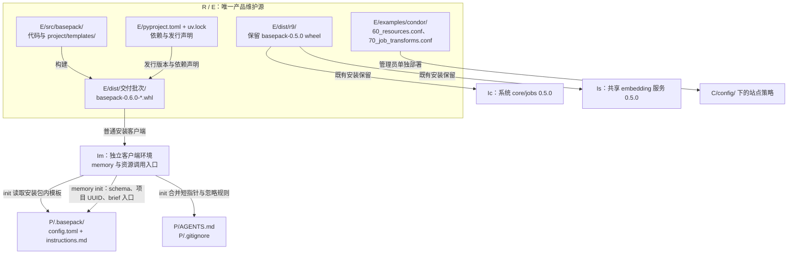
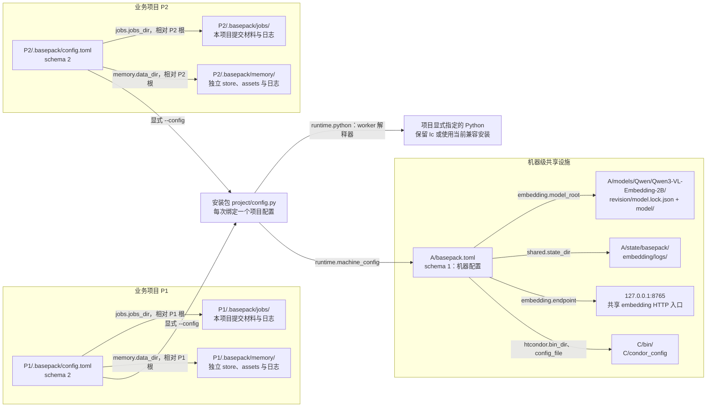
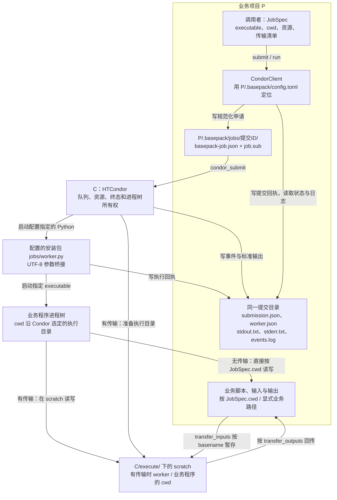
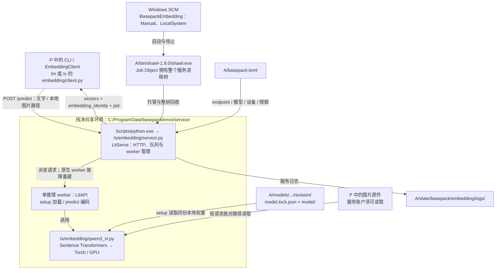
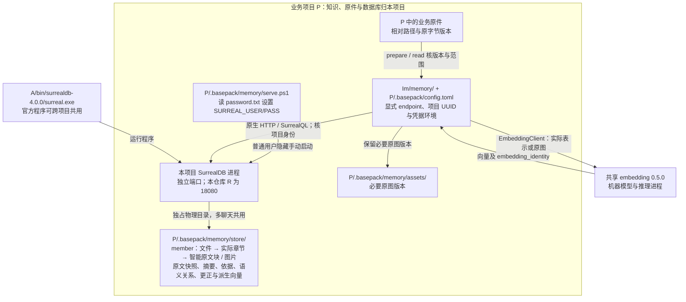
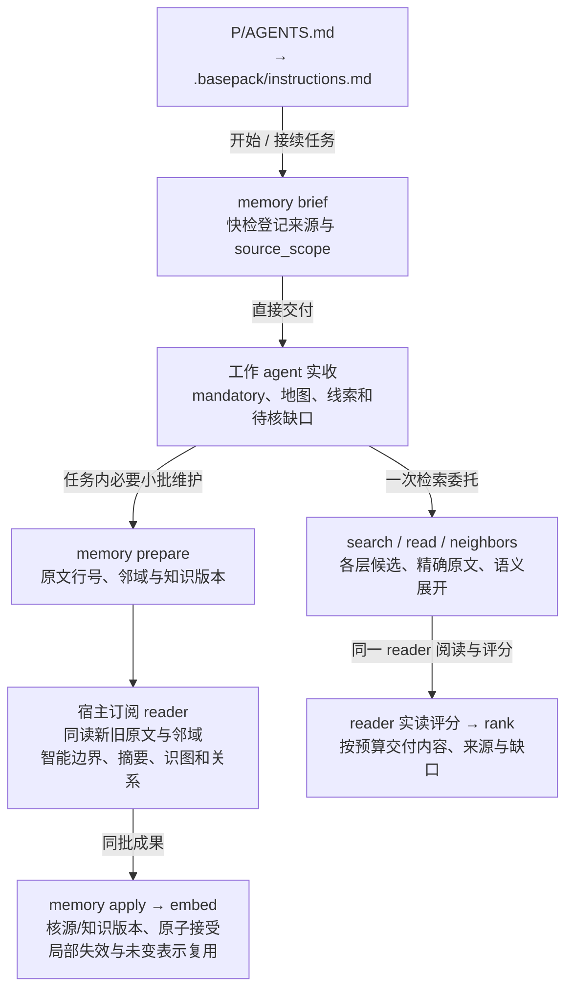
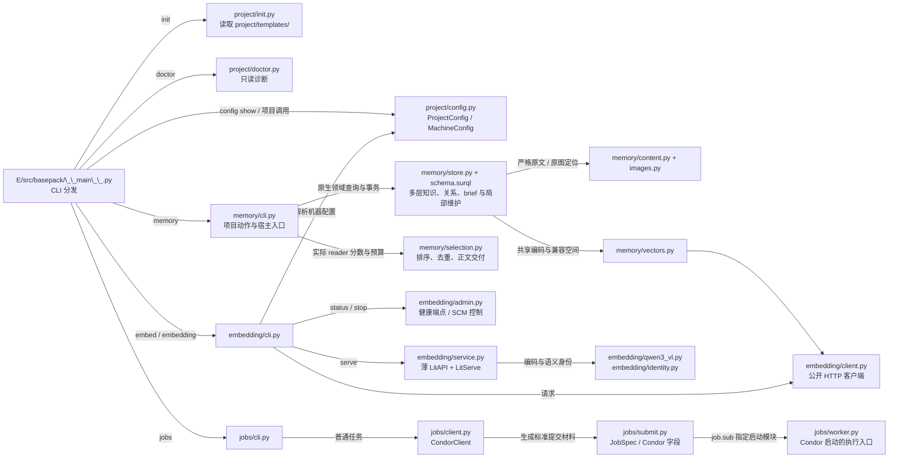
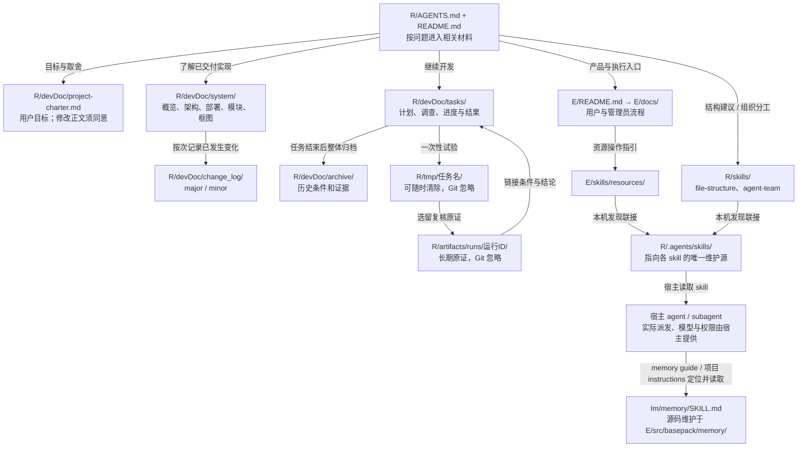

# 当前文件与运行逻辑框图

按 2026 年 11 月 9 日的 0.6.0 源码、正式客户端安装与本机部署绘制。0.5.0 core/jobs 和共享 embedding 服务继续保留，后者与 0.6.0 客户端协议兼容。沿用[参考 chat](codex://threads/01a1bb3f-4db8-7c10-8d71-c951aba18aa2) 按文件位置分层的方法；记忆行为的实际验收边界见[专项进度](../tasks/20261106-memory-system/progress.md)，阶段合同见[记忆方案图](../tasks/20261106-memory-system/diagrams.md)。

## 路径与读图约定

| 代号 | 位置与含义 |
| --- | --- |
| R | 本源码仓库：`D:/project/20261106 memsys` |
| E | 当前 active 工程：`R/experiments/20261106-basepack` |
| Im | 0.6.0 客户端安装包：`D:/AgentTools/envs/basepack-client/Lib/site-packages/basepack` |
| Ic | 保留的 0.5.0 core/jobs：`C:/Program Files/Python313/Lib/site-packages/basepack` |
| Is | 保留的 0.5.0 embedding 服务：`C:/ProgramData/basepack/envs/service/Lib/site-packages/basepack` |
| A | 本机共享设施：`D:/AgentTools` |
| C | 本机 HTCondor：`C:/condor` |
| P、P1、P2 | 接入 basePack 的独立业务项目；本仓库 R 也已接入，项目库使用本地 18080 端口 |

箭头按标签表示构建、调用、引用、读写或所有权，不能只按相邻位置推断依赖。以下机器绝对路径是本次部署实例；公共代码通过配置定位。完整合同见[部署说明](deployment.md)。

## 1. 源码怎样成为安装与项目接入

wheel 携带 memory skill，devDoc、根 skills、测试、示例和模型沿各自维护位置保留；运行从普通安装加载。0.6.0 客户端安装没有替换或停止既有 0.5.0 资源服务。普通 `init` 生成接入文件，`memory init` 再绑定已启动的项目库、安装 schema 和宿主入口。依据：[路线入口](../../experiments/20261106-basepack/README.md)、[项目接入实现](../../experiments/20261106-basepack/src/basepack/project/init.py)、[记忆实现](modules/memory.md)。

## 2. 两个业务项目如何绑定共享设施

`project/config.py` 是唯一路径解析处：`project.root` 相对配置文件目录；项目数据路径相对该根且位于 `.basepack/`；机器相对路径相对 `A/basepack.toml`。`runtime.python` 给普通作业的 worker 使用，不会把当前 CLI 自动换解释器重启。机器 TOML 定位 Condor，普通作业容量和站点策略仍由 Condor 配置维护。依据：[config.py](../../experiments/20261106-basepack/src/basepack/project/config.py)。

## 3. 普通作业经过哪些文件和进程

业务输出不必全部进入 `.basepack/`。有传输时，输入按 basename 进入 execute scratch，worker 和业务程序在其中执行，清单中的输出再回传至 `JobSpec.cwd`；Condor 自身队列和日志另存 C/spool、C/log。`wait` 等待超时后作业仍可继续；`run` 的排队/运行期限及取消由原生 Condor 流程执行。embedding 服务在这棵作业树之外，额度以管理员固定背景预留协调。依据：[提交编码](../../experiments/20261106-basepack/src/basepack/jobs/submit.py)、[客户端](../../experiments/20261106-basepack/src/basepack/jobs/client.py)、[资源合同](modules/resources.md)。

## 4. embedding 的代码、模型和进程归谁管理

共享服务仍为 Is 中的 0.5.0，0.6.0 客户端沿用其协议与 embedding_identity 合同，服务本轮未停、未改。单推理 worker 不等于单个系统进程，LitServe 还使用 Manager 等辅助进程。模型常驻，不随客户端超时退出；排队期限不打断已开始推理。worker 故障由 LitServe 重建，主进程或 Shawl 故障后由管理员手动启动；停止按 SCM → Shawl 整树回收。语义身份由模型和编码合同决定，部署路径不属于该身份。依据：[service.py](../../experiments/20261106-basepack/src/basepack/embedding/service.py)、[生命周期与接口](modules/resources.md)、[R9 交付](../archive/20261107-resource-coordination/r9-result.md)。

## 5. 项目记忆的数据库与维护归谁管理

本仓库的 SurrealDB 是普通用户隐藏手动进程，由项目 `serve.ps1` 启动；共享 embedding 继续由 SCM/Shawl 托管。每项目的端口、UUID、物理 store 和凭据独立，namespace/database 不代替物理隔离。文件、实际章节与智能原文块各为可寻址 member，默认可直接全文/向量检索；包含、摘要依据和语义边共同保存在项目库。恢复使用原生导出并保留原件、必要 assets 与配置。依据：[记忆实现](modules/memory.md)、[用户流程](../../experiments/20261106-basepack/docs/memory.md)。

宿主按项目入口执行 brief 并实际派发 reader，程序通过版本与事务接受成果。brief 的 changes/pending 驱动当前任务的小批维护；深维护沿同一流程继续。库内保留智能边界、摘要与关系，向量可从表示重建。本仓库已完成初始化；devDoc 首建、增量和阶段结论以[专项进度](../tasks/20261106-memory-system/progress.md)为准。

## 6. 产品源码内部怎样分工

图列主要调用与材料关系，不枚举每个 import；项目命令从 `__main__` 取得解析后的配置再交给对应模块。memory skill 通过宿主的订阅 reader 执行理解、建图与评分，数据库使用原生 HTTP/SQL，服务与备份使用 SurrealDB CLI。旧自写 HTTP/supervisor/worker 登记、私有 RPC 和 `migrate` 已从 0.5.0 退役，历史材料见资源归档。依据：[源码入口](../../experiments/20261106-basepack/src/basepack/__main__.py)、[架构边界](architecture.md)。

## 7. 开发文档、skills 与临时材料放在哪里

skill 是宿主读取的指令与参考；memory skill 随 wheel 安装，根通用 skill 与 resources skill 沿发现联接读取，各自保留唯一维护源。系统事实随实际实现更新，计划只在 tasks，结束材料进 archive；图和叙述冲突时应回查源码、配置与验收条件。依据：[文档约定](../documentation.md)、[结构说明](architecture.md)、[环境与发现入口](environment.md)。
