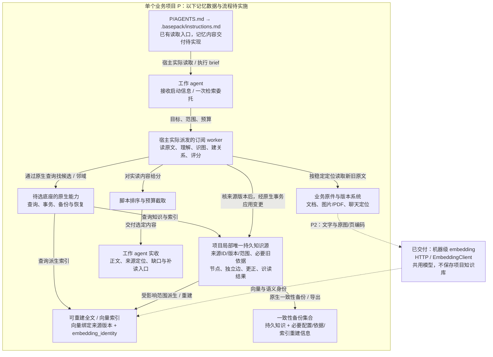
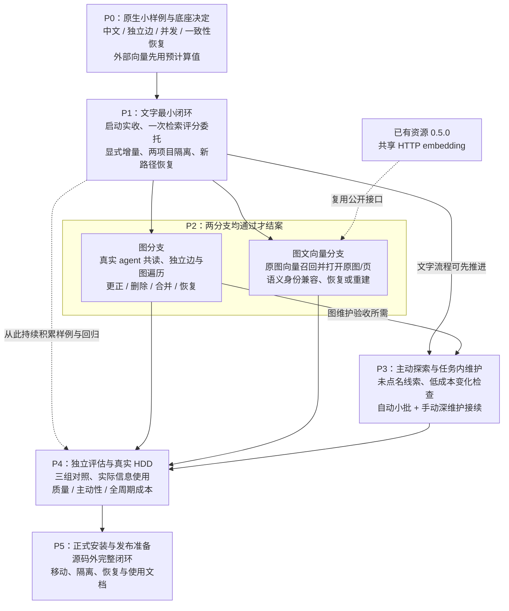

# 记忆系统方案逻辑框图

这是 2026 年 11 月 9 日[实施计划](plan.md)的图解。**P0 待执行，P1–P5 未实现/验收**；底座及具体存储布局尚未选定，实际状态只在[进度](progress.md)维护。已交付的接入、embedding 和 jobs 见[当前系统图](../../system/diagrams.md)。

## 1. 项目局部知识、原件与共享能力

建议知识与索引收在 `P/.basepack/memory/` 的少量存储文件，具体格式由 P0 实测决定；通用底座程序可以共用，库文件仍分别留在各项目。业务原件不自动整库复制，原件备份沿业务责任；旧依据须能由版本系统回查或保留必要片段。

启动时，必须保留的信息直接交付，相关与探索线索才参加预算选择；入口存在不等于内容已经到达。变化维护沿“检测 → 共读 → 核版本 → 原生事务 → 更新索引”进行，知识已提交而索引失败时报告待更新范围。embedding 只编码，语义判断由实际订阅 agent 完成。行为与数据合同见[计划](plan.md#最小行为与数据合同)。

## 2. 阶段怎样依赖与验收

P0/P1 无需 embedding 或 Condor；P3 不等待图片向量分支。R9 的资源验收不证明记忆、图遍历或多模态检索已可用。各阶段以实际用户行为和成本证据结案，真实机械盘未测时不能声明满足完整交付要求。详细动作及完成条件只在[阶段计划](plan.md#阶段与完成条件)维护。
