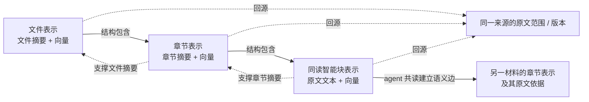
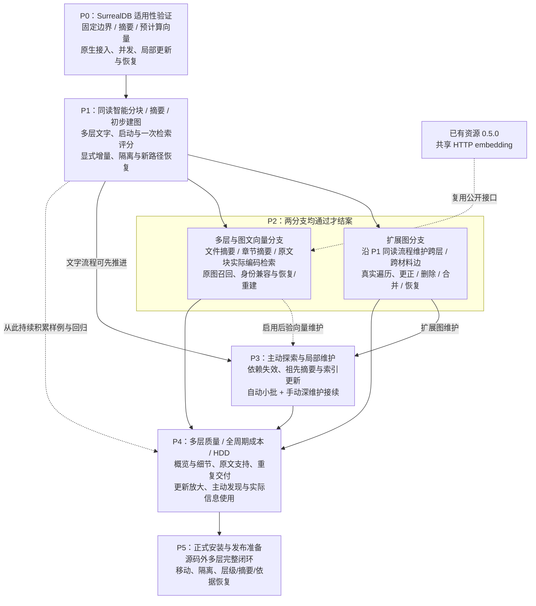

# 记忆系统方案逻辑框图

本图保留 2026 年 11 月 9 日的阶段划分与验收依赖。现行查询与发布合同以已同步的[实施计划](plan.md#共读变化与-io)和[当前系统图](../../system/diagrams.md)为准；下文早期文字流程与先知识后索引的顺序仅属当时设计。各阶段的实际证据与未测边界只在[进度](progress.md)及结果文档维护。

## 1. 项目局部知识、原件与共享能力

```mermaid
flowchart TB
  subgraph project["项目 P：项目局部记忆"]
    original["业务原件与版本系统<br/>文档、图片/PDF、聊天定位"]
    entry["P/AGENTS.md → .basepack/instructions.md<br/>宿主读取入口并执行 brief"]
    work["工作 agent<br/>接收启动信息 / 一次检索委托"]
    reader["宿主实际派发的订阅 worker<br/>同次阅读：智能分块、摘要、节点/边"]
    store["项目局部唯一持久知识源<br/>来源/表示ID、版本、原文范围<br/>块边界、层级、摘要、语义边与更正"]
    index["可重建的各层全文 / 向量索引<br/>表示ID + 输入版本 + embedding_identity"]
    backend["首期 SurrealDB 原生 CLI/MCP<br/>查询、事务、备份与恢复"]
    candidate["多层候选：文件 / 章节 / 原文块"]
    expand["worker 按需展开父子 / 语义邻域<br/>回读原文、按返回内容/范围去重并给分"]
    rank["脚本按分排序与预算截取"]
    deliver["工作 agent 实收<br/>正文、来源定位、缺口与补读入口"]
    backup["一致性备份集合<br/>层级、摘要与依据等持久知识<br/>必要配置及索引重建信息"]
    entry -->|宿主实际读取 / 执行 brief| work
    work -->|目标、范围、预算| reader
    reader -->|多层查询| backend
    backend -->|查询持久表示与关系| store
    backend -->|查询派生索引| index
    backend --> candidate
    candidate --> expand
    expand -->|必要时继续查询| backend
    expand -->|读取依据| original
    reader -->|按稳定定位读取新旧原文| original
    reader -->|核版本后，按原生写入边界应用变更| store
    store -->|受影响范围派生 / 重建| index
    expand -->|实读内容与分数| rank
    rank -->|一次返回选定内容| deliver
    store -->|原生一致性备份 / 导出| backup
  end
  embedding["已交付：机器级 embedding<br/>HTTP / EmbeddingClient<br/>共用模型，不保存项目知识库"]
  store -.->|P2：文件/章节摘要、原文块文本| embedding
  original -.->|P2：原图/页编码| embedding
  embedding -.->|向量与语义身份| index
```

知识与索引收在 `P/.basepack/memory/`，使用项目独立的 SurrealKV 目录；接入映射见 [P0 结果](p0-result.md)。通用底座程序可以共用，库文件仍分别留在各项目。业务原件不自动整库复制，原件备份沿业务责任；旧依据须能由版本系统回查或保留必要片段。

启动时，必须保留的信息直接交付，相关与探索线索才参加预算选择；入口存在不等于内容已经到达。变化维护沿“检测 → 同读智能分块/摘要/建边 → 核版本 → 原生事务 → 更新索引”进行。结构解析只供定位，embedding 只编码，语义判断由实际订阅 agent 完成。行为与数据合同见[计划](plan.md#最小行为与数据合同)。

## 2. 多层表示、摘要依据与语义关系

长结构文件默认提供这些可寻址层次，三层均可独立成为候选；短材料按实际结构表示。文件/章节摘要保留覆盖范围与依据，超长原件使用有依据的摘要，不截断冒充整文件表示。结构包含关系与 agent 语义边分别维护；修改原文块时，更新受影响的祖先摘要、向量及语义依据，复用未变内容。已接受摘要、层级和依据随持久知识备份，向量可据此重建。

## 3. 阶段怎样依赖与验收

P1 的文字与初步关系流程不等待 embedding 或 Condor；P3 可先维护 P1 已有能力，扩展图/向量维护在对应能力启用后验收，不等待图片分支完成。R9 的资源验收不证明记忆、多层检索或完整语义图已可用；真实机械盘未测时不能声明满足完整交付要求。详细动作及完成条件只在[阶段计划](plan.md#阶段与完成条件)维护。
