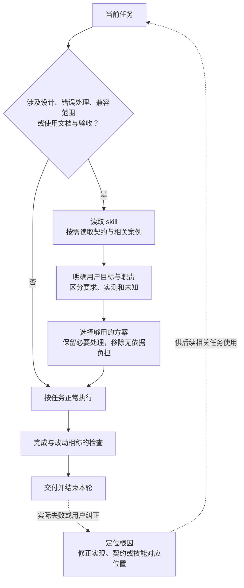

# engineering-judgment skill 计划

2026 年 11 月 10 日。状态：计划已制定，skill 待实施。本轮交付计划和逻辑框图；技能编写、接入和行为验证在实施时完成。

## 目标与依据

将“简洁、避免防御性”落实为设计、编码和使用文档中的取舍方法：围绕用户目标选择够用的方案，让限制与错误处理有依据、职责明确、失败可见，减少使用和维护负担。

[项目纲领](../../project-charter.md#适用于所有项目的要求)已同时要求避免防御式编程和防御式写作；[整改分析](../20261110-rectification/research/integration-notes.md#采用与更正)提供了复发样本及合理反例。现有[整改计划](../20261110-rectification/plan.md)修复产品问题，本任务建设可独立使用的指导能力，两者分别交付。

当前可证的是入口对写作要求的具体化不足，以及研发举证与使用流程混入。上下文干扰、取舍偏移是待检验的机制解释，不作为模型内在动机的结论。初版用实际产出验证指导是否有用。

## 交付与接入

沿用根目录通用技能的维护方式，未来交付：

| 位置 | 职责 |
| --- | --- |
| `skills/engineering-judgment/SKILL.md` | 触发条件、核心判断与使用方式；主体可独立读懂 |
| `skills/engineering-judgment/references/cases.md` | 按代码、兼容范围、文档/流程组织的少量正反案例，相关时读取 |
| 根 `AGENTS.md` 与 `README.md` | 简短原则及条件化入口、独立使用方法；实现后更新 |

技能自身不依赖 Python、数据库、basePack 配置或其它 skill。项目的真实契约、授权和产品状态由使用项目提供；发布案例采用自包含情境，本项目原证留在开发材料。现有 `writing-for-agents` 用于编写和组织指令文档，不成为使用本技能的前置。

源码维护在根 `skills/`，宿主发现入口按已有通用技能方式接入；实施时验证完整目录在测试项目的 `.agents/skills/` 中可发现，不能把源码目录存在视为安装成功。初版由正文与案例起步，只有实际需要时补 UI 元数据或工具。

## 何时使用、怎样判断

在形成方案前，当任务涉及新增、修改或审查以下内容时读取：接口与职责设计，校验、异常和恢复，依赖或兼容范围，安装/操作文档及验收流程。用户也可显式调用 `$engineering-judgment`。常规文字修正等无此类取舍的任务沿原流程执行。

根入口保留用户目标和简洁原则，再给出上述读取条件；技能 description 使用同样的范围。实际触发效果需要验证，名称和自动匹配本身不构成保证。

核心判断在当前工作中完成，不另设逐项表单：

- **目标与负担：** 明确这次要交付的结果，选择满足当前需求且使用、维护负担合适的方案；将推测中的未来需求留待实际出现。
- **契约与职责：** 找到输入、状态与准入的维护者。边界处理有明确用途，内部遵循契约；异常由有处理能力的一层处理，其余保留原错。契约含糊时修正接口或职责。
- **事实与未知：** 区分用户要求、能力合同、实测样本和未知范围。已知不兼容写明依据；未测既不自动变成禁止，也不自动变成支持。只核查会改变当前决定的未知；需要用户决定的关键缺口再询问。
- **读者与完成：** 使用文档就近交付必要条件、操作、成功结果与失败后动作；研发证据回到研发记录。检查与本次改动相称，达到完成条件即交付。

最终输出沿任务需要说明结果、实际检查和余项；不附固定的“没有做什么”清单，也不为每项工作强制增加一轮审核。

## 应用逻辑框图

以下为拟实现的使用逻辑；反馈分支只由实际问题触发。

## 实施顺序与完成条件

| 阶段 | 工作与产出 | 完成条件 |
| --- | --- | --- |
| 1. 编写初版 | 写核心指导与自包含案例；借鉴现成资源的适用部分，统一核心含义的维护位置 | 单读主体能进行取舍；能区分多余防御与合理处理；没有附加固定审核链 |
| 2. 小样本试用 | 在根 `tmp/` 的隔离任务中，选代表性文档和代码任务做有/无技能比较，再检查少量未用于起草的新情境；同时检查显式调用、相关任务触发和无关任务 | 比较实际产出及必要理由：多余限制减少，必要行为保留，没有新增无用停顿或研究步骤；若无改善，定向修订或删去无效指导 |
| 3. 接入交付 | 通过本地技能格式检查，完成测试项目发现入口；更新根指针、独立使用说明及结果记录，提交相关改动 | 新上下文能发现并使用；离开本项目也能应用；记录实际样本结果和未解决问题，不以格式通过代替行为验证 |

主 agent 负责边界、整合和提交；编写可直接完成，小样本试用用清洁上下文的订阅 agent。无需 LLM API 或独立评测平台。此处比较属于技能开发验证，不进入普通用户任务。

旧例覆盖以下成对判断：

| 情境 | 要观察的行为 |
| --- | --- |
| 只测过一张 GPU／存在实际运算与显存要求 | 分离机器样本与能力条件，保留实际资源约束 |
| 轻客户端新 Python 版本已跑通／某 extra 存在已知依赖冲突 | 按证据和功能范围决定兼容声明，既不无据阻止，也不扩大成功结论 |
| 普通安装／管理员配置同卡共享预算 | 安装交付所选功能的短验证，真实预算配置仍由管理员承担 |
| 内部必需字段或异常／纯 CPU 池合法缺少 GPU 字段 | 真实故障可见，合法缺省保留；依据契约判断，不按语法批量删除 |
| 等待超时但任务继续运行／无操作影响的重复免责声明 | 保留改变操作的信息，精简无用负担 |

未见情境另从真实任务选择，不把预期答案写给执行 agent；普通任务也应能顺利完成而不被扩展成全面审查。评估针对决定和行为，不按否定词、try/catch 数量或篇幅评分。结论限于实际试用范围，后续真实反馈再定向维护。

实施接续时，将本计划及实际新增技能纳入本项目 `source_scope`，按必要小批更新记忆。初版达到上述条件后结束本轮，不以全库追新、其它整改批次完成或扩大研究为交付条件。

## 参考的采用方式

- [OpenAI 技能机制](https://learn.chatgpt.com/docs/build-skills)：用于触发、按需读取与发现入口；采用本机 `skill-creator` 和 `writing-for-agents` 编写。
- [karpathy-guidelines](https://github.com/multica-ai/andrej-karpathy-skills/blob/main/skills/karpathy-guidelines/SKILL.md)：借鉴最小实现、范围与完成目标；未知不一律转为停下询问。
- [simple-engineering](https://github.com/Robot-Inventor/agent-skills/blob/main/skills/simple-engineering/SKILL.md)：借鉴通过接口设计减少重复校验；方案比较与检查规模随任务决定。
- [avoid-overdefensive-programming](https://github.com/aravelo7/codex-agent-skills/blob/main/skills/avoid-overdefensive-programming/SKILL.md)：借鉴失败可见和职责判断；不引入其逐项报告要求。

上述原文已在前序调研中读取；尚未证明这些原则组成的新技能能改善本项目任务，实际效果由阶段 2 验证。
