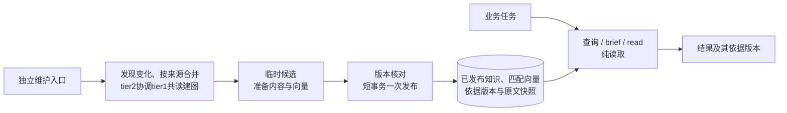
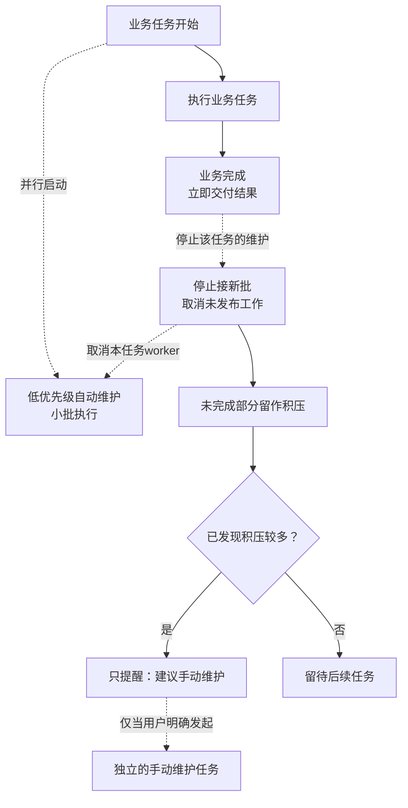

# basePack 整改计划

2026-11-10 制定，综合本聊天、新机反馈及[工程取舍讨论](codex://threads/01a1c4bd-c2ba-7ac3-9a11-6f601f89e9e6)维护。当前交付更新后的计划，产品整改与技能试用待实施；已有源码修复和历史验证沿原记录保留。目标是解决真实故障、缩短使用流程，并修正产生重复防御和流程膨胀的职责与取舍方式。

## 已核事实与范围

- [本项目扩库](../20261106-memory-system/project-coverage-result.md)的 C0–C4 已完成，最终207个来源。直接文件、原六源、扩大记忆各10题的评分为18/20、20/20、20/20；未证明扩库额外质量优势或全周期费用收益。首次地图未直接交付关键前提，正式库已有定向摘要修正和一次新上下文启动检查。
- 退役成员误触发当前祖先失效、通过退役父级传播、自动改写历史来源版本，已有源码修复 `043a411`；普通发行包和稳定客户端尚未包含，见[修复记录](../../change_log/minor/20261110_145550_fix-retired-memory-invalidation.md)。
- 实际试用中的目录输入错误和HTTP 413已触发；凭据入口提醒已有0.6.3源码与安装证据，接续时复用，不另写一套加载机制。
- 用户总体认同两份新机反馈：[防御性写作与编程评审原文](research/new-machine-defensive-review.original.md)、[CPU向量需求原文](research/cpu-vector-requirements.original.md)。原文从tmp原样选留；外部实测、源码核对、归因更正及采用方案见[整合分析](research/integration-notes.md)。Python 3.14文字闭环是反馈中的实测，不能写成当前全部extras已在本机验过。
- 用户随后明确：同模型、同精度下预期不大的正常数值误差视作没有差别。CPU/CUDA按语义等价与索引互用实施，取消原反馈中逐条严格同序和近同分/K边界的强一致要求；原稿保留原身份。
- 重新读到[原扩库聊天](codex://threads/01a1c3bf-8ccd-7983-ba24-0c2e9e2571c4)结案：除初期范围/ID问题，后续还修正了同来源版本下摘要夹带后续事实、旧版本/许可表述、正文遗漏及启动地图漏前提。来源hash匹配和答题满分分别不足以覆盖这些具体问题，后续阅读直接核断言、依据和前提交付，复用现有故障回归。

整改只覆盖 basePack 当前active工程，包括CPU/CUDA统一向量路径、Python兼容性和用户文档整改。按用户最新要求，查询与维护流程独立，查询允许使用上次已发布的知识；自动维护随业务任务启动，业务完成后尽快结束，不为维护延长任务。积压较多时只建议用户另行发起手动维护。研究对照由开发者另按研究目标执行，不进入安装、扩库或日常使用的必经路径。项目纲领保持原意。

## 共同取舍与职责

以使用者正确完成当前任务为准：限制、校验、说明和检查应解决实际问题，并放在能负责处理的位置。已有“简洁、避免防御性”的原则仍然有效；本轮补齐其具体判断依据，而不是仅重复原则。

- **能力合同与证据各归其位。** 用户要求、依赖与能力条件决定操作；已知不兼容写明原因。某机成功是实测样本，未测保持未知，二者都不能直接变成其它环境的许可或禁令。只核查会改变当前决定的未知。
- **处理留给责任层。** 内部按明确契约调用，错误由有处理办法的一层负责；其余保留原错。重作业准入归Condor，机器与共享模型预算归管理员；产品客户端复用其合同，普通用户完成所选功能的短冒烟。
- **检查服务于交付。** 开发者完成相关回归、兼容性验证与必要研究；使用者完成实际操作。达到本批完成条件即交付，真实失败再修对应维护源，不为普通任务增加固定复审链。
- **反馈修正根因。** 从真实故障或用户纠正判断是实现、契约、职责、入口表述还是执行失误；修到所属源码、配置或文档，复用少量正反案例。独立skill是可试用的指导方式，其收益按第5节决定，不代替产品修复。

## 工作项与完成条件

| 项目 | 工作与责任 | 最小实施及完成条件 |
| --- | --- | --- |
| 1 | 查询与维护解耦；记忆owner | 查询纯读已发布知识与对应快照；任务开始并行启动低优先级自动维护，业务完成即停止接新批并取消未发布工作，不等待维护。按来源合并候选，内容与匹配向量准备好后短事务发布，复用现有版本与expected。积压只提醒，手动维护须用户明确发起。memory skill落实tier1阅读建图、tier2协调；研究实验退出使用路径。 |
| 2 | basePack真实故障与观测；产品owner | 交付退役成员补丁及prepare/413修正；纠正空PID导致的过强清理确认、负时间归零、英文猜超时。Condor保留原生调度和有证据的提交恢复，分别核正常CPU节点、终态及异常场景。第1项另用交错回归核旧变化检查误标新接受态的风险，再做最小修复。 |
| 3 | 分批交付；安装owner | 按第6节分A故障/兼容、B查询与维护解耦、C CPU/CUDA向量交付；技能试用独立。每批先验普通wheel，再在已知共用客户端调用结束后升级一次；逐项目核受影响的导入、UUID、必保及代表性read/search。已就绪批次独立交付。 |
| 4 | 一次实际流程核验；主owner收尾 | 用一组真实资料小改验证查询无维护副作用、旧快照可回源、小批原子发布；让维护尚未完成时结束业务，核结果不等待、停止新批及积压仅提醒。记录实际工具/等待/返工，只测受影响路径；移交余项后结束该批。 |
| 5 | CPU/CUDA向量；embedding与记忆owner | 默认vector贯通search和brief的任务相关通道；自动选择可用CUDA，否则CPU。同模型、前处理与精度的正常浮点差异按等价处理，跨设备复用索引。验无CUDA首次使用、text库补建、代表性跨设备语义找回/引用及搬迁更新；几乎同分候选换序可接受。 |
| 6 | 安装文档与Python；产品owner | 使用文档改为能力条件、步骤、成功输出、失败处理；硬件型号与日期化验证移回devDoc。解除轻客户端无故限制3.14的元数据，正常安装并验3.13/3.14文字闭环；embedding依赖和解释器组合按实际可解及运行结果声明。CPU/CUDA各有一条短冒烟路径，开发回归留在开发流程。 |
| 7 | 工程取舍指导；skill owner | 从已有独立计划接续小型engineering-judgment试用；相对现有规则验证新增收益，核必要行为与触发、工作负担。有效才保留独立skill，无收益则精简或合回已有入口；不阻塞产品整改。 |

每个模块和共享安装有唯一owner，团队随工作量调整。各分支完成必要检查，主owner整合结果及提交，不逐个阅读单元复审。工作项编号用于分工；交付批次及实际依赖见第6节。

### 1. 查询、自动维护与手动维护的目标架构

本节为当前选定设计，尚未实施。它替代[四种方案比较](research/continuous-update-options.md)中“查询按需触发更新”的推荐；沿用[重建总览](../20261106-rebuild/plan.md#工作方式与停止条件)的简短使用与独立研究原则。

**查询只读，维护独立发布。** `search`、`brief`和查询结果的`read`读取上次已发布知识及其依据快照，返回对应版本；不扫描变化、不触发语义维护、不等待候选或积压清零。查询文本的向量编码属于正常检索计算，与更新库内向量分开。已知文件可按业务需要直接阅读当前原件，但不由此触发维护，也不将当前文件冒充旧知识的依据。

业务原件变化只产生待维护信息，不立即撤下上次已发布的知识。明确退役、已知错误或已被更正的内容仍按其状态排除，不能把现有全部stale记录统一恢复。每条摘要、关系和引用锚定实际依据的source_version、revision和位置；依赖端随后更新时，旧依据仍读旧快照，不因稳定ID相同而偷换为新内容。快照缺失返回实际错误。不要求全库同一时刻版本一致。

复用一个数据库、稳定ID、source_version、expected和现有批次文件。变化内容先在批次候选中完成阅读、分块、建边及所选检索模式需要的向量计算，纯text模式无需编码；发布时核对来源和依据版本，在短事务中同时切换该批知识与匹配向量。候选未完成时查询继续读取旧发布态。输入版本与embedding identity均未变化的向量直接复用；冲突保留原错并留下待办，协调者下次读取新材料后再判断，不盲重试。无需第二套查询库、全局版本平台、通用消息队列或常驻语义服务。

**自动维护只利用业务任务的存续时间。** 宿主在业务任务开始时异步派出低优先级维护worker；业务立即继续，不等待派工或维护回执。worker在批次边界合并同来源多次保存，按小批推进。业务和查询优先使用资源，有争用时暂停或跳过自动维护。订阅agent仍负责理解与建图，不假设已有LLM API。

停止信号绑定本次业务任务，只停止其worker。结束时不补尾批、不等待全量embed、不为统计积压再扫描全库；已发布批次保留，未发布工作留在现有批次材料或下次重新发现。发布入口同步仲裁本任务的停止与开始提交：停止先发生就不开新事务；已进入提交的短事务由数据库完成或回滚，不暴露半批，业务结果不等待它。结果不确定时下次读取实际状态。共享编码请求若已送出，只停止本任务继续等待和采用其迟到结果，不关闭共享服务。

宿主接入需提供任务开始/完成事件与可取消的子任务句柄，worker在耗时步骤之间响应停止；这是实施入口，不能把现有同步CLI调用描述成已有自动生命周期能力。目标是维护不进入业务完成的等待链；通过小批、低并发及资源优先级减少争用，实际停止响应在开发验收中核实。

积压沿用已有changes/pending和候选信息，按来源去重；仅依据已发现范围判断是否较多。提醒简述数量或反复积压现象，最多一条；未扫描范围保持未知。用户没有明确发起时只保留待办，不创建手动维护任务。用户主动发起的维护复用同一执行器，由独立任务控制范围与结束，不受原业务任务的结束时间约束，也不再套一层自动维护。

已知位置直接共读，记忆用于发现位置、隐藏前提及跨材料关系。首次安装只做所选功能的短冒烟；开发修复做相关回归；盲评、三组对照、收益研究和峰值基准独立进行，不成为使用或维护的必经环节。

[纲领](../../project-charter.md)已有tier2协调、每位最多四位tier1、可选批量审核及同读分块/建边要求；原扩库已采用该组织，不重建团队机制。修正随包memory skill的广维护段：专项按tier1阅读、智能分块/摘要/候选关系，tier2派工、跨批共读和整合；通用日常tier3默认不覆盖它。多轮检索、筛选与重排仍由独立检索worker按项目配置默认tier1承担，给业务agent返回必要依据；检索worker不兼任自动维护。模型与推理强度从项目配置解析，本地embedding编码器承担不同职责。

第4项记录真实阅读/判断、工具处理、等待及返工的实际开销；取不到的分项标未知。用一个小批完成更新与快照回源，再用一个未完成批核实业务完成不等待、停止响应和积压只提醒；另核显式退役/更正不会重新进入结果。无需重做全库、重跑三组答题或为每个编辑重新发包。若真实失败，修对应根因并复测受影响路径，不增加固定检查层。

### 2. 产品修复的范围

- **退役成员：** 交付已有修复及真实回归，核历史版本保持、显式复活和active但stale的真实依赖。升级不能靠删除正式历史绕过问题。
- **prepare：** 明示文件参数合同，在目录输入处给出准确错误与文件枚举用法；本次不扩展递归导入规则。
- **HTTP 413：** 重用一次实际序列化得到的字节数，在已知错误分支提供可操作信息；服务容量若未从实际配置核实，继续标未知。手动批次保留expected与每批原子性，关系两端另按接受版本共读；不静默拆事务、截断或重试。无需新增预检平台。
- **凭据与新增发现：** 升级后刷新现有instructions，复用0.6.3接续入口。源码/测试新增继续沿现有显式scope登记；本轮不因缓存扫描问题再造目录发现器。相应旧问题记录追加验证状态。
- **作业观测：** 从未启动、已启动但回执/PID缺失、已核进程退出分别按已有原生证据表达；空集不宣称已检查进程。暴露真实时间差及缺失，超时按结构化字段/事件判断，无法分类则保留原始reason与未知状态。
- **必要语义保留：** 纯CPU池未发布GPU字段可表示无GPU；必需字段异常继续抛错。提交失败后按唯一token查得实际job ID的恢复保留且不二次提交，查不到或反查失败保留原始错误。容量预检目前比较本机total而非available，未阻止瞬时不足排队；按Condor负责匹配/准入的职责移除重复总量门槛，capacity留作观测，正值及输出路径合同各自保留。
- **持续更新的交错：** 当前changes从库外读取旧状态后无expected条件地标stale，存在误标已重新接受记录的静态风险。先用交错回归确认；按第1项把来源变化记为待维护，不破坏上次发布态，状态写入仍在既有事务中绑定读时版本。冲突交调用方刷新，不增通用重试层。摘要按断言保留准确且固定的版本依据。

### 3. CPU向量与跨设备互用

这是产品能力整改，设计与兼容性验收由开发阶段承担，成熟使用流程只有准备模型、补建/更新向量、正常检索：

1. **CPU可用及统一入口。** 编码器、LitServe启动、机器配置、安装依赖及doctor一起支持CPU/CUDA；启动前按能力选择设备，真实加载/OOM错误保留。CPU路径不要求nvidia-smi。新项目默认vector，search与brief的related共用配置；mandatory和map保持独立启动通道，text/hybrid仍可显式选择。
2. **复用语义身份。** 固定模型revision、输入处理、pooling/归一化、计算精度、维度和距离；同分时沿稳定ID排序。CPU/CUDA的正常舍入差异视作等价，不因设备、地址、路径或末位数值差异拆分identity或要求重建。真实模型/精度/预处理合同变化时才按identity迁移，保留ID、来源和原文位置。
3. **忽略正常浮点差别。** 按用户最新取舍，近同分换序、K边界个别等价候选互换可接受。删除为严格同序设计的规范重算、量化分桶和专门边界矩阵；使用现有模型推理与距离排序。只做代表性语义找回、跨设备互查和基本输出检查，明显检索退化、NaN/Inf或维度不符按实际故障修复，不预设未经测量的模型误差硬阈值。
4. **迁移与状态。** 复用现有embed按ID及输入版本补建；旧text项目补建完成后显式切换`memory.search_mode='vector'`并核默认search/brief，保留ID和原文位置。可见待建范围和进度，失败保留原错，后续维护只处理剩余项。查询说明已发布范围的兼容向量覆盖；当前“至少一条兼容就成功”和brief未核identity的计数一并修正，不将未发布候选或原件新变化计作查询必须等齐的缺口。新内容与其向量按第1项一起发布。模型缺失、旧库部分待建和真实无命中清楚区分，不在查询内补建或静默文字回退。
5. **开发验收。** 无可用CUDA的Windows普通安装，用“每周导出数据库快照”与“持久化数据多久备份一次”验证默认search及brief向量找回并回源；用少量文本/原图实测CPU生成索引由CUDA查询、CUDA索引由CPU查询，确认有效索引复用、相关依据可找到、过滤和原文定位正确。text旧库补建、搬迁及原件更新按原规则验证。安装用户只运行所选后端的一条短冒烟。

### 4. 文档和兼容性整改

根README、路线README、管理员/资源/接入文档及生成instructions按读者重写相关段：条件、命令、预期输出、失败后下一步各就近表达。硬件型号、驱动实测号、作者未测范围和完整标定证据进入现有devDoc，不逐段声明“不能代替”。保留会改变操作的事实，例如等待超时后推理仍运行、共享显存预算、恢复集合和原件身份。

使用流程按职责重写，而非只删免责声明：首次安装走所选功能的最短闭环；管理员单独配置共享预算；开发兼容和峰值研究留在开发任务。生成instructions与随包memory skill一起落实查询/维护解耦，接入项目更新本机生成入口；现有“brief发现变化后在当前任务维护、可合并维护与检索”的指令在B批替换，A批文档只描述当时实际交付行为。

Python上限按真实故障与依赖合同决定；新机3.14文字闭环已足以要求修正轻客户端门槛，不把`<3.14`机械改成另一个未经依据的上限。正常安装3.13/3.14轻客户端并跑相关闭环，更新锁文件；固定embedding extras与CPU/CUDA分支另核依赖可解及实际推理。模型revision和复现所需依赖锁定保留其用途，已知不兼容明确写原因。使用文档描述当前交付行为，不提前把待实施CPU能力写成可用。

### 5. 工程取舍指导与反馈

独立的[engineering-judgment计划](../20261110-engineering-judgment/plan.md)负责技能主体、按需案例、宿主发现入口及试用，产品问题仍由本计划负责。它在形成设计、错误处理、兼容声明或使用流程时提供判断依据，不增加事后必跑审核。`writing-for-agents`继续负责指令文档的组织方式。

采用[有效性复核](../20261110-engineering-judgment/research/feasibility.md)的收紧建议：现成原则和公开研究仅支持小规模试用，不能推算本项目防复发概率。以保留既有规则的流程为基线，只增加目标skill，核多余防御、必要行为、触发与工作负担；对照条件和新情境选择统一由独立计划维护。

有可重复的新增收益才保留独立技能；无收益就精简或合回既有入口，记录结论后结束本轮。小样本不能证明长期杜绝复发。真实问题沿所属任务进度记录版本、现象、复现和处理；规则或技能只在根因确属指导缺口时修正，不另建反馈数据库或把试用带入普通用户任务。

### 6. 分批交付与核验

| 批次 | 范围与完成条件 | 依赖 |
| --- | --- | --- |
| A：已知故障与兼容 | 第2项真实故障、已有退役补丁及第6项已就绪文档/轻客户端兼容；相关回归与普通安装通过，错误和观测准确 | 可先交付，不等待解耦、CPU向量或技能试用 |
| B：查询与维护解耦 | 第1项及对应生成入口；第4项验证纯读、旧快照回源、小批原子发布、任务结束不等待维护与积压只提醒 | 复用已有text/可用vector能力；需要所用模式的候选编码/发布接口，不要求先完成CPU适配 |
| C：CPU/CUDA默认向量 | 第5项及配套配置、服务和文档；默认search/brief、跨设备索引复用及代表性语义找回通过，正常浮点差异不作失败 | CPU适配可独立推进；默认向量的新内容发布复用B接口，由同一owner整合，不另建更新链 |
| S：指导试用 | 第7项沿独立计划交付试用结论；收益明确才接入，否则精简或合回旧入口 | 独立进行，不作为A/B/C的前置 |

产品相关回归先验源码，再验普通安装的实际导入。GPU、Condor或embedding共享服务仅在本次改动实际影响其合同或必要用例时验证。已有扩库与恢复证据直接复用；本次若改变存储/恢复合同，再验证受影响路径。

同组改动完成后更新对应系统说明、任务结果和change_log；保留足以复核的原件、测试及安装证据，临时内容回到根tmp。

## 状态、证据与停止条件

本轮计划维护已完成，A/B/C实施与S试用待启动。各项详细状态只在所属任务维护，本计划保留入口和是否交接，避免复制逐批账本。计划及反馈材料在后续维护任务登记source_scope并吸收；本次文档维护不以记忆追新或积压清零为结束条件。

原扩库评测、两次无效基线、partial审计、可能泄盲和不可得用量全部保留原身份。已经完成的启动摘要修正及定向探针直接复用，不回填原评分，也不新增一轮大型对照来证明“更快/更省”。后续研究依据实际漏项立题。

按第6节各批自己的完成条件交付，余项交接对应owner；其它批未完成不重开已结案工作。远端推送和GitHub Release按独立授权执行。
