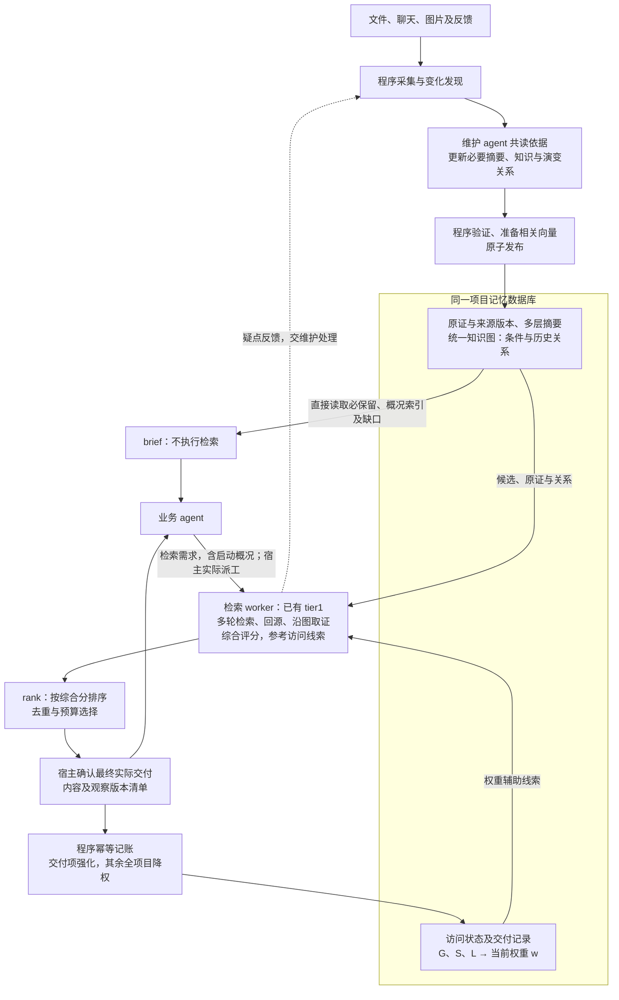

# 记忆整改目标逻辑图

2026-11-12。与[最终口径及状态](plan.md#最终口径与状态)配套，表示本轮目标正常路径，不代表全部已实现。独立当前理解层已移除；现有零席位主 agent 回退与未来受限入口按 B 另行收敛。

- 历史图是统一知识图的关系和版本视图，不另外维护一张图；交付记录是程序生成的使用元数据，不是需要 agent 判断的语义边。
- 程序更新访问权重，tier1 判断本次材料价值，rank 不二次加权；搜索、阅读和内部重排不计交付，权重公式不读取时间。
- 交付记录只强化实际返回的表示版本，不沿父子、依据或图邻居传播；访问不触发主题重写或 embedding 重建。
- 维护作者完成必要共读并由程序发布后即结束，默认无额外审计。已知新目标及 mandatory 更正仍及时处理，不要求先更新全局主题理解。
- 图中 brief 分工、自动记账、访问线索及完整历史回读仍属待实施目标；算法数值、材料粒度和空结果等合同按计划收敛。一条成功交付不证明检索闭环或知识覆盖全部完成，实际失败与缺口另报。
