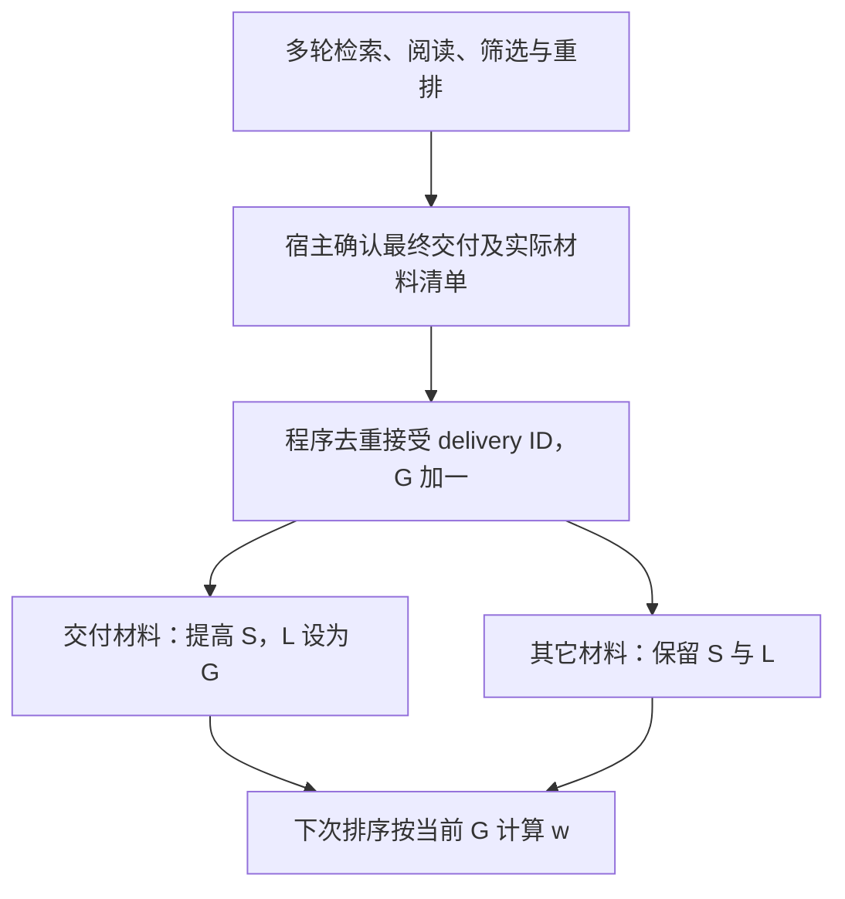

# 纯访问事件驱动的记忆权重

2026-11-12。用户明确希望加入：每次检索 worker 实际交付最终结果后，强化交付材料、降低其余全项目材料的权重；与经过多久无关，不增加 AI 判断；希望先快后慢、多次刺激后更难忘。本轮交付算法与接入方案，**功能方向已确认，具体公式、数值和接口仍为建议，产品尚未实施**。

## 事件合同

项目整数 `G` 记录完成的最终检索交付次数。事件中的 `D` 是实际送入调用 agent 上下文的材料集合，按材料身份去重。同一轮多次 search/read/rank、检索内部 reader 返回、维护读取都不推进 `G`；重试复用同一 delivery ID。失败或取消不记成功事件，追加一次真正交付则产生新事件。

按用户“每次交付”的字面版本，成功交付空集合时也推进 `G`，即所有材料下降。另一种合理默认是仅非空结果推进；这会改变事件口径，尚未选定，实施前需要统一。本文件数值只依赖已经接受的事件序列。

降权覆盖项目内所有参与普通排序的记忆单元，包括没进入本轮候选和 scope 外的材料；不得悄悄缩成候选集或主题内降权。不可变原件／依据快照不改写，mandatory 继续无条件保留；stale、retired 和语义替代各按其已有合同处理。访问权重表达使用习惯，不证明真假或现行性。

建议以可检索 member 表示为材料粒度：返回一个章节摘要只强化该摘要，不自动强化其全部原文块、父摘要和图邻居。源文件粒度更粗，读一个段落就强化整文件，是可选产品语义而非等价优化。正式数据合同仍需统一摘要、原证、图片、图节点及历史版本的归属。

## 三种算法

下文为可验证的工程模型，并非对人类记忆的生物学拟合。所有“半衰”单位均为**未再次交付该材料的检索交付轮数**，公式不读取时钟。

| 方案 | 每条材料的核心状态 | 多次交付后的效果 | 取舍 |
| --- | --- | --- | --- |
| 1 单权重指数 | 当前 `w` | 提高起点，随后相对衰减率固定 | 最简对照，不能独立表达抗遗忘程度 |
| 2 权重与稳定度 | `w` 及 `S`，`w` 可由事件锚点派生 | 提高当前权重，并延长后续半衰轮数 | 推荐；状态少、参数含义直接 |
| 3 快慢双迹 | 快迹 `f`、慢迹 `s`，派生 `w` | 多次交付逐渐积累慢迹，未交付时两迹都衰减 | 适合希望长期访问优势本身也消退的偏好，固定常数较多 |

### 1：单权重指数

```text
未交付：w ← q·w
被交付：w ← w + a·(1−w)
```

试用 `q=0.98, a=0.3`；连续 `n` 次未交付后 `w(n)=w(0)·q^n`。绝对下降量先大后小，但无论被交付多少次，后续相对下降率相同。若两条材料当前同为 0.8，就无法区分哪条曾反复被使用。这是一个普通当前权重作为全部状态的限制，不是程序能力限制。

无界固定加减更弱：未交付减 b、交付加 a，等价于全库公共偏移 −b，再给交付项加 a+b。同龄材料排序中的公共偏移抵消，主要剩累计交付次数，不自然产生旧访问影响淡出的效果。

### 2：权重与稳定度，推荐简版

令 `L` 为材料最后一次被交付的事件序号；新材料从诞生事件开始。`S>0` 为稳定度，当前权重：

```text
n = G − L
w = 1 / (1 + n/S) = S / (S+n)
```

未交付时只增加 `n`，所以 `w` 下降。下降的绝对幅度与相对比例都逐渐减小；`n=S` 时 `w=0.5`。因此 S 表示从出生或最近一次交付、权重为 1 时起，经历多少次未交付会降到 0.5；若已经老化 n 轮，再降到当前权重的一半需要 S+n 轮。

本次在事件 `G+1` 被交付时：

```text
S ← min(10·H, S+B)
L ← G+1
# 当前 w 恢复为 1；未交付材料不改变 L 或 S。
```

只开放两个算法调参入口：初始稳定度 `H=20`、每次强化增加量 `B=10`；新材料 `S=H, L=当前G`，从中性最大权重 1 开始，不承受入库前的交付历史。稳定度上限暂建议固定为 `10H`，避免反复使用后近乎永久占优。20、10、10H 都是待真实使用校准的工程初值。

用户可查看 `weight` 与 `stability`；`L` 和全局 `G` 是程序元数据，无须逐项填写。`weight` 按需计算即可，不需要再维护一份容易失同步的持久副本。交付后恢复到 1 的简版省去额外的提升比例与幅度状态；已在上限时允许不变。

| 累计被交付次数 | 此后稳定度 | 再有 20 次未交付 | 再有 50 次未交付 | 再有 100 次未交付 |
| --- | --- | --- | --- | --- |
| 1 | 30 | 0.600 | 0.375 | 0.231 |
| 5 | 70 | 0.778 | 0.583 | 0.412 |
| 10 | 120 | 0.857 | 0.706 | 0.545 |
| 18 及更多 | 200 | 0.909 | 0.800 | 0.667 |

同为刚恢复到 1，反复使用的材料下降更慢。即使达到上限，持续未交付仍会趋近零；S 本身保留既往强化，不随未交付降低。如果希望连这部分历史优势也被逐渐遗忘，选方案 3 更自然。

强化还可改成 `S←min(10H,cS)`，例如 `c=1.5`。从 H=20 起第 6 次交付达到上限；上述线性 +10 到第 18 次才达到上限。乘法巩固更强，线性增加更平缓。默认建议线性版，不同时开放两套增长模式。

### 3：快慢双迹

对外当前权重 `w=(f+s)/2`；内部维护两条 0–1 状态。一个具体模型是：

```text
未交付：f ← 0.8f；s ← 0.98s
被交付：f ← f+0.2(1−f)；s ← s+0.02(1−s)
```

这使快迹易升易降，慢迹缓慢积累和消退；两个保留系数 0.8、0.98 是可调整的全局参数，平均混合比例固定。新材料可取 `f=s=1` 作为中性起点，随访问事件形成不同组成。

当材料已经淡出，单次交付主要提高快迹；多次交付逐渐填充慢迹。随后先快迹下降，再由慢迹主导。不同组成的材料即使当前同权重，未来也会有不同下降曲线；但两个分量各自的相对衰减率始终固定，多次使用改变组成而非改变这两个衰减率。持续不交付时，两迹及其历史优势都趋于零。

## 不逐条写全库也能做到全库降权

方案 2 每次原子记录交付事件、推进一次 `G`，只改交付集合的 S、L。任意其它材料虽没有写数据库，查询其当前权重时用新的 G 计算，结果与每轮全量更新完全相同。



若本轮交付 k 条、全库 N 条，直接全库更新要 O(N) 次状态写入；此法需 O(k+1) 级状态写入。实际事务、索引及事件去重还有相应开销，不承诺常数时间完成整个检索。读取 m 个候选附加 O(m) 算术及必要批量状态读取，不需要 embedding、LLM 或后台定时衰减任务。若要全库按当前访问权重排序，仍需计算全库当前值，不能直接按存储的 S 排序。

计算时保留最后强化锚点。不要把普通读取算作强化，也不要把重新算出的 w 写成新锚点再套原式；那会变成另一条曲线。若坚持存当前 w，精确跨 Δ 轮的更新是 `w←w/(1+Δw/S)`，不是 `w/(1+Δ/S)`。

## 与现有产品接入

- `prompts.py:219–259` 的派工/模板及 `cli.py:119–121` 的纯 rank 都不观测宿主最终交付。当前没有“调用 agent 已收到”的可靠事件入口，不能简单在 search/read/rank 中扣加权。
- 推荐统一检索工作流的宿主适配器使用最终实际结果附带的 manifest 自动记账，人和 agent 不增加日常命令。`delivery_id` 在重试时保持不变；数据库内一个事务完成去重、G 推进和被交付材料更新。宿主与数据库不能共享事务时，只承诺已确认送达事件在库内幂等生效；用可回查的宿主消息身份恢复漏记，不声称跨系统天然 exactly-once。
- manifest 带实际表示身份、观察知识版本、原证 source_version／revision 和定位。source_revision 不足以区分同一原证快照上的新旧摘要。知识改版是否继承权重、旧版本交付如何归属，须在实施合同明确，不把旧版使用直接算到新版。
- 访问状态与交付事件独立于知识正文及知识/向量输入版本。记录访问不需要语义维护 owner，也不触发重建 embedding；其并发事务与维护更正应各有明确边界。诊断时间戳可留存，权重公式不读取。
- 初版建议保持语义／词面／图关系候选入口，再在统一最终重排处融合；保留原相关性分、访问权重及最终分。比如非负 agent 相关性分乘 `0.8+0.2w`，把访问偏好限制在有限范围，此系数也是待校准建议。不要直接将权重乘“越小越好”的 cosine distance。
- 当前 vector/hybrid 已先 LIMIT；最终重排只能影响已有候选，不能宣称已经改变全库召回。保留不受访问权重硬过滤的相关性候选、原证 read 及 mandatory；低权重仍有重新被交付、恢复权重的机会。

全项目降权必然产生跨主题干扰：连续做 A，会让暂不使用的 B 下降。保持全项目语义、限制访问融合强度、允许高相关低权重材料重新进入，是满足当前约束的缓解。按主题或 scope 建各自事件计数器可减少干扰，但那是另一种产品规则，本轮不替换用户要求。

## 实施边界与验证

建议新增 I 工作项，算法 2 线性巩固为首选候选，3 作为“连历史稳定性也消退”的备选。收敛事件/粒度/版本合同、宿主交付入口及公式后再实施，不因本轮数学检查就宣称产品或检索质量完成。

2026-11-12 使用项目 Python 数值检查：25 材料、1,000 个随机交付事件，逐轮全量更新与全局事件懒计算最大误差 `7.78×10^-16` 以下；验证正值、有界、未交付严格下降、下降幅度递减以及表格数值。脚本与输出选留至根 `artifacts/runs/20261112-access-only-weights/`（Git 忽略）。这是公式等价检查，不是真实检索质量评测。

实施验收覆盖：不输入时间；项目闲置不会改变权重；同交付重试不重复强化；多轮检索只在最终交付计一次；并发无丢失；新材料不受过去事件惩罚；scope 外仍降权；旧版本不误奖新版；纯 rank 的无库合同不被默改；访问记录不引起 embedding 重建；低权重高相关材料仍能召回并复苏；导出恢复保留权重及事件序号。

当前检查尚不包含宿主可靠交付 hook、数据库并发集成、迁移/恢复或真实业务质量比较。具体数值及融合强度须通过后续实际检索反馈校准，不能用曲线符合预期替代结果有用。

## 方案二的合成仿真（2026-11-12）

按用户要求在 `tmp/20261112-access-forgetting-sim/` 建立可复跑脚本、配置、CSV 与图。固定 H=20、B=10、S上限200；排序用 `observed_score×(1−alpha+alpha×w)`，alpha=0 为基线。固定 seed=20261112 生成200组独立试验，每组12条材料、300次交付；所有alpha共享潜在相关性和评分噪声。评价使用人工设定的潜在相关性，与排序可见的加噪分数分开。

| 合成场景 | 本轮结果及边界 |
| --- | --- |
| 重复强化及历史 | 1/5/18次交付后再空置100事件，w=0.231/0.412/0.667。两项同为w=0.2时，再次交付后，旧高S仍更耐遗忘。 |
| 跨主题及委托粒度 | 相同10项A任务，每项1/10次最终交付使未用B权重为0.667/0.167。确定性切换案例中alpha=0.2让原分92的A连续20轮胜过100的B；A降到70后B立即恢复。 |
| 稳定价值与评分噪声 | alpha=0.2使平均设定相关性损失3.038→1.855，说明此假设下历史偏好能改善选择。 |
| 每轮价值独立变化 | alpha=0.2使损失3.083→3.397；历史在此不预测当前需求。 |
| 中途价值重新分配 | alpha=0.5全程损失3.049→5.057，切换后首20轮3.034→11.501；alpha=0.2在该随机场景全程仍有收益，不泛化确定性反例。 |
| 同等价值与反馈集中 | 所有alpha损失均为0，但最常交付项平均份额从11.17%到33.76%（alpha=0.5）；集中不等于错误。 |
| 交付误记及候选缺席 | 30任务把内部搜索也记交付，使未实际交付B权重0.400→0.995；先被候选LIMIT排除的材料不能靠后续加权恢复。 |

25材料／1,000事件的全量与按需计算最大差为6.66×10^-16。独立标量实现复算4场景×5alpha×3试验的60条完整轨迹及汇总指标，所查结果误差为0。脚本、配置、图、关键数据和检查回执选留于[仿真原证](../../../../artifacts/runs/20261112-access-forgetting-sim/README.md)；临时目录保留完整工作。

这些是合成案例，区间只反映trial层的抽样波动；不证明真实AI正确性、总体净收益或最优默认参数。保留方案二作为产品候选，优先最终交付记账与独立相关性召回；产品实现、宿主送达hook、并发及真实业务验收仍待完成。

## 现实启发的混合相关性（2026-11-12）

用户指出现实应融合持续有用、逐问变化与评分噪声。联网核对[重复检索研究（SIGIR 2007）](https://people.csail.mit.edu/teevan/work/publications/papers/sigir07.pdf)、[跨会话任务研究（SIGIR 2011）](https://www.microsoft.com/en-us/research/publication/modeling-and-analysis-of-cross-session-search-tasks/)、[任务恢复与重新找回研究（WSDM 2010）](https://www.microsoft.com/en-us/research/wp-content/uploads/2016/02/wsdm10.pdf)：它们支持材料再用、任务持续/交错/恢复及需求变化，但点击和重访不等于真实效用，不能据此拟合AI项目的混合比例或将日历间隔换成事件轮数。

据此在同一事件流加入直觉模型：`R[t,i]=0.2×持久价值[i]+0.5×主题适配[topic[t],i]+0.3×当次独立需求[t,i]`，可见分另加标准差8的零均值噪声。12材料包含3份跨主题资料和9份主题专门资料；三个主题有0.9概率继续当前主题，否则切换并允许回访，平均连续10个交付事件。系数、概率及分布均为未拟合假设；20/50/30不是方差占比、实测相关系数或固定/独立材料比例。没有更改方案二状态更新和全项目降权规则。

seed=20261412，200组配对试验、每组300事件。alpha=0/0.05/0.1/0.2/0.5的整体设定相关性损失分别为2.7364/2.6999/2.6588/2.7347/4.8475。alpha=0.2的配对差−0.0016，近似95%区间[−0.0301,+0.0268]，整体接近持平；切换起3事件窗口损失2.7615→2.9000，其余事件2.7269→2.6724（描述性比较，未另作窗口显著性判断）。输入相邻潜在分向量平均相关系数约0.693，但最佳材料连续相同仅27.1%，说明持续相关不等于应该重复交付同一项。

完整扫描主题保持概率0.5/0.9/0.98、逐问分量0.1/0.3/0.6，另扫噪声0/4/8/16，共12种设定。alpha=0.2随设定有收益、持平和代价；评分较准时访问偏置更易干扰，噪声较大时历史先验更可能有帮助。弱偏置值得真实对照，不能以本轮直觉模型选定产品默认值；多材料交付、系统性评分偏差、真实任务长尾等仍未覆盖。

工作沿`tmp/20261112-access-forgetting-sim/`追加；[研究依据](../../../../artifacts/runs/20261112-mixed-relevance/relevance-sources.md)、[完整分析及图](../../../../artifacts/runs/20261112-mixed-relevance/README.md)另选留，原仿真快照保持。独立复算180条轨迹最大差4.55×10^-13，60组重聚合差1.78×10^-15，完整输入哈希匹配，原四模式数字保持。产品代码、真实检索及费用收益未验。

## 限制访问偏好干扰的候选（2026-11-12）

用户询问优雅改善方法。本轮沿同一12种输入比较10种排序策略，未更改全局G/S/L/w，也未读取隐藏主题作为策略输入。推荐讨论“给访问偏好明确影响预算”：有界加分`score=r+delta*w`较温和；或先保留`r>=max(r)-delta`的近分候选，再优先w，w相同优先r。两者都保证选中项让出的**当前可见分**不超过delta，不保证潜在真实损失，也不意味着分差能识别评分噪声。[选择性个性化研究](https://www.microsoft.com/en-us/research/wp-content/uploads/2015/09/ictir076-bennettATS.pdf)支持保护原排序、避免无必要介入的方向，不验证本轮具体公式。

中央案例：原alpha=0.2损失2.7347、最大可见分让步16.498；近分delta=2为2.6585／1.999，接近弱alpha=0.1的损失2.6588，却有更明确的单次让步预算。有界加分delta=2为2.7173／1.772。反例：零噪声下近分仍损失0.1153，加分损失0.0073；没有全面更优或已选定默认值的结论。

更完整方向是记录材料实际交付时的紧凑用途表示，在既有查询表示上计算上下文匹配c，使用`r+delta*w*c`；全项目降权保持，额外写入只发生在最终交付。一个全局w无法辨别同样访问次数来自A还是B。scratch仅以observed分向量为可观测代理，未显示跨场景稳定的额外收益，不宣称真实query embedding方案已验证。双通道候选召回可另保留原相关性配额并追加访问候选；当前全候选仿真不证明其收益。

脚本检查有界条件，协作者只读核查事件更新、输入公平性及边界证明；具体对照和复跑入口见[候选分析原证](../../../../artifacts/runs/20261112-access-ranking-options/README.md)。本轮为有界探索和设计建议，未实施产品。
