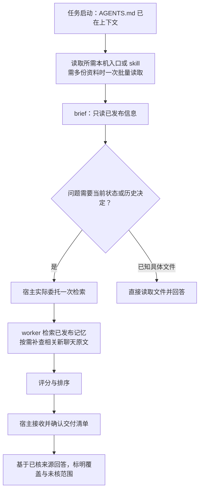
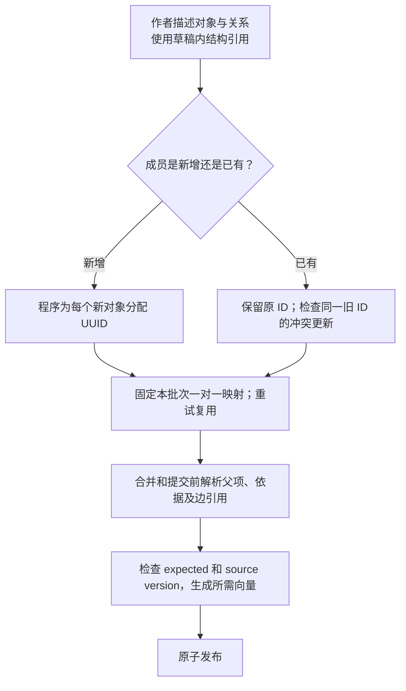
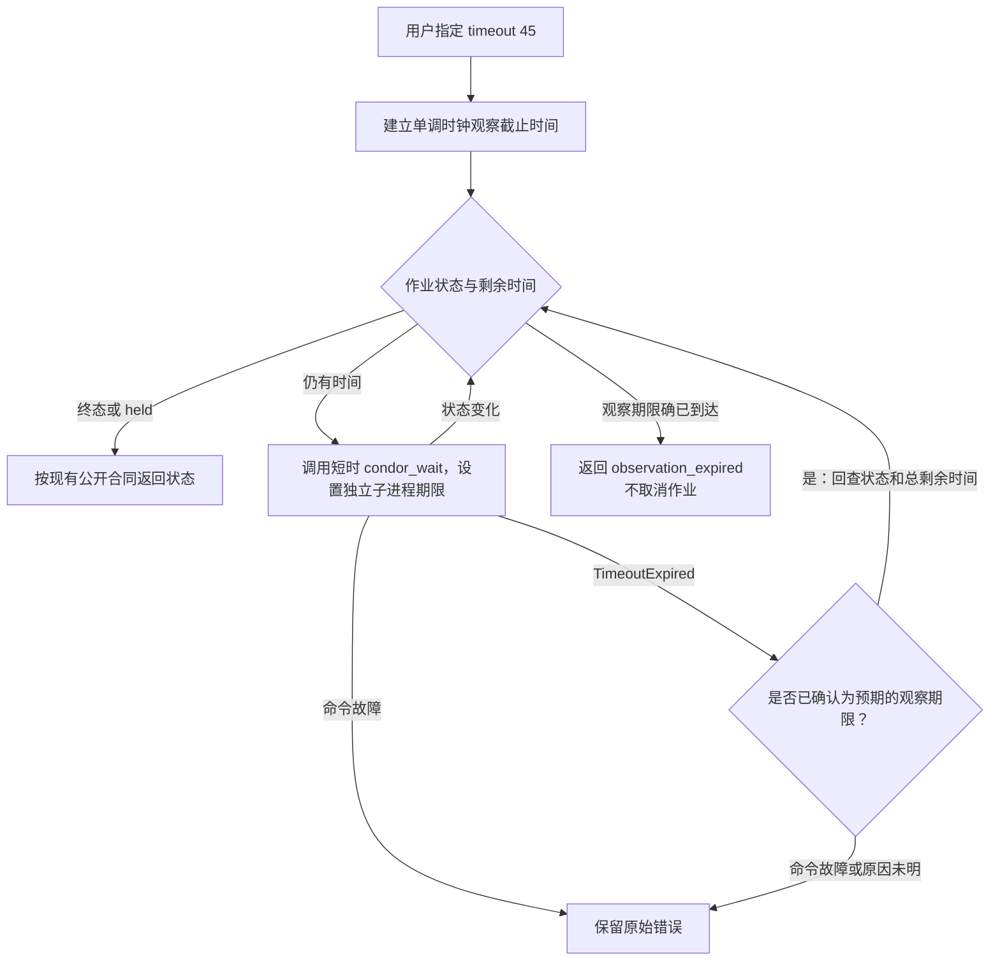
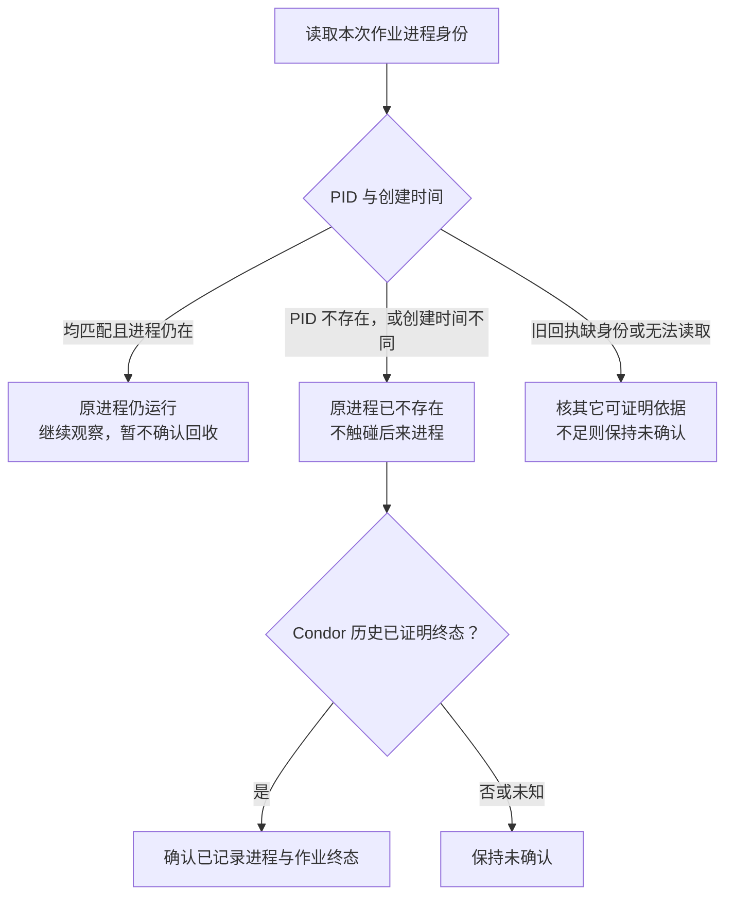

# 交付收尾：目标逻辑图

以下是**待实施的目标逻辑**，不表示现有实现已经具备这些行为；范围、合同和完成条件以[交付收尾计划](plan.md)为准。图中的结构引用只是概念，不规定最终语法。

## 任务启动与当前信息检索

入口说明和已安装技能是独立材料；主agent不必每次读完整skill，worker由prompt直接定位。资料读取和brief执行是不同动作。检索不取得维护owner，语义维护另行执行；指令触发能减少遗漏，不能强制保证宿主必然遵循。

## 新成员身份与引用

当前风险来自作者自取永久ID后，同批字典覆盖重复项。目标中新增成员的作者载荷不含永久ID；引用按草稿及条目或位置限定，映射随冻结批次保存。无需新增ID服务或重编号现有数据库；图不规定最终输入语法。

## 等待期限与子进程超时

现有job 14367只记录内部子进程报告约4.04秒超时，整条命令耗时未知。先核原因，再决定处理；不将所有异常一律当作正常观察到期，也不重新提交作业。

## 清理确认与进程身份

回收范围仍是已记录进程与Condor状态；从未启动的作业按原有历史依据处理，不把一个PID的消失扩成未记录整棵进程树已回收。
