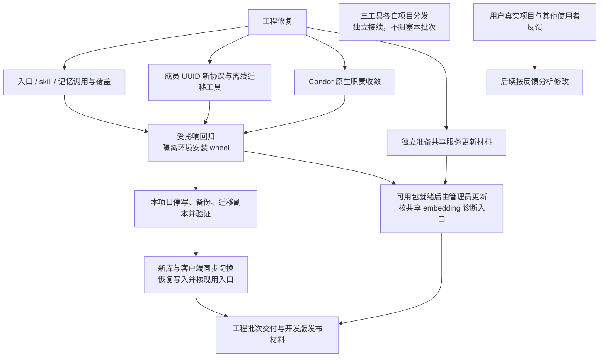
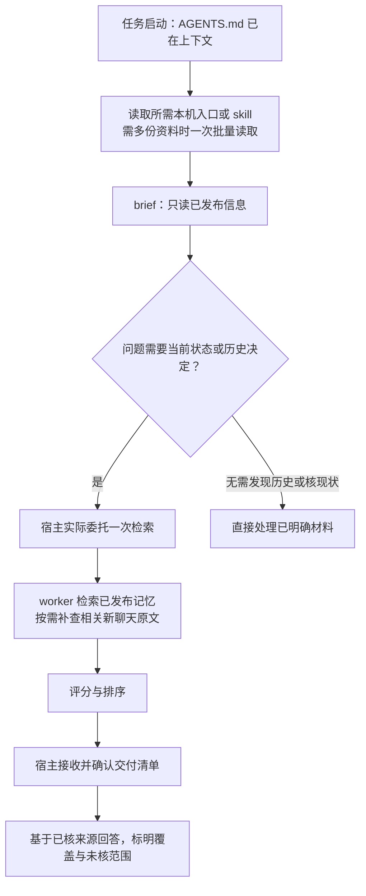
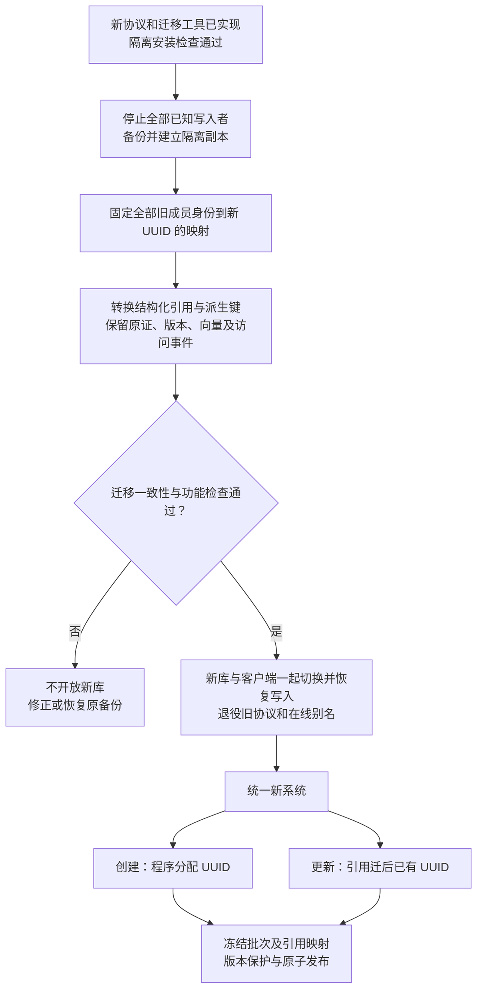
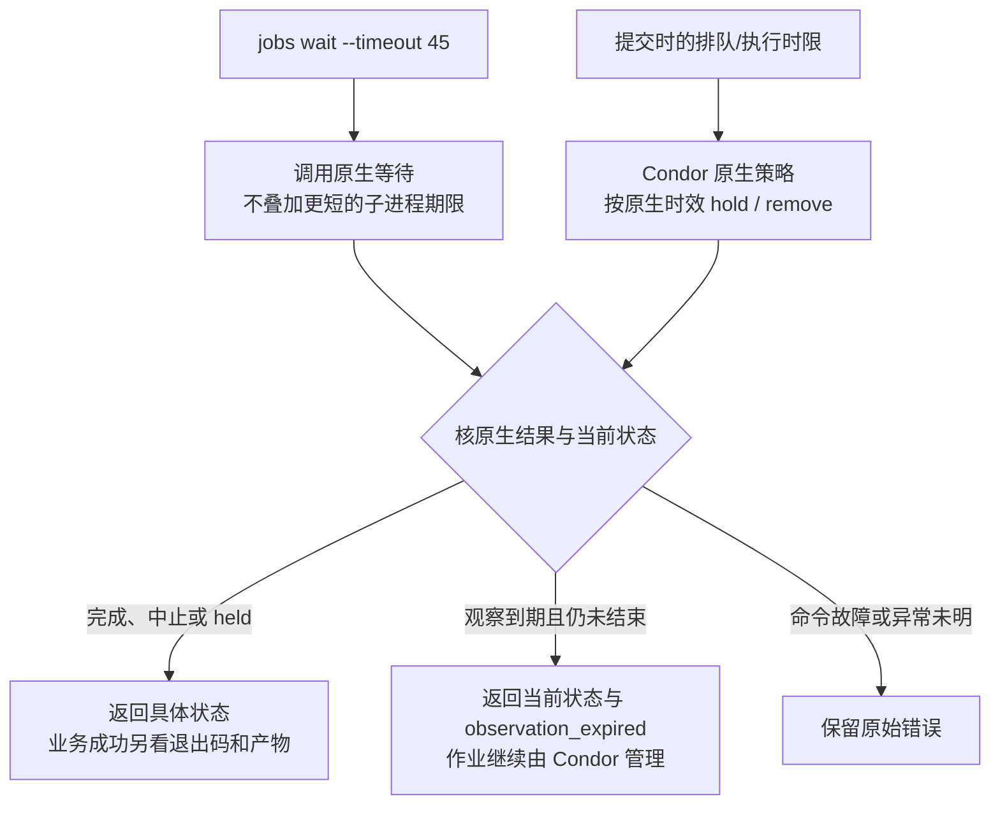
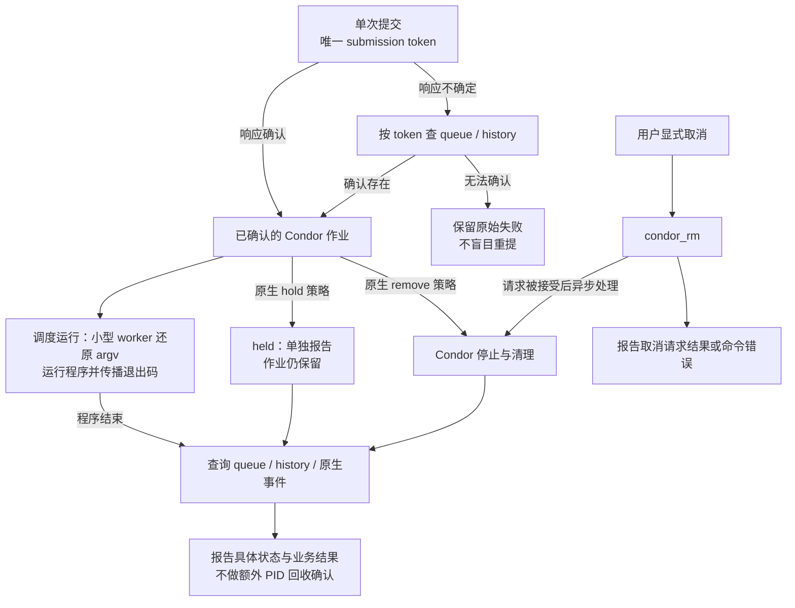

# 交付收尾：目标逻辑图

以下是**待实施的目标逻辑**，不表示现有实现已经具备这些行为；范围、合同和完成条件以[交付收尾计划](plan.md)为准。图中的结构引用只是概念，不规定最终语法。

## 总体执行顺序与交付边界

源码外安装先在隔离环境进行；现用客户端与库在迁移通过后一起切换。共享服务动作未执行时如实保留未完成；公开Release按已有授权边界单独执行。三工具分发及用户收益/新机反馈另行接续。

## 任务启动与当前信息检索

入口说明和已安装技能是独立材料；主agent不必每次读完整skill，worker由prompt直接定位。资料读取和brief执行是不同动作。检索不取得维护owner，语义维护另行执行；指令触发能减少遗漏，不能强制保证宿主必然遵循。

## 存量迁移后统一身份与引用

创建与更新使用同一套UUID身份和新写入合同；存量成员先完成一次性迁移，不再沿用历史编号。旧ID映射仅作迁移/恢复材料，正常运行不读取；原文中作为历史文字出现的旧编号保留，不做内容替换。图不规定最终输入语法。

## 观察等待与作业时限分工

观察到期不取消、不重提作业；原生作业政策独立于观察者执行。图中held指查询时已观察到该状态，不表示`condor_wait`必然因held立即唤醒。接受原生周期、整数秒和命令/查询开销，不设置客户端作业截止时间。现有job14367的约4.04秒仅是内部子进程超时值，整条命令耗时未知；不将所有异常一律当作正常到期。

## 原生生命周期与必要封装

held与移除分开；若后续原生策略再移除held作业，仍沿remove分支报告。取消请求成功与已观察到终态分别说明；不额外承诺操作系统进程族已全部回收。PID回执、后代枚举与`cleanup_confirmed`整条消费路径退役，参数保真和提交恢复保留；详细合同见计划。
