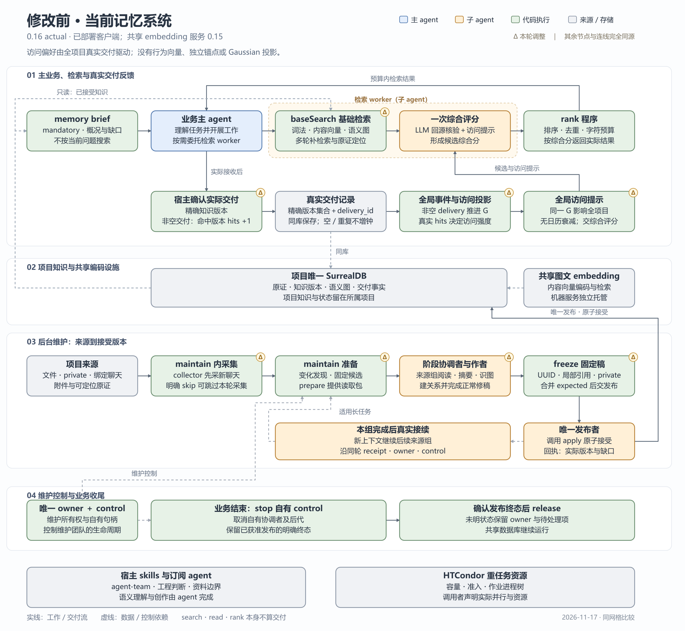
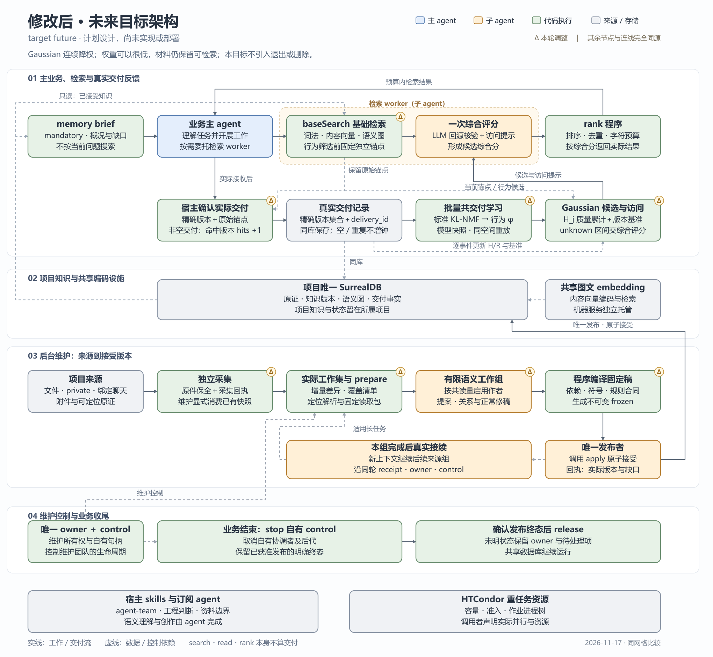

# Gaussian模糊降权与系统总图

2026-11-17用户已选择**Gaussian相似度，权重降到很低但始终保留**。本页取代此前“默认线性＋绝对退出”的推荐；平方核、概率退出和GC不再是待建分支。技术合同统一在[目标架构](target-architecture.md)，顺序在[计划](plan.md)，实际状态在[进度](progress.md)。仅修改计划与图，当前部署0.16没有切换。

## 模糊边界如何工作

材料没有固定用途类别。共同交付历史经KL-NMF形成非负单位行为向量phi；基础检索先固定独立原始锚点及份额alpha。每次确认非空真实交付后，未命中项按连续接近程度增龄，精确命中版本重置年龄并累计真实使用次数。

```text
rho_ij = phi_i · phi_j
K_beta(i,j) = exp(−||phi_i−phi_j||²/(2 beta))
            = exp(−(1−rho_ij)/beta), beta > 0
k_it = Σ_j alpha_tj K_beta(i,j)
未命中增龄 = ε + (1−ε) k_it, 0 < ε < 1
权重 u_v = S_v/(S_v+e_v), S_v=s(1+h_v), s>0
```

beta是带宽平方，对应官方[RBF核](https://scikit-learn.org/stable/modules/generated/sklearn.metrics.pairwise.rbf_kernel.html)的gamma=1/(2 beta)。上述机会年龄及强度是本项目政策，不是RBF文献验证过的遗忘算法。公式的k表示完整核项；缺向量的质量保持unknown区间，不当成零相似度，也不把剩余锚点重新归一。

核必须**逐锚点计算再平均**，不能先平均向量再套Gaussian。后一种会改变混合任务的意义。Gaussian也不能沿用线性核的r维累计向量M；当前选择稀疏锚点质量H，按候选精确求核加权和，不引入近似误差或全库相似矩阵。

| 参数 | 较小/较窄 | 较大/较宽 |
| --- | --- | --- |
| beta带宽 | 额外增龄集中于接近方向，远处尾部较弱 | 更多方向共同增龄，远处影响较强 |
| ε基线 | 全域最低增龄速度较慢 | 不同方向之间的长期影响较强 |
| s先验强度 | 相同未用次数下权重下降较快 | 下降较慢；真实hits同样增加强度 |

例如beta=.2时，rho为1、.8、.5、0对应核值约1、.368、.082、.0067。这只解释曲线，不是生产默认。正交方向仍有Gaussian正尾，每事件增龄为ε+(1−ε)exp(−1/beta)，不能继续用线性核的正交半衰S/ε。

## 很冷仍然保留

有限正强度、有限事件数下，数学权重始终大于0；长期未用时可以趋近0，不设人为正下限。数值接近0也不触发删除或退出。

- 正文、原证、知识版本、语义图、索引和逻辑ID继续保留，低权重不丧失基础检索资格。
- tier1参考权重、支持度、区间和原证后一次综合评分，rank不再乘一次权重；本次相关性与上下文预算仍决定实际选单。
- 非mandatory摘要/地图入口可以降低主动提示优先程度，本次brief未出现不等于退出系统；mandatory继续必保。
- 再次实际交付刷新该精确版本，无须重新接受或重建。首次接受只有h=0先验，不算真实命中。
- 语义纠错、stale/retired、用户明确删除及原件变更继续沿各自合同，访问降权不代替这些判断。

代价是存储与历史不会因遗忘自动缩小。本次撤下低效用阈值、GC、forgotten记录及为GC新增的请求保护状态，保留已有发布所有权和未明发布保护。

## 修改前后的完整系统

修改前是**已部署0.16**，修改后是**待实施目标**。main agent、subagent、代码执行用固定颜色，来源和存储用中性色。两图从同一份节点、坐标和连线定义生成，未改动部分完全相同；变化块在相同位置另作标记。





可编辑矢量：[修改前SVG](diagrams/memory-system-before.svg)、[修改后SVG](diagrams/memory-system-after.svg)。语义范围、生成与实际视觉检查见[图源说明](diagrams/README.md)。
