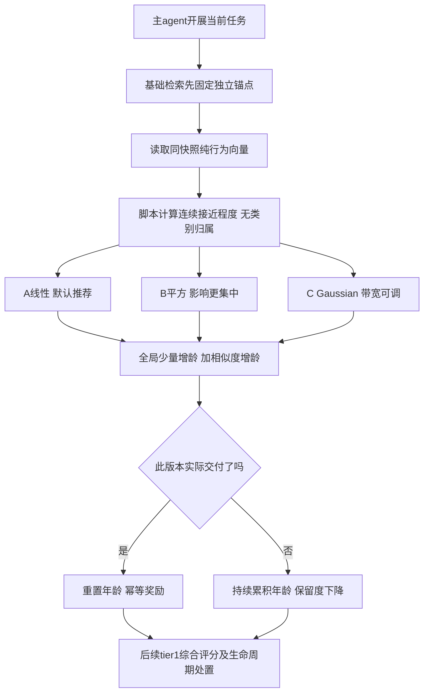
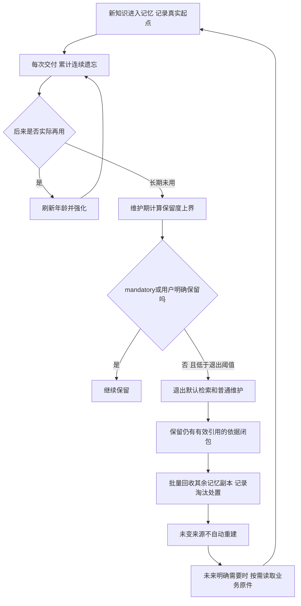

# 模糊边界遗忘的选项与决定

2026-11-17按用户后续澄清修订：长期未使用的方向允许逐渐退出记忆。长期做A仍给B带来少量遗忘是目标，不是待消除的缺陷。用户提出的成熟/淘汰情形都可成为降低记忆驻留投入的理由；统计状态不因此改写成“该方向已被证伪”。本轮只修改计划，未删除数据或切换0.16。

现行技术合同在[目标架构](target-architecture.md)，实施顺序在[计划](plan.md)。本页维护选项与取舍，不另建一套算法状态。

## 先确定什么叫模糊边界

每份材料一个由共交付历史学习的行为向量，材料之间没有必须归入某一类的边界。一次真实交付让未命中材料承受“全局少量增龄＋按连续接近程度增加的增龄”；命中项恢复并强化。方向整体退出是其中各项逐渐衰减的结果，不需要先识别一个类别再整类删除。跨方向的桥接材料若仍实际使用，可继续保留。

模糊的是**相似影响的范围与幅度**。磁盘记录最终保留还是移除仍要有离散决定；采用统一低效用阈值，并不把主题空间变成硬分类。若连最终移除也希望采用平滑概率，可以另选下面的概率方式。

## 三种相似度规则

令rho为两个非负单位行为向量的余弦，alpha为独立锚点的非负份额。三种选项都按`k_i=Σ_j alpha_j f(rho_ij)`计算机会相似度，保留正ε。它们都是模糊边界，不依赖类别数量。

| 选项 | f(rho) | 影响范围与代价 | 本轮决定 |
| --- | --- | --- | --- |
| **A 线性连续核** | `rho` | 影响平缓、重叠广；固定快照可用r维累计向量，事件及候选开销随r线性增长 | **保留为默认推荐**，最短且易维护；本来已经符合模糊边界 |
| B 平方连续核 | `rho²` | 中等/较弱关联影响更小，邻域更集中但没有截断；可用r×r矩阵精确累计，无须历史逐项扫描 | 若希望“模糊影响更集中”，优先考虑这个备选；不默认同时实现两套 |
| C Gaussian连续核 | `exp(−(1−rho)/beta)`，`beta>0` | 带宽可调，远处也有正尾；一般不能精确压成一个固定小维累计向量，需保留历史或选择近似 | 暂不主推，先不引入带宽选择和近似误差合同 |

例如相似度rho从0.8变到0.5，再变到0.2，A的额外影响为0.8、0.5、0.2，B为0.64、0.25、0.04；全局ε依然让两者的远处材料最终老化。这些数值只说明曲线，不是生产参数或业务效果。

B必须是**各锚点平方后取份额平均**，不能偷偷换成平均相似度的平方。固定向量下令`T=Σ_events Σ_known_anchors alpha·phi_j phi_jᵀ`，则已知累计贡献为`phi_iᵀT phi_i`；每个命中仍只存一个标量基准，缺失锚点质量仍可用原R给界。构造锚点及重置d个命中的主要成本为`O((a+d)r²)`，p个候选为`O(pr²)`，全局累计状态`O(r²)`；不必保存每材料一份升维向量，也不建N×N矩阵。r=32时对称累计量最多528个独立值。A/B比较只改核，保持事件、锚点、ε与生命周期一致。

C中单位向量距离平方为`2(1−rho)`，因此该式是Gaussian/RBF的一种带宽写法。它在rho=0时仍有`exp(−1/beta)`尾巴，正ε之外还有额外全局影响；调大带宽并不自动改善任务切换。核定义可核[多项式核](https://scikit-learn.org/stable/modules/generated/sklearn.metrics.pairwise.polynomial_kernel.html)与[RBF](https://scikit-learn.org/stable/modules/generated/sklearn.metrics.pairwise.rbf_kernel.html)的官方文档；将它们用于遗忘及上述累计推导是本项目选择，未继承外部效果结论。

## 从变冷到真正退出

| 处置方式 | 能否让长期不用的方向退出 | 代价与选择 |
| --- | --- | --- |
| 只给检索降权 | 不能；分数可趋近0，正文/向量/维护对象仍在 | 作为计算步骤保留，不再当完整遗忘交付 |
| **连续保留度＋绝对低效用退出** | 能；定期维护时，保留度上界低于统一阈值即退出默认记忆，随后回收无引用副本 | **推荐**；可解释、可复算，无需随机数或硬主题类别；容量预算只作额外约束 |
| 平滑概率退出 | 可令移除概率随保留度平滑升高，长期不用对象在持续执行下几乎必然退出 | 存在个体早删/晚删，必须记录抽样与机会单位；不承诺每份材料固定期限内退出，暂不引入 |

只按预算取top-K不足：没有新竞争时，原来的低使用材料排名可能始终不变。默认方案因此需要绝对退出条件；阈值是驻留成本政策，不是事实真伪分界。物理移除仍由维护阶段批处理，检索和brief保持只读。

实际遗忘还须处理四个闭环，技术定义统一见[生命周期合同](target-architecture.md#从连续降权到实际遗忘)：

1. 从未命中的材料也会老化：记录真实进入记忆的事件截点作为驻留起点，h仍为0，保留度是先验，不伪造使用。
2. 细节、摘要和非mandatory地图入口都适用同一政策；没有“方向永远留一个概要”的隐含例外。mandatory保持用户明确要求的必保地位。
3. 退出记忆不写成语义错误/失效；按真实引用根保留必要依据，再回收其余图/表示/向量及记忆副本。
4. 保存最小淘汰处置，未变来源的普通维护不立即重建；明确按需回源或新来源变化才触发重新考虑。

当一个方向的各条非必保记忆都长期未使用时，它们会相继退出，最后该方向不再占默认记忆。这不需要一个名为“方向B”的永久对象；仍被别处实际依赖的桥接证据不属于完全无人使用的部分。业务原件继续在所属项目保管，本方案处理记忆系统副本；若原件后来也不存在，被回收正文的精确历史不再承诺可恢复，读取须明确返回已淘汰/不可用。

## 本轮计划如何落地

默认推荐为**A线性核＋绝对低效用退出**。先完成最小可用闭环；B作为用户可选择的精确非线性备选，C与概率退出暂不预建。ε/s及退出阈值的选择必须给出以真实交付次数计的等待量，不能把非常小的ε默认为已经实现实用遗忘。历史巨量hits可能使等待很长；若需要统一最大驻留等待，再考虑有界强度变换，真实hits保持不变。

本轮只采用既有调研与有限数学核对，没有新的效果结论。原线性规则的累计合同继续有效；新增工作是进入/退出状态、依赖回收、防重建与按需再接受。实施与验证仍只在本项目，项目纲领和实际0.16未修改。
