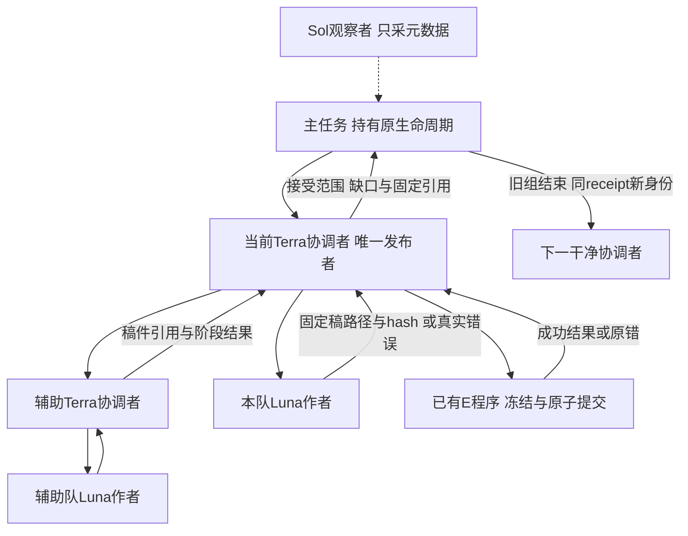

# 0.16完整维护与协作观察

2026-11-16—17，北京时间。结论：**C2的干净阶段接续实际生效；C1的协作收敛只部分成立，仍依赖督导，尚不能认定原用量预测已验证。** 本轮没有修改产品代码或模型映射。下列用量包括缓存输入；它们不是费用、订阅额度或墙钟时间。

## 实际范围与结果

客户端0.16.0，共享embedding服务保持0.15.0。预检于2026-11-16 20:35:19—20:40:00执行，正常用户上下文请求默认完整聊天采集，没有使用跳采集开关。发现1,549来源，机械46批、复用513chunks；固定语义候选130来源，另有8条待处置关系、1项反馈。

固定候选的**130／130来源已在接受版本上完成本轮处置**，原8条待处理关系记录已处理，58个语义批次成功。实际新建54个维护角色，分6阶段；141次source写操作包含部分来源的后续补齐，不能算141个独立完成来源。仅`feedback:0fbd4bfef4254cb2969a91f69d22c7b4`仍pending：受限环境SQLite 14访问失败没有修复，正常用户采集成功也不能证明该问题消失。

Codex采集状态为captured，discovered 235、retained_sources 1060、gaps 97、unresolved 336。capture中1,096条thread尝试不是语义接受来源数；来源中原有的截断及不可用上下文仍保留，完成处置不表示读过缺失原文。130候选含60受管聊天、28 devDoc、12源码目录项、13测试目录项、7产品文档、7产品agent指令／skill、1根agent-team、2包配置／依赖项。

本轮沿一个run、receipt、owner/control执行，未在接续时重开maintain或重新采集。run为`e91f342bc4ae4996b6c03ad86b2664f3`，receipt为`f921a997470d4fe0a60b0030f10360bc`。布局上限为两个Terra/ultra协调者、八个Luna/max读者，仅coord0发布；观察者Sol/ultra不参与语义作者或数据库发布。实际用人按下表，不把上限当成已启用角色。

| 阶段 | 实际Terra／Luna角色 | 完整来源 | 成功批 | Terra total | Luna total | 发布者首→末输入 |
| --- | ---: | ---: | ---: | ---: | ---: | ---: |
| initial | 2／6 | 13 | 6 | 10,926,485 | 26,360,780 | 21,675→90,768 |
| s1 | 2／5 | 16 | 5 | 5,705,416 | 7,941,942 | 21,764→82,604 |
| s2 | 2／7 | 17 | 9 | 11,392,650 | 16,968,474 | 21,699→125,365 |
| s3 | 2／8 | 33 | 15 | 17,935,929 | 34,858,459 | 21,761→110,164 |
| s4 | 2／8 | 12 | 8 | 6,600,173 | 13,186,812 | 21,699→73,231 |
| s5 | 2／8 | 39 | 15 | 36,390,890 | 42,364,672 | 21,699→167,513 |

阶段数值为完整处置路径；部分源写入不提前计完。s2还对5路径做了部分更新，留到s3补齐；s5中间也曾有5路径部分更新。8关系为原待处理记录，既有节点／关系修复不等于新增8条边。成员／节点操作次数也不等于独立知识数。

2026-11-17 00:27:42前已按阶段核全部实际维护角色结束；最后一组10角色由宿主限定前缀确认。stop返回成功、publications为空；对已结束发布者发中断后其前态仍为completed；再次owner核无在途发布后release成功，最终`owner=null`。正式数据库和共享embedding保持运行。自预检开始至收尾约3小时52分钟，后续只整理统计／文档。

## 用量与核算边界

仅定点读取已核本轮角色及后代的日志，按唯一response_id、实际模型累加input、cached input、uncached input及output；reasoning output已包含在output，不再相加。已终结角色与累计计数交叉核对，不混用旧报告的token_count指纹口径。工具返回字符是日志可见保留量，不能替代模型输入，也不能把包含历史“error”的正文算作一次执行失败。

| 统计账 | 响应 | 输入 | 缓存输入 | 非缓存输入 | 输出 | total |
| --- | ---: | ---: | ---: | ---: | ---: | ---: |
| 维护分支 Terra（12角色） | 1,086 | 88,809,475 | 87,855,360 | 954,115 | 142,068 | 88,951,543 |
| 维护分支 Luna（42角色） | 1,361 | 139,472,118 | 132,453,760 | 7,018,358 | 2,209,021 | 141,681,139 |
| root本用户turn Sol | 281 | 65,974,386 | 65,694,848 | 279,538 | 272,788 | 66,247,174 |
| 观察者 Sol | 243 | 36,752,388 | 36,586,624 | 165,764 | 152,374 | 36,904,762 |

全队截至采样合计 **333,784,618** token；其中两项Sol共103,151,936。维护分支两模型合计230,632,682，不能把Sol的观察／接续成本删去后称全队用量。

采集截止2026-11-17 **00:29:25.643 +08:00**；维护分支54角色均已终结、无未封阶段，所列Terra／Luna为终态账。root最后计入响应为00:29:10.113，observer为00:27:52.763；它们仍在收尾，以上是明确截止账，**不含随后文档／Git／统计最后收尾及最终答复**，不反复追尾声称整turn精确终值。唯一响应ID及跨角色、跨阶段重复检查通过；各表`total-input-output=0`。

root只取本次用户turn `01a1e458-09e6-7820-99ca-0033ff7511ac`，不混前面的实现／发行turn；实际模型是**gpt-6.1-sol**。它沿用本聊天历史，首响应输入141,703、已见峰450,013，发生过压缩。C2只重置子协调者，不能声称root也被清空。root负责目标、生命周期、接续与本次观察／督导，没有代替读者逐文件作者；这份实际开销保留在全队账，也不能全定性成产品日常维护的固定成本。

同项目0.15历史摘要可按相同response_id口径复算：217来源、76成功批、2 Terra／8 Luna；Terra total284,505,000，Luna222,444,211，平均输入分别227,451与133,766。旧轮所有76批已经使用E，不能把它当成本轮新收益。旧root还亲自作者60来源，旧root整turn约8,696万混有规则、包装及发行工作，现有摘要无法把其中维护部分准确拆出。

同口径观察：本轮Terra total是旧轮的31.3%（绝对量低68.7%），平均输入81,777／response、低64.0%；Luna total是旧轮的63.7%（绝对量低36.3%），平均输入102,478、低23.4%。但**Terra非缓存输入高25.5%，Luna非缓存输入高16.4%，Luna输出高3.6%**；响应数分别1,250→1,086、1,647→1,361。说明缓存历史堆积减少与首次读入／修稿负担不能混为一谈，也不能据此换算费用。旧轮同口径原证与局限见[历史复盘](../20261106-rebuild/research/real-project-review-20261115.md)。

原计划“Terra减少60–80%、Luna持平至+10%”以另一580来源案例作同材料假设。本轮130来源、旧同项目217来源，材料、已有知识、作者分工与旧上下文均不同；不能把绝对差或按来源数简单折算当成因果节省率。99.81%缓存占比本身也不是验收目标：应同时看上下文、响应次数、非缓存输入、输出及全队成本。

## 协调者实际接到了什么

正常发布仍以引用交给程序，不是每稿让协调者重新通读全文。协调者也承担必要跨源共读：例如s2亲自修复7条历史关系／节点记录，不能把这部分当成纯控制开销。观察中出现的成本主要来自反复准备／修稿、分组与尾部、状态查询、上下文累积及接续，并非有证据证明worker每次都向上发送了完整原文。

### 成立的部分

- **真正新身份接续。** 六阶段均实际fork none，沿同一维护轮串行进入。发布协调者首输入约2.17万，前五阶段的单响应峰值约7.3万—12.5万；这是上下文重置的直接证据，不是整轮token节省率。最后阶段的窗口及峰值见选留统计。
- **发布结果与余项没有靠重开维护丢掉。** s2的5个部分来源及精确未完行范围进入s3后补齐。临时宿主交接脚本曾准备覆盖jobs为空，执行前发现并修正，实际未丢失jobs；这是本轮宿主工具的近失误，不是产品已经丢了数据。
- **作者修复后正常原子提交。** 失败的冻结稿、实际错误及新hash修稿均有留存，没有用静默重试或略掉来源满足完成数。

### 仍暴露的问题

最后s5处理39路径、历时55分49秒，Terra用36,390,890 token，占本轮Terra约40.9%；183次等待中136次超时，发布者输入由21,699增长到167,513。维护分支共出现6次压缩。干净接续没有自动解决单阶段内部的往返与尾部；这些数也包含正常修稿和必要等待，不能整体扣作“可省浪费”。

| 观察 | 有限结论与后续方向 |
| --- | --- |
| 初始两个全树list、s1两个、s4及s5辅助协调者各一次，共6次 | C1范围查询约定未稳定执行。s5最后一次位于23:35:42.591，返回14,213个保留字符。主要提醒发给唯一发布者，不能假设辅助者收到同文。全树返回带入其他分支final |
| 阶段JSON有errors/jobs，但渲染stage_context投影不含它们 | 保存引用不等于新模型已看见关键内容。已有元数据不足证明每次打开交接文件；应让少量关键错误／未完范围实际到达接收方 |
| 两次交稿后改原文件 | 一次旧稿尚未尝试，采用修订hash发布；一次旧SHA已成功提交，作者另存重建同SHA，原结果保持。hash合同保护提交，却不会自行保存原交稿 |
| 两份prepared-frozen交付的completed为null | 这种结果形态本身不代表失败；需让raw作者／frozen发布者职责与实际交付形态一致，不能把离线freeze认定成越权数据库写入 |
| s3两次Disposition dependency changed | 最终诊断是漏准备被引用表示／父来源的expected，补齐7个引用来源后成功。早期并发假设已被替代，不能说暂停并发就是根治 |
| s4两个作者更新同一复盘节点 | 这是另一种真实共享节点版本冲突，后作者重读并固定新版本后成功；分组应考虑图写目标，文件不重叠不等于写集合不重叠 |
| s5最后5文件先后被拒绝：Disposition dependency changed、Evidence must be reread and accepted | 协调者最终诊断前者涉及已退役表示，后者涉及旧进度快照及其7个旧版本子依据；原作者换用当前证据并新增确切chunk后接受。不能把同一笼统报错的每次出现都归成并发或缺expected |
| 成员read与节点neighbors混用、指定版本缺行界、evidence误用节点、semantic ID、只读字段抄入draft | 都造成真实往返。优先提供准确API例子／最小合同与定位清楚的原错，避免增加通用重试层 |
| 初始辅助协调者结束后约38分钟没有新任务；后阶段又有动态复用 | 存在阶段尾部负担，但不能概括全程闲置。小组不能只按文件个数或为填满席位而切，需按语义联系、共享写目标及实际工作量 |
| 现行显式维护入口要求“按脚本布局启用满队”，组织建议又要求按实际工作量组队 | 后续应澄清布局上限、实际启用与完整覆盖的关系；只追加“不要填席位”会留下解释张力。这是合同需细化之处，不据此认定每个小组都由它造成 |
| 五文件71条未完行含49纯空白、22其他行 | 可以把纯空白缺口计算交给确定性代码，同时保全原件／hash／行号。两作者首次闭合任务共2,016,127token，也含合同、prepare、非空判断及1新增chunk，不能全部归因49空白行 |

后续阶段加入了宿主明确督导：限定自有分支、转交精确partial范围、固定稿另存新路径、补准备引用依赖、按语义和共享写目标分组，以及取消无变化心跳。共8个边界有日志定位。因此后期表现不能全算作原版prompt自发效果。空白统计提示发出前，两位作者已完成对应闭合；它不是这两次成功的原因。

## 下一步应改哪里

本轮只做维护与观察，下表是后续候选，尚未实施，不扩成新的调度平台。

| 优先项 | 代码 | prompt／skill |
| --- | --- | --- |
| 确定性纯空白范围 | 在覆盖／待细化范围计算排除纯空白，保留完整原文版本和行号 | 明确正文判断仍由作者完成，不能任意略过非空内容 |
| 关键交接真正到达 | 小范围投影关键未完任务／错误，或保证明确读取入口；不反复搬整份历史 | 新协调者先消费相关未完范围，提醒实际传到辅助者 |
| 固定交稿 | 若采用程序保存不可变输入，在既有交付边界完成；保留原hash | 明确一种作者交付形态，修稿新路径，MESSAGE／FINAL同稿只算一次 |
| 依赖与错误定位 | 失败信息带对象ID／路径及具体不满足条件，保留原错 | 给出成员／节点API、行界、ID、evidence及引用来源expected的准确示例 |
| 来源组组织 | 暂无证据要求新增工作队列或常驻调度层 | 先按主题／共享写目标／工作量组队，再用并行上限；必要跨源集成由一个作者负责，完成者可接下一有界组 |

受管聊天占本轮60／130，过程材料会继续产生新角色聊天。本轮没有再次采集，不能说它们已全部变成下一轮候选；是否调整过程材料摄入策略需独立讨论真实来源价值与用户要求，不能为了降低本次用量擅自缩覆盖。

## 原证与检查

必要安全元数据、复算脚本与汇总选留至`artifacts/runs/20261116-memory-evaluation/`；原receipt和正式知识状态在`.basepack/memory/`，恢复沿已有完整恢复链。临时稿／冻结稿的原路径与hash映射保留于运行材料，不把`tmp/`声称为长期备份。没有复制完整历史日志、凭据、私有业务正文或重复431MB export。运行原证是受忽略的本机材料，公开报告只包含技术聚合。

既有export早于本轮维护；本轮没有新增原生export，不能声称旧导出已包含此次新增知识。数据库当前状态与运行回执保留在本机，恢复到本轮之后的状态仍需包含后续写入的恢复材料。

统计源为纯元数据`final-statistics-input.json`（约5.8MB），`aggregate_statistics.py --mode final --input <该文件> --output-dir <新目录>`可脱离rollout和数据库复算。选留JSON、models／phases／actors／tools／interventions／baseline-comparison CSV及closure。主任务已用选留冻结输入独立复算：6个CSV逐字节相同，统计JSON除生成时间外完全相同，主要账、候选分区与批次一致；SHA及范围见选留说明。4份改动文档的UTF-8、19个相对链接路径、5个Mermaid块结构及Git差异检查通过；未渲染图，也未为纯报告再跑产品功能测试或另做全库扫描。

普通维护在作者阅读／处置及程序成功提交后结束；本轮没有增加逐稿语义审计，也不以CLI成功、成员数或扫描量代替全库质量证明。本报告、进度及本轮新产生聊天晚于固定采集／接受截点，尚未接受的后续内容以这些原件为准，不为收尾再开一轮整库维护。
