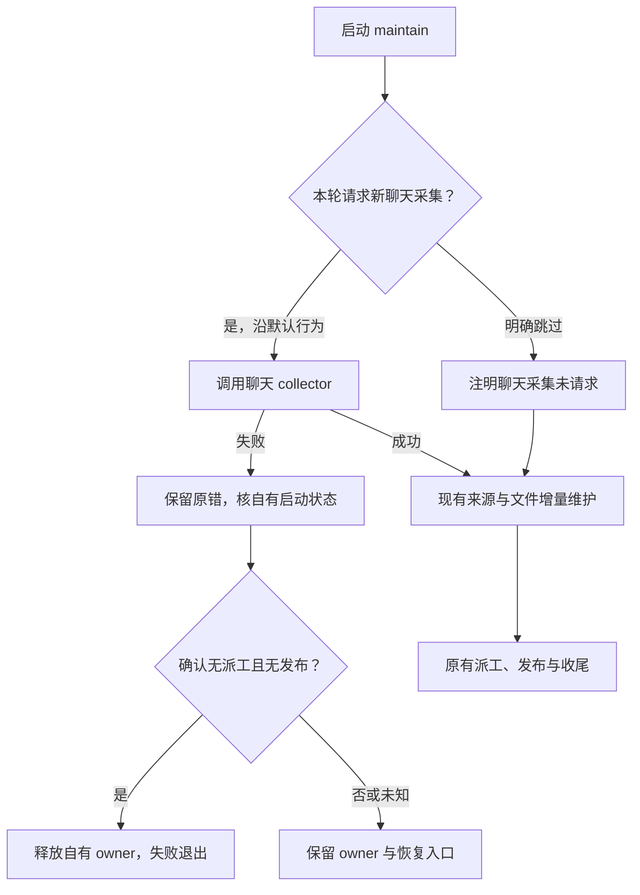
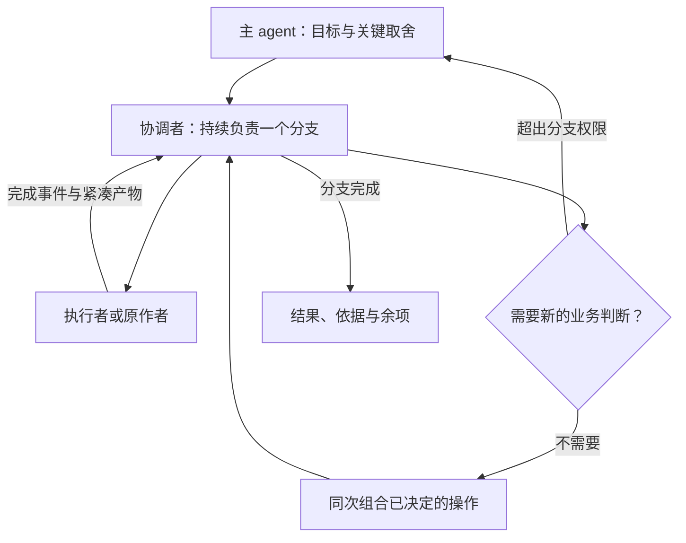

# 真实使用整改计划与可选方案

2026-11-15。状态：方案讨论，未实施。依据[两轮真实使用复盘](../20261106-rebuild/research/real-project-review-20261115.md)，本计划承接部署、来源布局、维护入口、协作开销与重任务资源边界。项目纲领、现行模型映射和运行库保持现状；以下接口名称均为拟议，不表示已可调用。

## 目标与推荐组合

让业务原文只维护一份，让可用文件工作有正式入口，让昂贵判断集中于必要决策，让重任务真正由现有资源设施管理。保留已生效的E发布组合、版本／原子提交／单owner和来源依据合同，不建设新的调度平台。

推荐选择 **M2＋S2＋C1，重任务先R1、重复后再R2；C2按自然阶段采用**。修复明确缺陷后逐项交付，不等所有选项完成才提供可用版本。方案选择与实施授权分开；本轮只交计划和图。

| 问题 | 证据与需要改变的行为 |
| --- | --- |
| HTTP能初始化、首次发布403 | 官方Origin示例漏端口；接入应能完成一次真实publish／查询／版本回源 |
| collector失败连带阻断文件维护 | 增加明确跳过新聊天采集的官方入口，并处理已知启动失败的自有owner |
| 私有标记要求额外镜像 | 让私有分类可以沿业务布局表达，不能只改忽略规则或每次靠同步副本 |
| 发布组合后协调上下文仍大 | 减少无变化等待、重复正文和逐步上报；不能把工作搬给root后宣称省费 |
| 多频点并行占满内存 | 核求解器实际并行与进程树，重任务接入HTCondor，保留项目单频约束 |

## 一、M：维护入口

| 方案 | 行为与代价 | 建议 |
| --- | --- | --- |
| M1 说明现有原子工具 | 明确prepare／publish可用，由项目自己组合文件发现与派工 | 可过渡，但未解决自写包装负担 |
| M2 显式跳过新聊天采集 | maintain增加明确选择，复用原发现、增量、layout与prompt链 | 推荐，改动集中 |
| M3 采集与维护拆成两阶段 | 单独运行聊天采集，维护显式消费其结果 | 职责清楚但多一步衔接，当前后置 |

M2可用拟议参数 `memory maintain --skip-codex-collection` 表达，具体命名实施时收敛。它只跳过本轮新聊天发现／采集：项目文件和已登记来源、历史快照及依赖一致性仍沿原维护合同处理；不是把历史聊天知识删掉或排除。回执明确采集“未请求”，不能称聊天已更新、freshness正常或全项目覆盖。

原默认行为保持：需要的collector失败仍返回原错，不暗中转成文件成功。调用agent在业务授权范围内可明确选择跳过并说明缺口，不增加每次都要用户批准的流程。automatic／manual仍表示维护方式，与是否采集聊天分开。

已知启动失败发生在语义派工前：仅在本进程取得自有owner、确认未派工且无在途／未明发布时stop并release，然后继续抛出原始异常。清理失败保留原错与清理错误；状态未明则保留owner和恢复入口，不能强行解锁。复用现有control，不另建失败状态库。

## 二、S：私有来源与一份正文

| 方案 | 做法 | 用户与维护代价 |
| --- | --- | --- |
| S1 以目录表达私有 | 将正式正文放进private内，按用途组织；停止额外镜像 | 产品改动少，但业务路径／链接需迁移；适合本来就需要独立私有Git的材料 |
| S2 配置额外私有范围 | 正文留在原位，项目配置声明私有目录／文件；根private始终私有 | 推荐保留现有布局，需新增分类与版本合同 |
| S3 每来源显式清单 | 每个来源登记路径与分类 | 适合逐项授权的特殊资料；台账成本最高，当前不推荐 |

S2只先做单向的“增加私有范围”：根private或命中配置即私有，不引入公开例外和复杂优先级。整项目私有可选全项目范围，混合项目选具体目录／文件。配置字段可暂称 `private_scope`，路径匹配按项目相对路径和目录边界定义。

发现范围回答“读哪些来源”，私有分类回答“这些来源及派生知识怎样标记”，Git／发行边界回答“哪些文件会被发布”。三者各有一个维护源，分类不扩大摄入范围，ignore不等于私有。

必要版本约束：当前source_version身份由来源、正文revision和path生成，不能仅把路径判断改成读取配置后UPSERT。分类改变而正文未变时，也必须形成可区分的新来源版本，保留旧快照；freeze固定分类及其规则版本，apply核发生变化则明确冲突，不用当前配置悄悄重写稿件。派生知识沿固定版本依据传播分类；能按原输入身份确认未变的向量继续复用，不因分类改动全库重编码。

本地私有保存不默认追加匿名化。确需对外分享时，另按授权处理输出和历史留存；chunk不收录某行并不阻止完整source snapshot保存它。

S2能力先在隔离小项目验证。现有镜像不会自动变成原位来源：旧路径、source／member身份和历史依据需单独做迁移映射。用户选择接入具体项目后，先核在途任务与恢复材料，再迁所选范围；不顺带删除旧快照、撤销历史private或迁移其他项目。

## 三、C：协调与上下文

| 方案 | 做法 | 建议 |
| --- | --- | --- |
| C1 收敛现有协作 | 干净brief、分支负责到底、紧凑完成回报、宿主事件等待、已决定操作同次组合 | 先做，复用现有E和宿主工具 |
| C2 自然阶段交接 | 旧历史确实挤占当前判断时，在稳定产物边界更换协调上下文 | 条件化采用，不设固定token阈值自动轮转 |
| C3 完整cycle／常驻调度层 | 统一事件、派工、发布与未来状态 | 暂缓，当前没有证据证明新增状态的收益超过维护负担 |

C1中主agent负责目标、关键取舍和最终集成；协调者负责该分支后续派工、依赖、正常修复及验收。上报结论、必要依据／产物和待决事项，不反复搬原文、全目录清单或完整ledger。reader格式／分块修稿回原作者，跨来源关系由必要共读者判断；普通成功批仍在作者生成与程序提交后结束，不加例行语义审计。

等待以宿主完成事件为主；有独立工作先做，没有工作使用宿主有界等待。超时无变化不再重复扫文件和重发状态消息；不要求所有等待都消失。模型按实际判断难度及项目档位选择，不因Terra total高就整体降档，也不新加无明确职责的代理层。

C2只在固定稿／产物已保存、发布状态明确的阶段交接。交清assignment、owner／control、未完工作、Job ID和实际句柄权限，始终只有一个dispatcher和publisher。宿主不支持接管旧句柄时，先完成当前有界工作再换新上下文；不能按名字假冒所有权或重开owner抢锁。

## 四、R：重任务与原生并行

| 方案 | 做法 | 建议 |
| --- | --- | --- |
| R1 复用现有JobSpec直提 | 为一次真实任务申报CPU／RAM等，作业启动并拥有求解器进程树 | 先验证最短闭环 |
| R2 项目专用薄入口 | 在R1成功后封装重复参数、单点选择与结果位置，仍提交同一Condor能力 | 同类任务反复出现再加 |
| R3 通用求解器平台 | 统一GUI／headless、许可证与多软件适配 | 暂缓；没有必要先建设 |

重任务按现有纲领接入HTCondor；它是容量、准入、排队和时限权威，不增加应用层共享锁、实时free准入或第二套资源台账。共享embedding继续在作业树之外沿管理员预留运行。短文件读取和普通轻任务不进队列。

业务执行者负责原生并行：一次启用几个频点、每点进程／线程、是否复用网格，须与资源申报相符。约20 GB只是本次单点观测，不是所有模型的通用请求值。先用已成功的串行单点估算进程树峰值及必要余量，未知时先做有界样例，不能因cores／tasks字面值就宣称限制了频率并行。

AEDT接入需先验证实际执行账户、会话、启动与许可证条件，以及真正的求解器是否属于Condor进程树。只把连接既有GUI的Python客户端提交入队列，不能证明GUI及求解已受管；条件不成立时保留具体阻塞，不声称headless已支持或绕过队列运行重求解。

wait到期只结束观察，不取消正在运行的作业；cancel请求与最终退出分开记录。用户中止因资源压力而发生时，不改写成模型不收敛。原始图、数据、网格来源和参数的已知限制继续进入业务证据。

## 实施批次与验收

| 批次 | 交付范围 | 必要验收与停止边界 |
| --- | --- | --- |
| P0 明确缺陷与说明 | 修正完整Origin；在现有freeze输入边界定位草稿／关系缺字段；区分author draft和frozen；说明源快照范围与本地私有保存 | 对应真实403及缺字段回归；一次真实发布、查询和版本回源。错误保留原因，不加独立作者审计或通用异常解析器 |
| P1 官方维护入口 | 选M2时改memory CLI／生成入口及原增量链；补已知启动失败清理 | 默认collector失败仍失败；明确跳过不调用collector；同一文件流程完成派工、publish与收尾；他人owner不受影响，未明发布不释放 |
| P2 单份来源能力 | 选S2时改项目配置、privacy、来源版本、freeze／apply及派生标记 | 原位私有与普通来源、混合依据、正文未变而分类改变、freeze后规则改变、历史回读；复用既有privacy测试，不做全库审计 |
| P3 真实工作接入 | C1进入agent-team及记忆角色prompt；R1做一项有界实际重任务 | 主agent能凭紧凑回报集成；资源申报和实际原生并行一致，作业树及产物可核；不重新跑整组大仿真作前置 |
| P4 按选择接入旧项目 | S2验证后单独确定镜像迁移范围；需要时再做C2／R2 | 保留原文、历史依据和恢复材料，路径映射与当前查询成立；本次计划不授权外部项目数据迁移 |

源码／依赖／产品文档在唯一active实验工程维护；开发计划、进度和选留依据仍在根devDoc与artifacts。安装时按受影响合同同步普通wheel、配置和生成入口；不以仅改源码代替实际安装验证。实施完成才更新system现行说明，发行与具体外部项目接入另按相应授权。

沿真实业务分别记录结果可用性、遗漏与错误、主agent上下文、全队用量和耗时。不同任务的累计total不作为节省率，不预设百分比费用目标，不在作者机新增单agent／团队对照。历史用量核对按明确聊天ID定点、一次流式汇总，避免多个agent并发全域扫同一磁盘；不为本次整改新建监控平台。

## 待选择与本轮交付

2026-11-16补充依据：[迁移与长科研任务复盘](research/robotic-arm-review-20261116.md)。以下细化仍为待选计划，不改变本计划未实施状态：

- P0新增“大文本整源快照”独立项：完整source.text单SQL触发客户端2,162,688字节上限，减小chunk不解决；先明确可恢复的存储／传输合同，并把路径和封装大小诊断前置到昂贵作者工作之前。
- M2之外还需明确稳定当前成果与海量历史补齐的优先级、最终接受范围。固定receipt不能暗中扩范围；未接受新成果时给当前原件入口，不靠再启动一轮全库维护闭合所有差异。
- S2保持按布局选择。新项目直接private Git的结构没有标记镜像问题，不因此强推配置化分类或迁移。
- C1／C2纳入单turn已无法由宿主取回的实例：自然阶段交接、有界原证及准确用量归属，避免按root_turn_id误把创建新聊天的触发链当当前任务边界。
- R1已有真实Condor完成／取消证据可复用，后续重点为公开worker与可信owner的分别预算、执行账户能力及工件权限交接；科学别名发现留在科研项目，重复交接可由R2薄入口收敛。

主要选择是S1还是S2，以及维护采用M2还是拆阶段的M3；C1与R1可沿现有职责先落地，C2／R2按实际重复再选。推荐范围若获实施授权，可先P0＋P1，再S2版本能力与P3，最后单独决定旧项目迁移。配置字段名、短入口细节和具体资源估计由实施阶段在所选合同内收敛，不需要逐项新增审批。

本轮只完成计划与4张逻辑图。已核复盘、项目纲领、现行资源／部署合同和相关源码边界，未运行求解、修改运行配置或迁移资料；实际检查见本任务进度。
