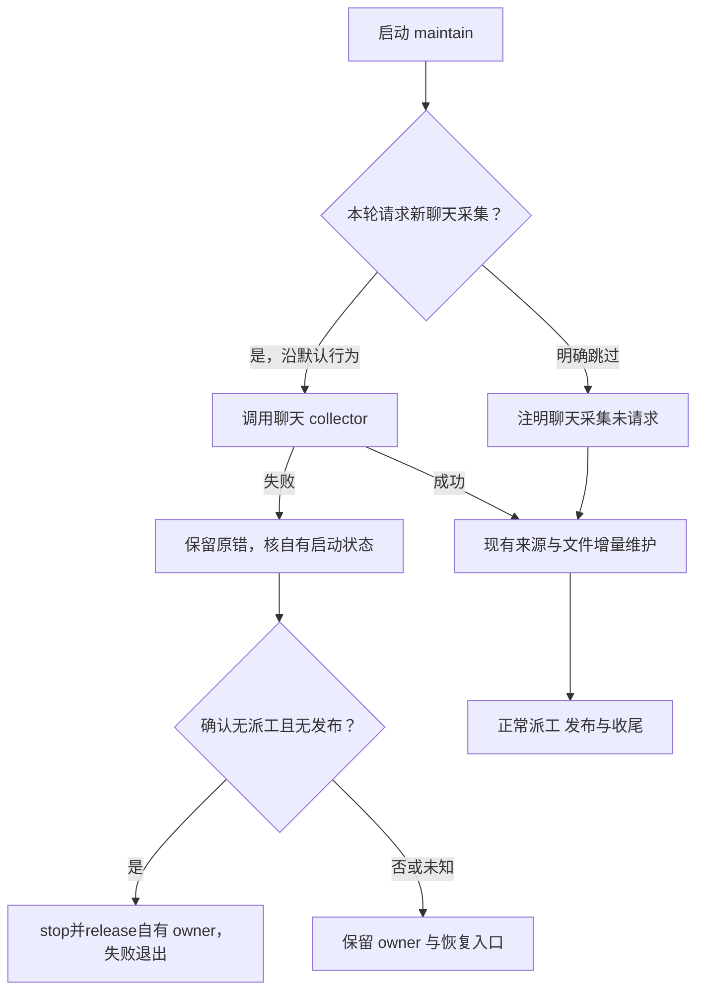
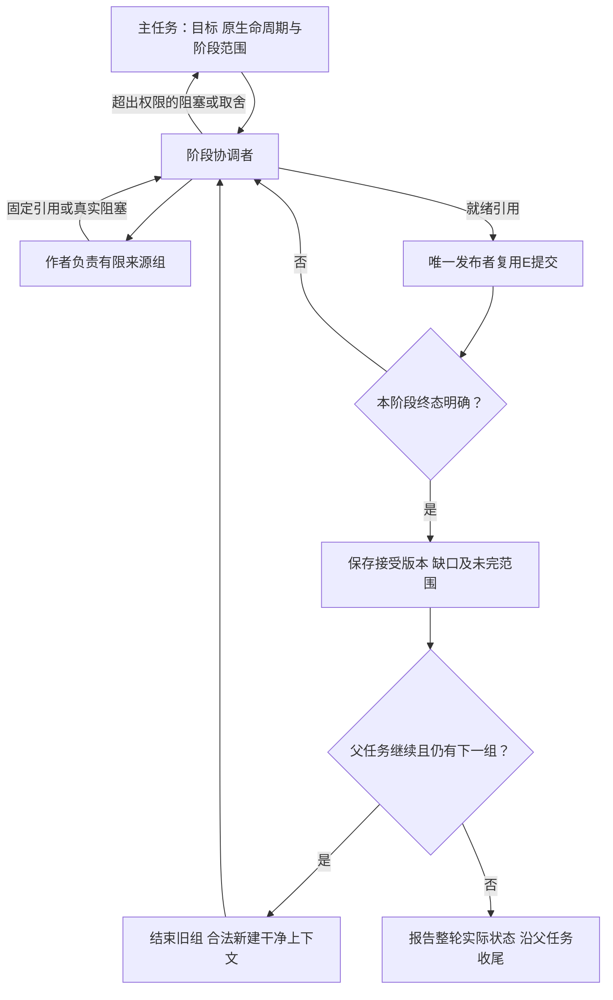

# 真实使用整改计划与可选方案

更新：2026-11-17。状态：本轮授权范围已完成并安装0.16.0；实际验收与边界见[结果](result.md)及[进度](progress.md)。本轮仅basePack本项目，P6外部接入不在范围。依据[两轮真实使用复盘](../20261106-rebuild/research/real-project-review-20261115.md)、[新项目复盘](research/robotic-arm-review-20261116.md)及[协调者通信调查](research/coordinator-communication-20261116.md)，本计划承接接入与发布缺陷、维护入口、来源布局、协作开销和重任务资源边界。项目纲领与模型映射保持；下文新接口以实现及验收记录为准。

后续[本项目完整维护实测](maintenance-20261116-result.md)已处理130固定来源及原8条关系；C2真实接续成立，C1仍有全树查询、交稿变化、依赖修复与长尾，后期包含8个督导边界。原token情景区间仍是同材料假设，不能据本轮与旧217来源的总量差宣称验证。关键交接投递、固定交稿形态、错误定位、纯空白范围及“满队”与按工作量分组的合同细化列为后续候选，本轮未继续改代码。

## 目标与推荐组合

让业务原文只维护一份，让可用文件工作有正式入口，让昂贵判断集中于必要决策，让重任务真正由现有资源设施管理。保留已生效的E发布组合、版本／原子提交／单owner和来源依据合同，不建设新的调度平台。

推荐先修明确缺陷，维护采用 **M2**，协作采用 **C1＋适用长任务的C2**。来源按布局选S1／S2：已有private布局直接复用，需要保留原位业务布局时采用S2。重任务复用R1已验能力，对重复交接按需用R2收敛。各项可分批交付，S2和外部项目迁移不阻挡协作整改；具体实施与外部操作沿后续授权范围执行。

| 问题 | 证据与需要改变的行为 |
| --- | --- |
| 自带管理员接入示例不完整 | Origin示例漏端口导致发布403；纠正文档示例，真实数据库部署和策略由机器维护者负责 |
| 大文本来源在提交前被拒绝 | 完整source.text单SQL超过客户端wire上限；修复整源快照边界并前置封装大小诊断，减小语义chunk无效 |
| collector失败连带阻断文件维护 | 增加明确跳过新聊天采集的官方入口，并处理已知启动失败的自有owner |
| 历史积压与当前成果竞争 | 固定候选范围内明确优先组；回执外成果及接受后的更新独立披露，不以旧回执成功声称最新成果已接受 |
| 私有标记要求额外镜像 | 让私有分类可以沿业务布局表达，不能只改忽略规则或每次靠同步副本 |
| 发布组合后协调上下文仍大 | 收窄状态查询，减少极小范围反复交接，固定交稿后再发布；不能把工作搬给root后宣称省费 |
| 多频点并行占满内存 | 核求解器实际并行与进程树，重任务接入HTCondor，保留项目单频约束 |

P0包含整源快照的独立修复：在现有存储／传输链内确定并实现可恢复的完整来源表示，保留原文字节、hash、来源版本、原子接受和恢复合同；prepare／预检尽早给出路径、实际封装大小及原始错误。按真实大源验证，不能以缩chunk、裁正文或未经验证地抬常数代替。freeze输入缺字段在已有接收边界修复，不合成通用异常处理层。

Origin仅属basePack自带管理员接入示例的文档勘误。basePack说明其客户端所需的连接条件并保证自有示例一致；实际SurrealDB部署、端口、允许来源及进程运维由机器维护者管理。此项不新增自动部署、策略管理或客户端绕过功能。

## 一、M：维护入口

| 方案 | 行为与代价 | 建议 |
| --- | --- | --- |
| M1 说明现有原子工具 | 明确prepare／publish可用，由项目自己组合文件发现与派工 | 可过渡，但未解决自写包装负担 |
| M2 显式跳过新聊天采集 | maintain增加明确选择，复用原发现、增量、layout与prompt链 | 推荐，改动集中 |
| M3 采集与维护拆成两阶段 | 单独运行聊天采集，维护显式消费其结果 | 职责清楚但多一步衔接，当前后置 |

M2已实现为 `memory maintain --skip-codex-collection`。它只跳过本轮新聊天发现／采集：项目文件和已登记来源、历史快照及依赖一致性仍沿原维护合同处理；不是把历史聊天知识删掉或排除。回执明确采集“未请求”，不能称聊天已更新、freshness正常或全项目覆盖。

原默认行为保持：需要的collector失败仍返回原错，不暗中转成文件成功。调用agent在业务授权范围内可明确选择跳过并说明缺口，不增加每次都要用户批准的流程。automatic／manual仍表示维护方式，与是否采集聊天分开。

已知启动失败发生在语义派工前：仅在本进程取得自有owner、确认未派工且无在途／未明发布时stop并release，然后继续抛出原始异常。清理失败保留原错与清理错误；状态未明则保留owner和恢复入口，不能强行解锁。复用现有control，不另建失败状态库。

维护优先级与采集开关分别表达。固定回执内优先处理用户约定、当前阶段和稳定成果入口，再补历史；保全原件和语义摄入分别报告。固定的是候选身份／来源集合，`current_revision`仅是发现时观察；同一候选每批prepare并接受当时当前版本，冲突回原作者正常修复，明确记录accepted revision与覆盖。接受后再修改不自动重开本阶段，新路径、回执外候选及后续未接受成果列原件入口和有限后续范围，旧回执成功不代表最终磁盘全新鲜。

确需换候选范围时，由原宿主在业务授权内按收尾合同处理自有旧轮和在途状态，再显式固定新回执；这属于范围变更，与C2的同回执阶段交接分开。业务收尾沿父任务停止边界，不默认再启动一轮全库维护。M2只解决采集阻断，不能据此宣称当前成果已同步。

## 二、S：私有来源与一份正文

| 方案 | 做法 | 用户与维护代价 |
| --- | --- | --- |
| S1 以目录表达私有 | 正式正文采用private与独立本机Git；已有布局直接复用 | 已在private的项目无需迁移；需改业务路径时另核链接与历史 |
| S2 配置额外私有范围 | 正文留在原位，项目配置声明私有目录／文件；根private始终私有 | 需要保留原位布局时推荐，需新增分类与版本合同 |
| S3 每来源显式清单 | 每个来源登记路径与分类 | 适合逐项授权的特殊资料；台账成本最高，当前不推荐 |

S2只先做单向的“增加私有范围”：根private或命中配置即私有，不引入公开例外和复杂优先级。整项目私有可选全项目范围，混合项目选具体目录／文件。配置字段为 `[memory].private_scope`，路径匹配按项目相对路径和目录边界定义。

发现范围回答“读哪些来源”，私有分类回答“这些来源及派生知识怎样标记”，Git／发行边界回答“哪些文件会被发布”。三者各有一个维护源，分类不扩大摄入范围，ignore不等于私有。

必要版本约束：当前source_version身份由来源、正文revision和path生成，不能仅把路径判断改成读取配置后UPSERT。分类改变而正文未变时，也必须形成可区分的新来源版本，保留旧快照；freeze固定分类及其规则版本，apply核发生变化则明确冲突，不用当前配置悄悄重写稿件。派生知识沿固定版本依据传播分类；能按原输入身份确认未变的向量继续复用，不因分类改动全库重编码。

本地私有保存不默认追加匿名化。确需对外分享时，另按授权处理输出和历史留存；chunk不收录某行并不阻止完整source snapshot保存它。

S2能力先在隔离小项目验证。现有镜像不会自动变成原位来源：旧路径、source／member身份和历史依据需单独做迁移映射。用户选择接入具体项目后，先核在途任务与恢复材料，再迁所选范围；不顺带删除旧快照、撤销历史private或迁移其他项目。

## 三、C：协调与上下文

| 方案 | 做法 | 建议 |
| --- | --- | --- |
| C1 收敛现有协作 | 有界来源组由作者负责、固定交稿、只看自有分支、事件等待、同次处理已决定操作 | 先做，复用现有E和宿主工具 |
| C2 自然阶段交接 | 长维护在稳定来源组和明确发布终态处，以干净上下文接续 | 与C1分别交付，长任务纳入；短工作不强制轮转 |
| C3 完整cycle／常驻调度层 | 统一事件、派工、发布与未来状态 | 暂缓，当前没有证据证明新增状态的收益超过维护负担 |

主agent负责目标、关键取舍、阶段边界与最终集成；当前协调者持续负责本阶段的派工、依赖、正常修复及结果汇总，只有一个dispatcher和publisher。主agent按阶段接收接受范围、必要依据与待决事项，不接管逐文件调度。格式／分块修稿回原作者，跨来源关系由必要共读者判断；普通成功批在作者生成与程序提交后结束，不加例行语义审计。

### C1：来源组与交付

[通信实证](research/coordinator-communication-20261116.md)已确认干净fork、约500字符完成报告和E分组发布存在。新增整改落在交接粒度和观察范围，分两步实施：

1. 只查询自有分支，按需读取skill／回执切片；已有完成事件优先使用，无独立工作时使用宿主有界等待。无变化超时后沿现有等待继续，不反复拉取全树final、扫同一状态或重发进度。保留必要完成事件和真实阻塞处理。
2. 预派有语义联系且非重叠的有限来源组，作者负责组内阅读、分块、关系与正常修复，交一组固定稿件引用。协调者同次提交已决定的就绪稿，复用多路径prepare和E；组大小按材料联系与可处理范围判断，不设固定文件数。保留原文覆盖、相关端点共读、stop响应及未读缺口。

交付使用明确的assignment、路径和hash，交付后的文件固定；修稿另存新文件／hash。每份明确交付只确认一次完成：可经显式MESSAGE或宿主FINAL交付，宿主随后自动产生的同稿FINAL沿已有引用识别，不重复发布或派工。新hash修稿按新交付处理。中间通信用于真实错误、依赖或需提前处理的变化；现有加密MESSAGE正文不可核，不以数量认定全部重复。不新增常驻去重台账或自主抢任务队列，多reader继续共享单一发布者。

### C2：同一维护轮内的干净接续

C2与C1分别解决历史长度和交接次数。长维护在主题／来源组完成、稿件与结果已保存、发布终态明确后接续；未明提交先沿原身份核清，不跨阶段盲目重发。阶段只结束本组工作，固定receipt的其余候选、未读范围、反馈和真实阻塞仍须显式保留。

主任务持有原维护生命周期；阶段间沿同一receipt、owner／control及父任务stop约束。交清已接受版本、待处理assignment、引用／hash、错误和必要Job ID／实际句柄权限。原协调者停止派工并结束自有工作后，再串行建立下一阶段；阶段交接不执行整轮stop／release，也不新开maintain或采集。业务结束时按原收尾合同停止自有团队、确认发布结束后释放所有权。

新协调者须实际获得干净上下文，不能用同会话的一段短摘要冒充。实施时核实并打通宿主派工、阶段身份、固定layout和恢复入口；保留已开始任务的身份，下一阶段使用明确的新身份和合法句柄。宿主不能转交旧reader句柄时，先完成当前有界组，再建立新reader；不靠同名任务、清文件或重开owner接管。若宿主入口仍不支持合法干净接续，只交付可用C1并明确C2阻塞，不宣称完整方案已完成。不设token阈值强制轮转，也不要求每个小任务都新建团队。

### 用量规划与观察

[情景估算](research/coordinator-communication-20261116.md#后续token情景估算)以Terra约4.11亿、4个Luna约5.39亿total为基线，含缓存输入。仅通信收敛估计Terra减少5–20%，加有限来源组30–55%，再实际干净交接60–80%；完整组合的Luna中间预算为持平至增加10%（约0–5,400万），±20%只作敏感性、并非最坏上界。中间情景两类模型合计减少约27–33%，不含其他业务agent及新增root交接。各档是累计范围，不将百分比相加。

这些是同材料、同模型及必要判断下的规划假设，不是实测、费用折扣或验收门槛。后续沿真实工作分别记录响应次数、平均输入、缓存／未缓存输入、输出、全队用量和实际接受质量；99.81%缓存占比本身不作目标。Luna、root和阶段启动开销一并观察，不能以转移工作、缩减覆盖或重复计算已生效E来宣称收益。模型仍按实际难度与项目档位选择，不因total高整体降档。

## 四、R：重任务与原生并行

| 方案 | 做法 | 建议 |
| --- | --- | --- |
| R1 复用现有JobSpec直提 | 复用已验提交／完成／取消，对目标执行器核账户、进程树、预算和工件 | 先补未覆盖的目标条件，已有证据不重复从零验证 |
| R2 项目专用薄入口 | 对已出现的重复参数、公开工件交接与回执绑定做薄封装，仍提交同一Condor能力 | 目标条件明确且重复发生时采用 |
| R3 通用求解器平台 | 统一GUI／headless、许可证与多软件适配 | 暂缓；没有必要先建设 |

重任务按现有纲领接入HTCondor；它是容量、准入、排队和时限权威，不增加应用层共享锁、实时free准入或第二套资源台账。共享embedding继续在作业树之外沿管理员预留运行。短文件读取和普通轻任务不进队列。

业务执行者负责原生并行：一次启用几个频点、每点进程／线程、是否复用网格，须与资源申报相符。约20 GB只是本次单点观测，不是所有模型的通用请求值。先用已成功的串行单点估算进程树峰值及必要余量，未知时先做有界样例，不能因cores／tasks字面值就宣称限制了频率并行。

AEDT接入需先验证实际执行账户、会话、启动与许可证条件，以及真正的求解器是否属于Condor进程树。只把连接既有GUI的Python客户端提交入队列，不能证明GUI及求解已受管；条件不成立时保留具体阻塞，不声称headless已支持或绕过队列运行重求解。

新项目已有真实Condor完成／取消证据，沿[复盘](research/robotic-arm-review-20261116.md#三r1已有真实证据下一步细化账户和工件)复用。公开worker和可信生成／评价owner分别声明资源范围；单个worker的限制不等于整实验总预算。交接核实际执行账户、输出创建者、可读范围和回执绑定，额外账户能力以目标上下文下的最短实际调用为准。科学真值隔离及源码别名发现留在科研项目；有明确隔离职责的Windows Job／DACL不能当作重复全局调度而删除。

wait到期只结束观察，不取消正在运行的作业；cancel请求与最终退出分开记录。用户中止因资源压力而发生时，不改写成模型不收敛。原始图、数据、网格来源和参数的已知限制继续进入业务证据。

## 后续研究候选：多视角访问与候选关系

2026-11-17按用户新设想补[技术方案与框图](research/contextual-access-20261117.md)。推荐以稳定视角ID和局部交付事件钟，隔离不同任务的使用偏好；共同交付作为可重建的统计超边，结合问题／内容表示学习允许重叠的归属，并向AI维护者提供候选关系。专家是统计视角，初期无需训练多个LLM，也不增加每次调权的agent轮次。

这将改变已选定的“每次交付使其余全项目材料降权”规则；当前全局v1仍是已部署行为，局部视角v2及参数均未实施或启用。旧用途匹配研究未证明稳定收益，独立当前理解／社区聚类平台此前已退出；新模块先限定为访问派生统计，不另立语义真相源。来源族、地图与语义提案编译也仍是待选方向，不据共用认定同源、主题或事实关系。

| 后续步骤 | 具体内容 | 进入下一步的证据 |
| --- | --- | --- |
| 观察合同 | 真实query/context引用、工作episode、进入筛选的候选、实际交付、策略／路由版本；首写固定、同ID幂等 | 不制造访问事件；旧缺字段为unknown；新策略缺必需字段明确报错，合法低置信路由明示为unknown |
| 稳定视角对照 | 脚本以高置信稀疏门控推进局部钟，返回条件访问线索；旧全局规则保留作基线 | 纯A事件不改变未激活B的局部状态；不把旧全局w再硬乘回来；当前版本、空清单、低频关键证据和退役保护保持 |
| 自动聚类影子运行 | 问题原型＋内容先验＋归一化共用统计；提出归属／新簇，不直接改变线上坐标 | 路由置信度、稳定性和冷启动可解释；拆并簇显式新epoch，不复制旧钟或把重聚类当新交付 |
| 候选边与有限启用 | 输出带支持事件和端点版本的候选，由AI共读接受；授权后才有限启用条件提示 | 时间／任务留出、固定候选与端到端等预算两类评估；共同交付拟合不能替代检索与业务质量验收；明确全队成本 |

统计更新由脚本批量处理，保留原E、单publisher、版本／依据／私有合同及tier1一次综合评分，rank不二次调权。聚类可建议维护共读范围，仍须考虑共享图写目标；本轮不修改既有满队规则。实现和参数需另行选择，以下已完成P0—P6状态保持。

## 实施批次与验收

| 批次 | 交付范围 | 必要验收与停止边界 |
| --- | --- | --- |
| P0 接入文档与发布缺陷 | 文档：纠正自带管理员示例Origin；代码：在freeze输入边界定位缺字段、区分author draft与frozen，修复整源快照及前置诊断 | 文档示例与连接条件核对，沿最短发布确认既有403修正；代码保留缺字段及大源回归，完整原文／hash／版本回源与恢复成立；原错可定位，不静默裁剪或加作者审计 |
| P1 维护入口与接受范围 | M2进入CLI／生成入口和原增量链；补自有启动失败清理、候选优先组与接受版本披露 | 默认collector失败仍失败；明确跳过不调用collector；文件维护完成派工／publish／收尾；旧聊天及依赖保留；候选内prepare当前版，回执外成果及接受后更新不混称已接受；他人owner不受影响、未明发布不释放 |
| P2 C1协作收敛 | 修改agent-team及记忆角色prompt；复用多路径prepare／E，收敛局部状态、固定交付和有限组职责 | 一组相关来源由作者负责；同稿自动FINAL不重复处理；交付后改稿原错及作者修复成立；正常成功不逐稿全文复审；覆盖／关系／缺口可核 |
| P3 C2阶段接续 | 打通宿主实际干净派工、阶段身份／layout和有界交接入口，长维护按自然阶段采用 | 下一次适用的真实维护中至少两个有界阶段接续，仍同receipt／owner/control且单发布者；无句柄接管时完成旧组再新建；压缩或同会话摘要不算换上下文；父stop能结束自有团队，未完候选不丢失；入口不支持则明确阻塞 |
| P4 按布局提供S2 | 需要原位私有时改配置、privacy、来源版本、freeze／apply及派生标记；S1已有项目直接复用 | 原位私有／普通来源、混合依据、正文未变而分类改变、freeze后规则改变及历史回读；复用既有privacy测试，不做全库审计或默认迁移 |
| P5 资源目标接入 | R1复用真实终态证据，定向核尚未覆盖的执行器／账户／工件；重复交接按需R2 | 真实执行账户下最短调用，申报与实际进程树／原生并行一致，worker与owner预算分别明确，产物可读且绑定回执；不重跑整组大仿真作前置 |
| P6 所选外部项目接入 | 按具体项目范围应用维护／协作能力；S2验证后再迁所选镜像来源 | 保留原件、历史依据和恢复材料，路径映射及当前查询成立；外部迁移与生产操作另依具体授权，C2和R2不以迁移为前提 |

推荐顺序为P0／P1先解除阻断，随后P2、适用长任务的P3。P4按来源布局需要、P5按实际重任务独立推进；P6逐项目确定接入范围。各批功能检查通过即可单独交付，用量规划不作为百分比通过门槛。

源码／依赖／产品文档在唯一active实验工程维护；开发计划、进度和选留依据仍在根devDoc与artifacts。安装时按受影响合同同步普通wheel、配置和生成入口；不以仅改源码代替实际安装验证。实施完成才更新system现行说明，发行与具体外部项目接入另按相应授权。

沿真实业务核结果可用性、遗漏与错误，按C节分别记录用量与耗时；不同任务累计total不直接作节省率，不新增单agent／团队正式对照或监控平台。取证按明确thread／turn及派工链定点读取，同时保留root_turn_id的触发关系，不能只按该字段推断用户任务归属。历史用量一次流式汇总，宿主超长turn不可取回时交付有限原证与未读范围，避免并发全域扫描磁盘。

## 当前状态与实施边界

本次已将后续证据归入正文、实施批次和4张逻辑图，删除末尾追加项造成的另一套顺序。推荐范围及条件以上文为准；M1／M3、S3、C3、R3保留为适用场景不同的备选或后置项。具体参数名、snapshot最小实现和资源估计由实施阶段在所选合同内收敛。

本轮P0—P4实现、普通wheel、本项目入口刷新及真实宿主两阶段验收已完成；P5完成本项目R1账户／线程／工件定向验证。P6按用户答复仅接入basePack本项目，未操作外部项目；外部镜像迁移、R2、AEDT／GUI／许可证目标条件留其具体项目。追加授权的GitHub push和[0.16.0 Release](https://github.com/YS-Pan/basePack/releases/tag/v0.16.0)已完成，公开附件下载与Latest已核。原用量区间仍是规划假设，不能因工程交付而记为收益已验收；测试原错、有限兼容和实际验收边界见[结果](result.md)。
