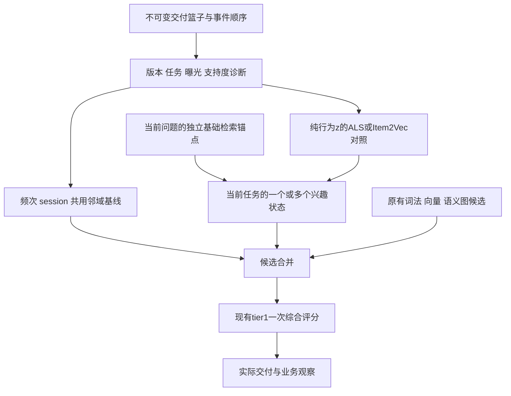

# 共交付行为表示：论文与项目核对

2026-11-17。针对每材料纯行为向量、自动视角、任务切换和候选图边，核对原论文、作者代码与官方项目文档。本文区分来源结论与basePack工程推论，不以其他数据集指标宣称本项目收益；没有训练、安装新依赖或启用访问策略。

当前0.16的访问偏好仍是全局权重；纯行为z、自动视角与局部钟仍是[候选方案](contextual-access-20261117.md)。以下校正针对该设计，不把未实现能力写成运行故障。用户要求的纯行为输入保持：正文、标题、内容embedding和query向量不参与z的初始化／训练；现有内容检索可独立提供锚点。

## 直接相关的研究

| 原证 | 实际做法与适用边界 | 可借鉴部分 |
| --- | --- | --- |
| [Item2Vec，2016](https://arxiv.org/abs/1603.04259) | 以无序集合内材料对训练SGNS，有输入u和上下文v两套参数，论文导出u作item表示。负采样与热门下采样影响目标，不是真实不相关标签 | 最贴近篮内共同交付；先固定u导出规则，明确配对／噪声分布与频率处理 |
| [Prod2Vec，2015，§3.1](https://djurikom.github.io/pdfs/grbovic2015kddB.pdf) | 模型包含跨收据相邻预测；bagged变体明确不让同一收据内产品互相预测 | 保留事件层次；不能因名字相近就当作Item2Vec的篮内训练 |
| [Hu／Koren／Volinsky，2008](https://yifanhu.net/PUB/cf.pdf) | 隐式反馈分开二值偏好p与置信度c；零项进入低置信优化，不是已证负反馈 | 给ALS定义明确目标，避免“任意X分解”的接口含混 |
| [Session-based评估，2018](https://arxiv.org/abs/1803.09587)、[TIFU-KNN，2020](https://arxiv.org/abs/2006.00556) | 简单session邻域／频次方法可成为有竞争力的基线；TIFU保留有序篮序列、篮内无序 | 先比较邻域和频次；本项目不照搬日历衰减或把整个项目硬当多用户购物系统 |
| [MIND，2019](https://arxiv.org/abs/1904.08030)、[ComiRec，2020](https://arxiv.org/abs/2005.09347)及[作者代码](https://github.com/THUDM/ComiRec) | 多兴趣主要在用户历史侧，item仍可单向量；ComiRec可从item ID序列学习，MIND还使用额外特征 | 保留单材料z，考虑多个当前任务状态；不把无序delivery展开成伪点击顺序，也不把兴趣head编号当稳定任务 |
| [PinnerSage，2020](https://cs.stanford.edu/people/jure/pubs/pinnersage-kdd20.pdf) | 固定底层item空间，对历史聚类，以真实成员medoid代表兴趣；底层PinSage含图像／文本等信息 | 借固定空间、medoid和多兴趣入口；其完整embedding与日历重要性不符合本项目纯共交付／无时间遗忘条件 |
| [EASE，2019](https://arxiv.org/abs/1905.03375) | 无隐藏低维层，学习item间线性权重，约束对角为0，朴素存储为材料数平方；系数可负 | 可作适量数据下的排序对照，不作为“每材料一个低维z”的直接实现，负系数不转为反驳边 |
| [LightGCN，2020](https://arxiv.org/abs/2002.02126)及[作者代码](https://github.com/kuandeng/LightGCN) | 在观察到的二部图上传播表示，训练仍依赖观察项与未观察项的排序假设 | 可研究间接邻域候选；没有行为边的材料不会凭空获得可靠含义，初期不先加GNN |
| [GraphSAIL，2020](https://arxiv.org/abs/2008.13517) | 增量推荐模型通过保持旧结构／表示缓解灾难性遗忘 | 提醒区分访问状态老化与表示模型遗忘；不是现局部钟已保护完整检索链的证据 |
| [替代与互补网络，2015](https://arxiv.org/abs/1506.08839) | 用带类型监督与产品信息学习不同关系 | 共用近邻不能独自辨认支持、互补或替代；语义关系仍须原证与AI判断 |

上述多兴趣／序列论文通常使用远多于本项目已观察交付量的数据，所报实验规模不是可移植的最低样本门槛。模型存在和源代码公开，不等于其依赖、Windows运行或业务效果已经在本项目验证。

## 可复用项目的接口陷阱

| 项目原证 | 具体发现 | 本项目采用前的处理 |
| --- | --- | --- |
| [Gensim Word2Vec官方文档](https://radimrehurek.com/gensim/models/word2vec.html) | 所查文档默认min_count=5、sg=0、window=5、sample=.001、shrink_windows=True；导出KeyedVectors不保留全部继续训练状态 | 不直接把delivery当默认句子。显式选skip-gram、保留稀有ID，比较关闭下采样；配对／抽样须匹配无序篮子。单元素篮子没有SGNS正对，不能把随机初值发布为已学表示 |
| [implicit ALS官方文档](https://benfred.github.io/implicit/api/models/cpu/als.html) | fit输入承担偏好与confidence两种语义；缺失为p=0,c=1。partial_fit只更新指定因素，不等于全模型重新收敛 | 明确构造observed confidence，固定库版本／参数；不能把1/d配对质量直接作为confidence，或误以为alpha自动补1 |
| [RecBole官方评估配置](https://recbole.io/docs/user_guide/config/evaluation_settings.html) | 分组、排序、切分与候选评估各自配置，所查文档默认随机排序；隐式评估通常把未观察项作负项 | 可借实验配置与模型实现，覆盖本项目的全局时间／任务切分、可用版本与语义标注，不直接套默认指标 |

## 对当前方案的具体校正

### 1. 明确训练数据层次与目标

原始事实为`D_t={该次实际交付的精确材料版本}`。篮内无序，跨delivery的事件先后是真实记录；不同工作episode应另标，不能把所有任务串成一个连续偏好序列。最后排名顺序是检索器输出，不是使用顺序。

Item2Vec与ALS是两个不同优化目标。前者的噪声分布、热门下采样和正对抽样共同定义表征，不只影响运行速度；前一稿“负采样只是优化噪声对照”的说法需收紧。可先用论文u_i导出，并将求和／拼接另列试验。

若采用ALS，写清：`p_ti=1[r_ti>0]`，候选置信度例如`c_ti=1+α f(r_ti)`，最小化`Σ c_ti(p_ti-a_tᵀz_i)²+λ(||A||²+||Z||²)`。f与参数待选；使用implicit时按其实际接口传observed c，未观察的稀疏零项由库作p=0,c=1。包贡献归一化、偏好标签、置信度与原始支持次数应分别保留，不能混成一个数。

### 2. 先证明附加价值，不先把聚类当入口前置

新增无需训练的频次、session-kNN、共用邻域／收缩共现对照；可用归一化历史交付列作为透明行为描述。用户希望的纯行为低维z仍是目标之一，但要与这些基线比较是否增加可用性。

约22次delivery的事件×材料矩阵秩最多22；64维只应是存储示例，不能解释为已识别64种用途。这个秩结论针对该矩阵，不是所有SGNS目标的维数定理。还应测每材料独立支持数、孤立／单次版本、共同交付图连通性、邻域在时间截点和重采样下是否稳定。min_count=1保留稀有ID，不会使它自动可靠。

### 3. 单材料表示与多任务状态分开

保留每材料一个z。多个兴趣向量优先放在当前问题／工作episode侧，由锚点集合或真实历史形成；不能把文献中的多用户兴趣误读为每份材料必须多向量。

先比较一个加权平均与若干medoid／session邻域。只有混合任务确实被单一状态掩盖时，再研究ComiRec式路由。若适配序列模型，先对每个无序D_t做集合编码，再沿真实事件顺序建模；新的适配仍需验证，不能直接沿用下一item指标。

basePack通常已有明确问题，应让当前问题的基础检索锚点主导入口；电商模型对“接下来想要什么”的历史预测不能覆盖当前显式意图。内容入口与行为z训练继续隔离。

### 4. 局部钟与表征遗忘是两件事

在固定模型／视角下，B未激活时G_B不动，这个算术性质保持。继续只用A增量训练时，噪声对照、频次权重、正则化及共享邻域仍可能改变B的z、聚类和排名；不能据u_B没降就声称B检索不受损。

初期优先冻结训练epoch并批量重建，比较原始频次与episode平衡／旧事件回放，记录训练权重选择；访问hits仍按实际交付计数，不因训练抽样改写。重训后整批版本化切换z、视角映射及必要派生状态，不能直接比较独立空间数值。空间对齐／旧结构蒸馏留为有实际增量遗忘证据后的选项，不以保存旧表示替代知识有效性检查。

### 5. 检查精确版本ID带来的行为碎片化

当前每`(id,knowledge_revision)`一个z最安全，却可能使频繁更新的材料长期冷启动。先量化“当前可交付版本有多少行为证据”，不能用内容向量覆盖代替。

原始日志同时保留稳定材料ID与精确版本；访问奖励、证据有效性和语义边端点仍严格按版本。严格分版训练与经明确连续性规则聚合的稳定ID训练可做独立对照；不因为UUID相同或内容相似就自动继承旧hits、向量或语义等价。若旧版本不可比，保留unknown及独立内容检索。

### 6. 共同使用是候选信号，关系类型另证

同用可来自互补、比较、原证与摘要，未同用也可来自预算或替代；一个余弦分数不能唯一辨认关系。图传播能提出未直接同用的候选，仍是结构推断，不能恢复完全没有行为证据的材料含义。

统计候选保持小预算，附实际支持事件、版本与偏置说明。维护worker独立共读，接受语义关系、标条件或不接受；不能把模型自己的候选分数再作为独立语义监督。

## 评估需要分开再用、探索和有效性

[Reality Check](https://arxiv.org/abs/2109.14233)要求分别看重复与探索，避免总体结果掩盖差异；[Schnabel等](https://proceedings.mlr.press/v48/schnabel16.html)说明推荐观察有选择偏差；[Ji等](https://arxiv.org/abs/2010.11060)说明不遵守全局时间线会泄漏未来交互或尚不存在的材料。这些结论不能自动给出basePack收益，但足以约束验证设计。

- 补任务／episode、query或不可变引用、当时知识快照、进入筛选上下文的候选及分数、检索／模型版本、实际delivery。采用／遗漏反馈可选，但与“没选”区别。只有真实随机策略才记其选择概率，没有曝光概率不宣称无偏反事实效果。
- 按全局训练截点滚动，完整工作episode分组；同次delivery不跨训练／测试。z、共用图、cluster、时钟、语义边和候选库存都只能来自预测时已可获得的版本。
- 行为重建可做“历史训练、当前篮子部分锚点预测其余成员”，不得先用完整目标篮子训练；这只检验共用结构，不等于答案相关性。缺query的旧记录不能伪装成真实问答金标准。
- 业务评价分别报告旧材料再用、新材料发现、关键低频证据、stale／retired误用及实际任务结果；包括A—B—大量A—再问B、混合问题、共享通用材料、冷启动、版本更新和空交付。
- 固定候选比较评分，端到端等预算比较候选发现；已有tier1给一次综合分、rank不二次调权保持。冻结语料／预算／模型，报告全队输入／输出、等待及维护共读成本，不能以共同交付预测或总体命中一项验收。
- 在同一A→B回放中，固定z比较全局／局部访问，再固定访问规则比较冻结／更新z，分离访问状态老化与表征变化；不把整套模型一起换后的差异全归因于局部钟。

## 修订后的目标架构与顺序

先完成日志与数据诊断，再建立透明行为邻域与一个低维模型的可比较闭环。小样本先验证实际案例，不直接开展参数竞赛；之后依证据加入当前任务多兴趣状态。局部钟作为独立策略／消融与完整检索链共同验证，候选边可从已有邻域少量试用，不等待复杂聚类或GNN。当前0.16默认行为、单publisher、语义版本、私有与项目局部边界不改。

本轮完成联网原证核对和设计修订，没有安装Gensim／implicit／RecBole、运行作者训练代码、训练z或测真实收益。入口brief成功；例行automatic预检复现已知SQLite14，在语义派工前由CLI清理，独立owner=null。全程未恢复外部项目维护。

2026-11-17按用户要求保存本轮及直接前置方案引用的文献原文。私有来源，可选：`private/sources/behavior-literature-20261117/README.md`（项目根相对路径）；相邻`manifest.json`记录原始来源、获取版本、时间、大小、校验值和缺口。原文因版权/许可分发边界留在private；本篇书目、链接与自主分析继续公开，缺少私有目录仍可阅读本研究。
