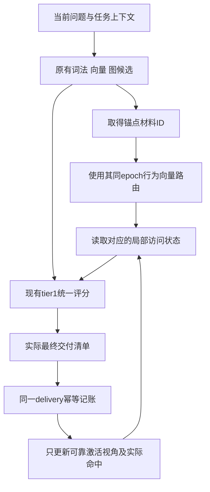
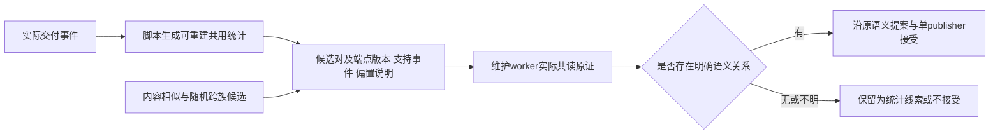

# 多视角访问权重、自动聚类与候选关系

2026-11-17后续决定：本页保留探索过程及算术示例，已不作为现行实施方案。用户按长期普适/简洁/易维护授权选型后，主线统一为[目标架构](../target-architecture.md)的KL-NMF、同快照因子坐标与可重放局部访问；替代本页独立聚类/稳定视角ID、独立m状态、精确版本训练及birth锚点的旧建议。实施顺序只见[现行计划](../plan.md)，本页所述“推荐”仅属形成时的候选。

2026-11-17。研究候选，未实施、未切换当前全项目降权规则。用户希望每份材料按不同视角拥有不同系数，由脚本根据共同交付等信息迭代学习，缓解任务切换，并向建图worker推荐潜在关系。后续澄清聚类主输入应是只由历史共同交付学习的隐式行为向量；据此推荐“行为向量→视角映射→局部事件钟”，先做影子统计。内容／查询embedding不参与行为向量的初始化或训练，既有内容检索保留独立入口；共同交付用于发现候选，不直接接受语义边。

后续[论文与项目核对](behavior-literature-20261117.md)校正实施顺序和训练合同：先建立透明行为邻域与一个低维模型的比较，再按实际混合问题加入任务侧多兴趣状态；局部钟另作策略对照，不能据其算术性质宣布完整检索链不遗忘。以下为目标架构，非必须一次建设全部模块的顺序。

## 每材料保存的核心对象：纯行为向量

每个可交付材料版本`(id, knowledge_revision)`保存`z_i ∈ R^d`，例如64个float32约256字节，仅为维数示例，不含索引／元数据成本。它描述“这个版本在使用历史中与哪些材料共同出现”，不读取标题、正文、内容embedding、问题向量或语义主题。冷启动无行为证据时为unknown，不能用内容embedding填充成貌似已学得的行为向量。

训练原始事实仍是`delivery_id → 精确版本集合`，向量是可重建的压缩表示。最小附带字段为`model_epoch`、算法／参数、训练事件游标、支持事件数／独立episode数及置信度。向量维度通常没有固定业务含义；z_i、由它聚类得到的视角归属m_ik、以及h/L/G等访问状态分别维护，不能把第几维直接当成一个稳定专家，也不能把向量长度当作重要性。

两条可比较的具体训练路线：

| 方法 | 输入与计算 | 每材料最后保存什么 |
| --- | --- | --- |
| [Item2Vec](https://arxiv.org/abs/1603.04259)式无序篮子训练 | 每次交付是一组材料ID；篮内共用对作训练信号，按包大小／流行度调整贡献；噪声分布属于对比目标，不是真实不相关标签 | 先用论文输入向量u_i导出；训练有上下文参数v_i，求和／拼接另作试验，不混称同一向量 |
| 事件×材料矩阵加权分解 | 可用低秩重建作透明基线；若采用隐式ALS，分开二值偏好p和置信度c，按其实际目标／库接口建矩阵 | 材料因子作为z_i；包归一化质量不直接当confidence，未观察项的弱约束不冒充真实不相关 |

两者均可由脚本数值优化，不需要LLM分析每次降权。内容不相近但经常共同使用的材料可能在行为空间靠近；替代材料即使文本相似也不保证如此，间接共同邻居也可产生接近。几何关系描述使用结构，不等于语义相似或可互换。

自然语言问题不能直接与纯行为z_i做同空间余弦。入口可沿原词法／内容检索取得锚点材料，再用这些锚点在同一epoch的z_i形成行为查询或视角路由。内容负责找入口，不能混入z_i的构造。新材料无z_i时继续保留基础检索机会。缺query/context不妨碍构造已有共同交付矩阵，但会限制任务解释、入口路由与效果评估。

约22行事件矩阵的秩最多22，64维仅为存储举例，不能推出已学得64种用途；这不是所有SGNS目标的维数定理。还须测当前可交付版本的行为覆盖与版本碎片化。严格分版与稳定材料身份聚合可独立对照，访问奖励／语义证据继续按精确版本；不因同UUID就自动继承旧向量或hits。

## 现行基础与需要改变的规则

当前0.16按知识精确版本记录最终交付，非空交付推进全局G；`S=8(1+hits)`、`w=S/(S+G-L)`。没有时间衰减，tier1参考访问线索后给一次综合分，rank不再加权。接口见`memory/access.py`，验收与局限见[历史／访问结果](../../../archive/20261112-usage-rectification/history-access-result.md)及[限定对照](../../../archive/20261112-usage-rectification/acceptance-result.md#访问线索的限定对照)。

旧研究已认识跨任务干扰，也讨论过用途匹配`r+δwc`，但简化代理未显示稳定额外收益；参见[旧研究](../../../archive/20261112-usage-rectification/research/access-only-weights-20261112.md#限制访问偏好干扰的候选2026-11-12)。该方法仍依赖单个全局w，不能保证B在长段A工作后保留偏好。

新增多个系数仍不够：若全部跟随同一个G下降，问题仍在。推荐将新策略改为“本次可靠激活的视角内发生竞争与降权”。这会改变此前选定的全项目统一降权规则，应作为新策略版本评估，不能称为现行规则的小修复。

研究开始时只读元数据观察到21条delivery，event连续1—21、均非空；15条context为空，其余6条键不统一，未形成query／曝光／结果合同。现有数据能重放共同交付，不能可靠重建任务路由、判断未曝光材料无用或证明任务切换收益。本研究自身后续正常检索交付另行记账，不混入这个21条快照。

## 三种方案

| 方案 | 脚本保存／计算 | 适用性与限制 |
| --- | --- | --- |
| 固定或已有主题入口＋局部钟 | 稳定视角ID、少量路由原型、稀疏材料—视角状态 | 最易解释与验证；新增视角可由脚本提议，初期边界需稳定 |
| 行为向量＋共同交付软聚类 | 仅从交付ID集合学习z_i，再生成允许重叠的视角归属 | 目标候选；先验证邻域基线与z的附加价值，再按需增加视角；内容入口独立，冷启动保持unknown |
| 每材料保存多个用途锚点 | 当前问题与各锚点的核相似度，累计匹配事件质量 | 无须公共簇，但最坏需检查全部锚点；近似索引漏匹配会改变衰减语义，作为后续对照 |

借用[MoE的门控混合思想](https://www.cs.toronto.edu/~hinton/absps/hme.pdf)，每个“专家”在这里是一组统计状态，不必训练多个LLM。共同交付组织与[item-based协同过滤](https://www.ra.ethz.ch/CDstore/www10/papers/519/)有相近基础；[在线主题学习](https://proceedings.neurips.cc/paper_files/paper/2010/hash/71f6278d140af599e06ad9bf1ba03cb0-Abstract.html)提供迭代学习的算法参考，不能据论文规模或收益推断本项目效果。

## 推荐的状态与更新

材料身份保留`id + knowledge_revision`。对视角k维护局部事件钟G_k；对有已知关联的版本i维护：

- m_ik：行为向量到视角的映射及置信度；一份通用材料可同时关联多个视角，不强制沿k归一化。
- h_ik、L_ik：该视角下实际交付次数和最后命中的局部钟。
- b_ik：第一次建立该关联时的出生锚点；未命中时L取b。缺少关联的材料为unknown，不能按低价值处理。

第一版优先高置信单视角：非空实际交付时，激活k的G_k加1，只强化本次在该视角实际交付的版本；其他已有视角钟不变。

```text
S_ik = 8 × (1 + h_ik)
u_ik = S_ik / (S_ik + G_k − L_ik)
交付命中：h_ik += 1，L_ik = G_k
```

未交付材料不逐条写库，下次读取按G_k懒算。8仅复用当前参数作为对照起点，不是新方案最优常数。关联可稀疏保存，每材料保留少量有效视角；新版本自己的hits从基线开始，不把旧版命中自动迁到新版。

若连续做A时B的路由质量严格为0，则G_B不变，B中的u不下降。算术示例：B此前交付一次、S=16，此后100次纯A，全局钟下B为0.1379，隔离局部钟下仍为1。若路由每次偷偷给B分配0.01，则B变0.9412；10,000次后降到0.1379。因此全量softmax的小尾巴只能减缓干扰，不能保证隔离。此例只验证坐标性质，不代表真实检索提升；脚本原证选留于`artifacts/runs/20261117-contextual-memory/`。

真正混合问题可在后续采用少数激活视角，`G_k += r_tk`，且非激活项严格为0。材料的奖励责任应结合r_tk与m_ik确定，不能把混合清单中每份A资料都奖励到B。低置信或缺少归属时先返回中性／unknown线索，不推进不可靠的专属钟；这会漏计一部分竞争历史，是首版明确取舍。门控在看最终清单前根据问题和当前目标确定，不能事后只从已选结果推断任务。



查询时可给出关联强度a_i(q)=Σg_k(q)m_ik，以及条件偏好`u_i(q)=Σg_k m_ik u_ik / Σg_k m_ik`；分母为0返回unknown，同时保留置信度。它们是辅助特征，不是相关性分，也不作硬过滤。新策略下旧全局w只作对照／诊断，不能再强制乘到条件偏好上，否则A对B的惩罚重新出现。全局／陌生问题通道应保留原相关性候选和中性访问提示。

局部状态一次d条交付、k个激活视角约需O(kd+k)写入；m个候选约O(mk)提示读取，聚类开销另计。初版k很小，不额外派“调权agent”，rank继续只按tier1最终综合分排序、去重和预算。

## 自动聚类与视角漂移

建议按新增交付事件批量运行脚本，不按日历时间衰减、不在每次检索扫描全库。行为学习只读交付ID集合；既有兼容内容向量只服务独立检索入口，不复用成行为向量。纯literal入口也可以产生锚点；锚点不足时保持行为路由未知，不强制新增模型调用。

1. 从归一化交付篮子学习z_i，再在同一行为空间中聚类，产生视角中心与重叠归属。主题名只用于展示，不要求每次调用AI取名，也不能把自动取名反向当作行为训练特征。
2. 共同交付作为超边保存，支持Item2Vec或事件—材料矩阵分解及后续聚类。未共同交付可能源于未曝光或预算，不是已证不相关；纯行为数据也继承原检索策略的选择偏置。研究开始时21个事件可核训练链与稀疏性，不足以证明向量或复杂路由可靠。
3. 多视角需容纳主题与用途差异：同一材料在“设计”“排障”“历史复盘”中可以有不同偏好，主题相似不等于用途相同。第一版先用一个视角族，避免构造全部主题×用途组合。

当前任务／query侧也可由多个锚点medoid或session邻域构成临时兴趣状态，材料仍保留单个z。先与单一加权平均比较；不要把多兴趣论文中的用户状态直接当成材料多向量，更不能把临时head编号当稳定视角ID。跨delivery有真实事件顺序，篮内仍无序。

成员归属、视角路由和条件访问是三个不同对象。第一版冻结活跃视角ID及原型；脚本可更新已证关联、提出新簇，聚类大幅调整先留在影子版本。A内增加证据不能通过强制归一化把B归属挤掉。

隔离保证以固定的路由／归属版本为条件；即使局部钟未动，重新估计路由或归属也可能改变最终偏好。这类模型变更应独立比较，不能用局部钟算术性质代替整条检索链的保证。

表示模型本身也可能遗忘：只用A持续训练时，B可能被噪声对照、频次权重或共享结构更新影响。首阶段比较冻结epoch／批量重建与episode平衡或旧事件回放，不直接每次delivery增量微调；访问计数仍如实记录，不随训练抽样改写。A—B—大量A—再问B时要联合看B召回、排名和关键证据。

行为向量重训可能旋转或重排整个坐标系；同一维数不等于同一空间。拆簇、并簇或显著改变原型必须建立新epoch／ID，保留旧状态供追溯。首版新条件状态中性初始化，不相加旧钟、不把旧年龄直接搬到新坐标；将来若重放历史重建，须依完整问题上下文明确重算并标新策略，不宣称无损继承。离线评估同样只用训练截点前的信息，不能拿未来聚类解释过去成绩。

## 共同交付到候选图边

一次最终交付D_t是一条超边。存超边关联只需O(|D_t|)，不必立即把每份大清单展开成团。需要派生材料对时，对d≥2的包可给每个无序对增量`2/[d(d−1)]`，使每包总配对质量为1；若展开全部配对，成本仍是O(d²)，应批量、有界处理或明确采用采样近似。

可用归一化共用、平滑lift／正PMI、最小支持度和支持度收缩排序候选；概率分母与样本单位须一致，保留原始次数。还应报告独立任务支持数，避免同一工作反复检索被误当成多次独立印证；流行背景材料需要边际频率校正，不能只按共同次数排。任务去重用于关联估计，不悄悄改变实际交付的访问事件口径。

同一来源的摘要、章节和原文块常共同交付，应沿已有parent／source_version或已确认来源族聚合、标记结构重复，避免把它们当作多份独立支持。精确交付清单仍保留，访问强化仍按原表示版本，不因统计聚合自动传播到父子或其他表示；已知结构边也不应占满“新关系”候选预算。



统计图只能断言“曾共同使用”。支持、反驳、替代、因果和依赖关系仍由AI共读判断；共用事件不能作为这些语义边的原文依据。候选可优先含“有足够独立支持、文字相似度却不高”的桥接对，帮助发现跨域联系；不能只推荐同主题近邻。

按既定维护预算只推荐少量新增候选，派生统计对的数量不等于必须完成的语义工单数。先测误报率、独有关系发现和实际共读成本，避免把共现图再次扩大成新的必清积压。

## 反馈偏置与最小记录合同

旧检索策略决定哪些内容有机会被选中，选中内容又成为聚类训练数据，可能形成自强化；[相关研究](https://arxiv.org/abs/1710.11214)用模拟说明这种算法混杂风险，不证明本系统已经发生同等损害。未被曝光不能判无用，共交付预测准确也不等于业务检索更好。

新增观察合同建议包括：实际delivery_id／精确版本清单、独立工作episode标识、query/context的本地引用或紧凑表示、scope／预算、进入筛选上下文的候选和最终分数、策略／路由／聚类版本；明确可选的业务成功／遗漏反馈。原问题不必复制到多处，不能把thread_id当作始终不变的任务。没有已知曝光概率不能宣称离线因果提升，必要时另设计受控探索。

当前重复delivery只核清单一致，不能假定重试补context会改变旧事件。新策略须在第一次接受时固定路由／上下文包及版本，同ID重试幂等；改变语境包时明确冲突，不能换ID重复强化。旧缺字段为unknown，不从最终结果反推成已观察的真实任务。主交付事实与派生统计分开，后者由事件游标重建，不额外引入AI判断或整库重复写入。

访问、归属、候选图均不能复活stale／retired知识，不能继承旧版本hits，也不能自动接受语义等价。新版本可获得待核的归属先验。新统计、原型与候选边同样可能泄露私有联系，须沿精确来源／端点保存private，缺标不等于公开；各项目数据仍局部独立。

## 与现计划结合及验证顺序

| 现有／待选能力 | 此方案的关系 |
| --- | --- |
| 已完成M2、C1／C2、E与版本发布链 | 继续复用，不重新声明完成或重复计收益；路由／聚类版本进入必要交接 |
| 来源族 | 解决出处与多表示；共用簇描述用途，不能据共用认定同源或重复 |
| 全域地图 | AI负责可解释主题入口；统计群只提供线索，不替代真实阅读或主动提示验收 |
| 语义提案编译 | 可承接带精确版本的候选关系；程序自动引用，AI仍选择语义与依据 |
| 维护分组 | 共用群可建议共读范围，仍须核共享图写目标；满队策略源于既有用户要求，本轮不改 |

旧计划曾退出独立“当前理解”与社区聚类平台。这里先建设可删重建的访问派生统计，不另立人工维护的语义真相源；若以后扩为独立主题知识层，应重新评估退出理由，不借本研究默默恢复旧架构。

推荐：补记录和数据诊断后，先比较频次／session／共用邻域与一个纯行为低维模型，再按混合需求加入任务侧多兴趣；局部钟保持独立对照，自动归属／候选边影子运行，有证据后有限启用。当前全局v1留作基线，新策略未选定前不改默认。新策略下低置信有效缺省要明示；缺必需上下文包属于调用错误，不能静默回退掩盖缺失。

验证分两条：固定候选池比较评分偏好，端到端等预算比较新候选发现。按时间和独立任务切分数据、冻结语料版本／预算／模型／训练截点，覆盖A长段→B、A/B交替、混合问题、通用材料、冷启动、大清单、旧证据、空交付和cluster迁移。保留无访问提示、现全局权重、局部钟及混合聚类几个消融；评价关键低频证据、当前适用性、错误／过期事实、实际任务结果及全队用量。只以共同交付作标签不能验收业务收益。

本轮只进行了源码／历史和主文献核对、元数据观察、局部钟算术例子；未训练聚类或为聚类另行编码资料，历史检索仍沿既有入口使用现有服务。未实施schema或访问策略、未接受图边，也没有真实检索收益结论。任务brief已执行，automatic预检复现已知SQLite14后自清理，独立owner=null；未派维护作者、未恢复外部项目维护。
