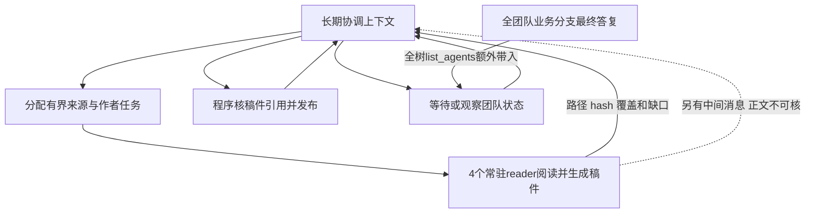
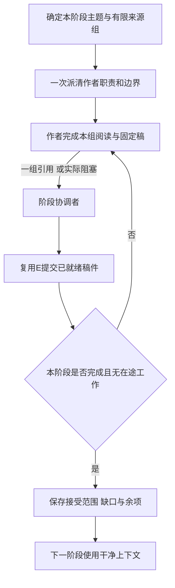

# 协调者与 reader 的实际通信

2026-11-16。按用户要求继续调查新项目长维护轮，重点是协调者实际收到的信息、派工粒度和组织形态。观察版本为0.15.0；本轮仅研究和细化待选计划，没有改变产品、模型配置或外部项目。

## 结论

主要问题是一个长期协调上下文承接了数百次小范围派工、交付、发布和状态观察。完成报告本身已经紧凑；只继续要求“短一点”，不足以解决本例。另有明确的全团队状态查询污染，以及交稿后修改文件造成的真实返工。

不能把全部开销视为无效：本轮确有355个成功接受批次，也有作者修稿、来源版本和发布错误需要处理。中间消息正文不可见，尚不能证明它们都在重复报告。

## 范围与可见性

定点读取协调者 `01a1df7d-9ce9-7a02-b9f5-250113444203` 及其4个 reader 的本机日志；协调者为Terra/ultra，reader均为Luna/max、`fork_turns=none`。协调者单个turn由2026-11-15 21:55持续至次日04:53左右（北京时间）。来源路径、原日志行号、抽取脚本及统计选留于 `artifacts/runs/20261116-coordinator-communication/`，原日志保留在本机Codex sessions。没有读取或推断隐藏推理。

接收日志的FINAL正文可读，普通MESSAGE正文以加密内容保存；发送端对应 `send_message.arguments.message` 同样加密。4个spawn、392个followup及46个协调者send的任务正文也不可直接核实。加密是本轮取证的可见性限制，不表示模型当时没收到正文；密文长度不能当作明文、上下文或token成本。

## 协调者收到了什么

| 通道 | 实际可核内容 | 规模与边界 |
| --- | --- | --- |
| reader最终交付 | 稿件路径、SHA256、assignment／来源范围、覆盖／缺口／错误、尚未apply等说明 | 387条，正文合计199,542字符，平均约516字符；全部与对应reader最终答复逐字相同 |
| reader中间通信 | 发送人、接收人、时间、事件类型可核；正文不可读 | 368条；不能断言是重复完成、有效进度或请求帮助 |
| root通信 | 启动和后续控制消息的路由可核；正文不可读 | 9条；不以密文推断业务要求 |
| 执行工具 | 启动prompt／skill、prepare／发布输出、回执、错误及源码阅读 | 565次exec，模型可见返回约536,956字符；不是都在读取稿件 |
| 团队列表 | 全树agent状态及completed条目的完整最终答复 | 24次调用，约94,795字符；含已收到的reader答复及无关业务分支正文 |
| 等待工具 | 超时或有更新的摘要 | 614次，其中351次超时；此通道未重复搬运完整final正文 |

典型成功交付可概括为：`draft=<固定文件>; sha256=<hash>; assignment=<范围>; coverage=<行段>; gaps/errors=none; not applied`。这是一份可提交的引用，不是把全部作者草稿发回协调者；reader本地commentary也不等于传给协调者的消息。

最终交付正文中位465字符，P95为1,113，最大2,038。reader本地另有395条可见commentary，不能冒充发给协调者的MESSAGE；本次未见把reader全部本地工具轨迹自动回传协调者的证据。

全树列表是另一个真实的信息入口：22次成功返回包含全树13个agent，completed正文共138段／70,312字符。其中40段／17,893字符来自自有reader，全部重复已有FINAL；另98段／52,419字符来自业务其他分支。协调者观察自己的维护分支时，没有必要反复带入这些业务答复。列表返回的明文量可核，但不能据此精确分摊累计token或费用。

程序读取稿件文件不等于模型读取全文。已核的主体路径是写引用后直接E发布，模型收到约700字符结果；只找到一次完整 `batch.json` 回读，其余稿件读取主要是修复所需的范围、ID、摘要或依据投影。不能将565次exec解释为565次把完整草稿喂给协调者。

## 往返与上下文

| 记录 | 数量 |
| --- | ---: |
| 初始化reader | 4 |
| 后续任务调用 | 392 |
| reader完成报告 | 387 |
| 等待调用／其中超时 | 614／351 |
| 全树列表调用 | 24 |
| 所有工具调用 | 1,649 |
| 去重后的模型响应用量记录 | 1,668 |

后续任务中包含修稿，完成报告也不等于唯一接受批次；不能把这些数字当作不同来源数。既有维护回执的355个成功批次与580个不同来源，仍沿[项目复盘](robotic-arm-review-20261116.md)的统计单位解释。

383/387个完成轮次可解析首次prepare范围：单文件163轮、双文件211轮、三文件9轮。这是实际命令范围，不是加密assignment的原文；文件少并不必然工作小。211条可解析行跨度的final中，101条最大明示跨度不超过20行，也有21条超过500行、最大1,600行；跨度不是总覆盖量。下面两个15行小文件周期确实显示了细交接，大文件反例则不能按同一粒度简单合并。

reader在当前assignment内能自主prepare、读依据／邻居、写稿和校验；但完成后至下一次task_started没有继续执行命令，下一组工作仍依赖协调者再派。问题更接近“有局部自主能力的作者被按很小的范围反复调度”，不能简单归为worker不会工作。

1,668条逐响应用量相加，与turn累计值完全一致：输入410,514,930，其中缓存409,722,368，未缓存792,562；输出342,536，total410,857,466。平均每响应输入246,112，输入中位数261,867.5。99.81%说明大量旧上下文得到了缓存，不直接证明缓存失效或对应费用大小。

本例放大的量是“响应次数×当次上下文”。首次输入20,775；第870条响应到450,526后发生一次压缩，下一条降至24,493；此后798条响应又累积至400,548。压缩有即时效果，但继续用同一组织方式推进，历史会重新增长。不能通过降低缓存占比验收整改，也不能把4.1亿累计输入描述为一次收到4.1亿新内容。

## 具体过程

以下时间均为UTC，L为协调者原日志一基行号；可用选留索引定点复核，无需重新扫描全盘。

| 片段 | 实际过程 | 说明 |
| --- | --- | --- |
| 启动13:55 | L16取得角色prompt，返回13,090字符；L23读skill和receipt返回38,728字符并被截断；L57又以多关键词及长上下文读取skill，返回38,189字符 | 必要合同读取叠加大段重复；不能把截断的receipt称作完整看完。另一次35,258字符源码阅读属于实际来源亲读，不能一律算浪费 |
| 正常发布后14:37–14:40 | L1433收到731字符FINAL；L1437组合写引用与publish，返回691字符；随后三次30秒等待均超时；L1463无范围过滤地list，返回7,479字符 | E已经有效组合。该list含两份已收reader答复1,299字符，另含5份其他业务答复4,971字符，是明确的重复和无关输入 |
| 必要修复16:44–16:58 | L4539等检查聊天导出与已存knowledge是否相符，报告feedback并交作者修复；L4769定向读取修复摘要，L4777发布；另一稿原文校验拒绝后，L4893新稿、L4895成功 | 应保留原证共读和作者修复，不能把一切往返都裁掉；没有证据表明正常成功都要协调者重做作者理解 |

另有两段完整作者周期：一个15行文件、两个各15行文件。协调者分别在L138–141、L209–212成功发布，随后才在L144、L215收到对应FINAL，继而L147、L232派下一任务。FINAL到达前已有早到MESSAGE，但正文不可读；只能确认先前已有足够的稿件引用可发布，不能声称已还原那个MESSAGE。368次中间发送中335次距作者final不超过15秒，说明双通道常临近，不足以证明正文相同。普通成功可明确一个有效交付入口，避免同一产物多次通知都触发新操作；真正需提前处理的错误继续即时上报。

一次交稿约定失守有直接证据：reader_03于14:50首次交付后又修改同一路径稿件；协调者L1746–1749发布报 `file SHA256 mismatch`。作者本地明文承认交付后改了措辞，随后fresh prepare、另存固定稿、重新交付；L1785–1788于14:51:48发布成功。这是可避免返工，但程序拒绝和返原作者处理是正确的，不应移除hash检查来省往返。

压缩后没有再次全文加载skill；旧模式继续运行仍使上下文重新增长。故“压缩后又大”不能主要归因为一次巨大启动prompt重新注入。

## 对整改方案的影响

E已支持一次传入多个completed引用，按hash校验并由程序freeze／apply；不必为批量发布另建常驻调度层。它压缩发布内部步骤，但不会自动减少几百次作者交接、等待或全树查询。因此，E实际使用和本轮仍有大上下文可以同时成立。

原C1中干净fork、紧凑交付和分支负责已有实际执行，不能再把它们笼统地当作主要新增修法。建议把C1细化为可观察的行为，并将C2落实到安全的阶段边界：

1. **先收窄通信范围。** 只观察自有分支；已有完成事件优先使用，不再全树取其他业务final。普通成功明确单一有效交付入口，无独立工作时使用宿主有界等待，不在每次无变化超时后扫同一状态。中间通信用于实际错误、依赖或需要提前处理的变化；不能因本轮正文不可见就指控现有368条都无用。
2. **交付后文件固定。** 完成消息指向不再修改的稿件与hash；确需修稿就交新文件／新hash。沿原作者处理修复，正常成功不加例行语义审计。程序已经拥有hash／版本／事务检查，不再让协调者逐字段重复审阅。
3. **预派有语义联系的有限来源组。** 作者在声明范围内负责阅读、分块和本组正常修复，给协调者一组固定稿件引用；协调者同次处理已就绪且已决定的操作。避免每个极小文件都要协调者醒来再领下一件。当前可复用多路径prepare与E，不假定已有claim-next队列，也不直接给多个reader共享发布权。更大的范围不能丢原文覆盖、跨来源关系或显式缺口。
4. **在自然阶段结束旧上下文。** 一个主题／来源组完成、所有自有作者及发布终态明确后，保存短交接清单，再启动下一有界阶段。不能只写“适时换上下文”而继续七小时同一循环；不设固定token轮转阈值，不假定新协调者能接管旧agent句柄，始终仅一个dispatcher／publisher。

现行[协调者prompt](../../../../experiments/20261106-basepack/src/basepack/memory/prompts/coordinator.md)的第19–25行已允许有界分配、复用作者、分组发布和已决定步骤组合；[reader prompt](../../../../experiments/20261106-basepack/src/basepack/memory/prompts/reader.md)把作者限制在派定范围，完成后由协调者发布。问题不是缺少所有协作原语，而是实际选取的交接粒度和观察范围。`publish.py`已有多引用发布；“worker自主抢下一任务”没有已证现成API，不能当作零改动能力。

先做通信范围、固定交稿和有界组职责，必要时再做阶段交接；暂不增加完整cycle平台或多层转报代理。模型选择仍按实际判断难度和项目档位，不能只凭total降档。后续沿真实使用观察响应次数、平均输入、全队用量、接受内容和错误／遗漏，防止把工作转给root或少做来源后宣称节省；不新增正式对照试验或监控平台。

## 后续token情景估算

2026-11-16按用户追加问题估算，非整改后实测，也不作为验收百分比。假设接受相同材料、保持模型与必要语义工作；不重复计算已生效E的收益。用量口径为日志累计total，含缓存输入及输出。

补抽4个已知reader日志的用量元数据，3,740个response_id无重复，422条turn_context均为Luna，未见模型切换。合计输入536,543,454，其中缓存527,654,784、未缓存8,888,670；输出2,893,458（包含reasoning output，不能再加一次），total539,436,912。平均每响应输入143,461；32次压缩说明现有reader也已经在长期复用上下文。

| 实施范围 | Terra预计减少 | 从本轮4.11亿降至 |
| --- | --- | --- |
| 只收窄状态／通知，减少短等待 | 5–20% | 约3.29–3.90亿 |
| 再按有限来源组合并交接 | 30–55% | 约1.85–2.88亿 |
| 再落实自然阶段干净交接 | 60–80% | 约0.82–1.64亿 |

依据是 `输入≈响应数×平均输入上下文`。351次30秒超时不能全部删除；仅改60秒等待最多粗略减少约175次超时唤醒，必要完成事件与异常仍在。合组减少派工、交付及发布往返；阶段交接再减少历史长度。以约1,000响应、平均10万输入和约20万输出为中间情景，Terra约1亿，减少约76%；响应数与平均上下文都是规划假设，不是已测效果。85%只宜视作进取边缘，不作主估计。

Luna不需要补做Terra省掉的大量缓存历史，实际新增工作主要是组内安排与关联判断。另一方面，较大阅读组可能增加每响应上下文。中间预算按**持平至增加10%**，即约5.39–5.93亿、增加0–5,394万；敏感性暂看−20%至+20%，可额外预留约1.08亿，不是可证明的最坏上界。若阶段同时采用干净reader，Luna也可能下降；已有32次自动压缩的作用不能重新算成新增收益。

此区间对上下文很敏感：Luna响应数不变时，每次平均多1万输入就是约3,740万增量，约占原total的7%；多2万约增14%。因此有限组应有语义联系与明确结束范围，不能把整个回执塞进一个worker。中间情景下，Terra与这4个Luna合计从约9.50亿降至约6.4–6.9亿，减少约27–33%；这是维护分支两类模型的累计量，不代表其他业务agent或新增root交接开销也已计入。

省掉的预计主要是缓存输入。干净阶段可能重复读取合同，未缓存输入和输出不保证同比下降；本估算不外推费用、订阅额度或耗时。用量元数据与计算假设选留于 `artifacts/runs/20261116-coordinator-communication/usage-estimate/`。

## 本轮检查与余项

实际核对通信可见性、逐字final匹配、工具调用、逐响应与累计用量一致性、压缩前后窗口及现有prompt／发布实现。未解密中间消息，未重新进行语义质量审计，未重跑业务、维护或产品测试。当前只能确认往返形态和具体信息入口，不能承诺某方案节省百分比或证明355批的全部语义质量。

本项目自动维护在语义派工前再次遇到已知Codex SQLite访问失败；已停止并释放本任务自有owner，没有维护子任务或在途发布。研究子任务仅定点读取上述日志，不在外部项目写入。
