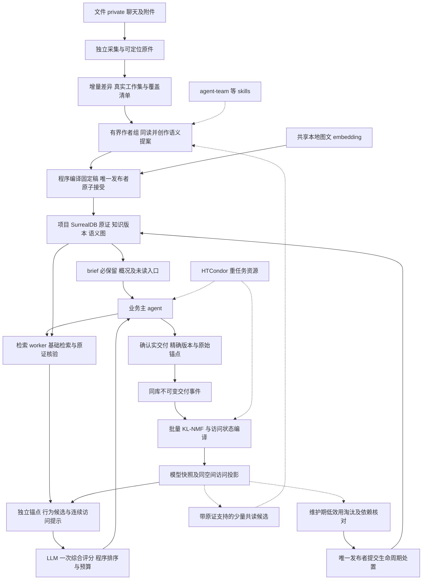
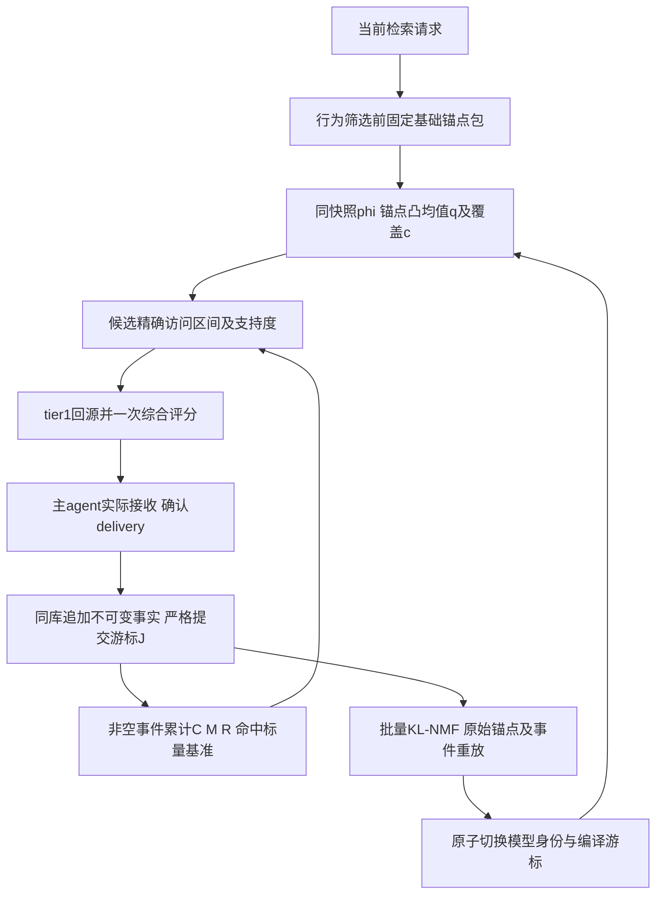

# 记忆系统长期目标架构

2026-11-17按用户允许长期未用方向退出记忆的澄清再修订，尚未实现。用户要求优先普适、结构简洁和未来维护，不以旧接口兼容或旧数据迁移约束设计。本页维护技术决定与逻辑图，[计划](plan.md)维护实施顺序，[进度](progress.md)维护实际状态；项目纲领不改。修改前指当前已部署0.16，见[当前总体图](../../system/diagrams.md)，不是把先前候选当作既有功能。

## 选定路线与取舍

采用**独立采集、有限语义工作集、程序编译提案、同库原子接受，以及由真实交付驱动的纯行为表示与连续相似度机会年龄**。语义知识由订阅agent创作；脚本维护确定性事实和数值状态。项目保留唯一SurrealDB、原证及知识版本、本地共享图文embedding和HTCondor资源边界。

| 决定 | 长期理由与被替代的方案 |
| --- | --- |
| 采集与语义维护独立 | 原件保全失败不冒充成功，也不阻止明确选择的既有原件维护；M2开关不再承担长期架构职责 |
| 作者写语义提案，程序编译唯一固定稿 | UUID、局部引用、依赖版本、private传播和hash由程序维护，减少协调者成为协议修理者 |
| 标准KL-NMF学习纯行为向量 | 复用成熟非负低维求解器；维数是容量，不解释为任务类别，不再导出另一套成员系数 |
| 模糊边界的连续机会年龄 | 默认线性核，独立锚点决定额外增龄，正基线使长期未用方向逐渐退出；不划分类别或截断远处影响 |
| 真正退出默认记忆并回收 | 连续保留度配合绝对低效用退出；来源未变不重建，必要依据保留后回收其余副本，知识不永久积存 |
| 模型快照与可重放访问投影 | 固定空间内累计向量＋每版本少量标量，重训重编译后切换，不迁旧基准 |
| 普通知识的概况与覆盖入口 | 复用已有多层摘要、节点、mandatory和未读指针，不恢复跨源“当前理解”短文及专用同步层 |

保留NMF，是因为非负输出直接适配当前核范围且可复用成熟求解器；Item2Vec的正对/噪声分布、两套导出向量及带符号相似度还需另定合同，不以已取消的视角映射作为排除理由。不先建DEC、ComiRec、GNN或贝叶斯推断平台。它们保留为研究依据，只有明确业务失败需要时再重新决策，不作为预排的建设阶段。NMF也有局部最优、长尾与数据偏置，选择依据是结构和维护职责，不是已证明业务效果更好。

## 修改后的basePack总体逻辑



基础检索保留词法、内容向量和已接受语义图。内容embedding与行为坐标是两种空间，分别有身份；自然语言问题不与行为z直接求语义余弦。mandatory独立交付。当前驻留集合内，访问提示不硬过滤低频或新证据；另行发布的生命周期淘汰会让材料退出默认检索。低使用表示驻留投入下降，不构成事实错误或语义退役；主动提示、摘要和非mandatory地图入口同样参与遗忘，不永久保留整个方向的概要。受限资料、派生模型和工作包沿项目分发边界保管，不因仅含数字或ID就自动可公开。

## 原件、知识与组织

1. **原件先独立保全。** 采集回执记录归属、截点、成功与未知；维护显式消费已有快照。便利入口可组合两者，但分别报告结果。原始聊天、确定性可读展开和业务材料按出处关联；相同字节或明确转换provenance可共享读取/编码，不抹去路径、出处、分类及原件身份。语义重复、替代与重要性仍由共读作者判断。
2. **确定性解析承担定位。** 在格式适配边界生成可反查的文本/图片视图，长单行支持精确行内/字段locator，不要求作者靠整行反复分块。保留原始字节、hash和版本；支持格式逐项交付，不以转换成功宣称语义接受。纯空白覆盖由程序计算。
3. **范围是实际工作集。** 发现范围、当轮纳入的已登记/新增/待处理对象、实际接受覆盖分别表达。全历史建设先形成有依据的粗层入口和未读清单，再按相关性细化；不把每种导出表示都变成独立深读义务。显式全范围维护仍须处置授权范围，不能只做粗层便宣布全文完成。
4. **来源组同时考虑语义和写目标。** 一个作者负责可完成的共读组、智能块、摘要/识图、关系和正常修稿。共享图写目标明确归属；非重叠文件不等于无写冲突。保留低频、新材料及少量随机共读，统计相似度不直接接受语义边。
5. **程序只编译已表达的语义。** 作者声明内容、位置、语义端点及实际依据；程序从固定prepare包解析局部符号、UUID、expected、依赖闭包及分类，生成不可变frozen。不得补造作者没有选择的事实或依据。语义冲突回必要共读作者，机械错误给具体对象/路径/位置，不靠昂贵协调者逐稿重读。
6. **短寿命团队，单一发布责任。** 小组可由单作者完成；复杂组使用协调者，必要时兼唯一publisher。容量是上限，按语义工作量启用人数，替代现行显式维护满队策略。主任务收阶段结果和关键阻塞；宿主执行真实派工、事件等待与取消，程序不能凭空启动订阅agent。仅看自有句柄；每组一次固定交付/回执，同稿FINAL不重做。长任务在自然终态真实换上下文，保留父stop及未明发布保护；不另建常驻调度服务。

## 一个纯行为模型，不建立用途类别

原始事实为幂等`delivery_id → 实交付精确知识版本集合`。训练只投影到稳定逻辑材料ID并在篮内去重，不读取正文、标题、内容embedding、query、曝光、最终排名或访问分数。普通修订、改名和移动保持逻辑ID；拆分、合并或职责断裂由知识维护者建立新ID。用途先验可以跨普通版本学习，命中奖励、回源、适用性与语义边仍钉精确版本；新revision不继承旧hits，stale/retired不得被行为邻域复活。

训练库存取当前驻留逻辑ID，重训排除已淘汰ID；原交付事实保留，重放不改变淘汰处置。过滤后只剩单材料的篮子不提供共用关系；仍以原逻辑篮子大小归一化，避免淘汰一个成员反而给其他成员增加贡献，不把过滤后的相同子集擅自视为新的原始篮子。

相同原始逻辑ID集合聚为篮子b，真实出现次数n_b，大小d_b；仅d_b≥2提供共用结构。选定频率忠实输入与无正则的标准KL目标：

```text
X_bi = 1[i∈b 且 i当前驻留] · n_b / d_b
min A,Z≥0  Σ_bi [X_bi log(X_bi/(AZᵀ)_bi) − X_bi + (AZᵀ)_bi]
```

由`D_KL(nx || ny)=n D_KL(x || y)`，同篮每次质量为1的逐delivery目标可这样聚合：相同篮子的元素权重完全相同、A各行自由缩放且独立、A/Z正则均为0、rank固定时，固定Z的最优目标剖面与全局最优Z集合相同；不承诺初始化、局部解、迭代路径或数值输出相同。撤销旧`log(1+n_b)`默认压缩，它有意降低重复任务贡献且没有本项目证据。过滤后每包有效质量可以小于1；严格聚合只与同一驻留过滤、原d_b权重的逐delivery视图等价。训练聚合始终不压缩真实事件钟或hits。KL零项仍约束重建质量，不代表已曝光负反馈；频率忠实也不消除选择偏差。

采用公开`NMF(solver='mu', beta_loss='kullback-leibler')`，固定初始化、停止条件及实现版本。先将Z的非零列作L2定标并补偿A；无贡献零列明确移除，再将有可靠共用证据的材料行L2归一为`phi_i≥0, ||phi_i||₂=1`。支持度单列；没有不同材料共交付伙伴、零向量或无训练数据时保持unknown/空行为模型，基础检索照常。不能把随机初值或极小非零载荷当已知用途。

r仅是表示维数，运行时没有类别数、类中心、成员系数或类别激活上限。按有限留出用途、邻域稳定性与资源选择容量，具体r及自动选择规则待N3落实；不声称标准NMF自行增删类别。列定标与固定种子也不消除NMF几何非唯一性；相同重建可有不同余弦，重训须把相似度变化纳入验证。

算法原证：[Lee/Seung](https://proceedings.neurips.cc/paper/2000/hash/f9d1152547c0bde01830b7e8bd60024c-Abstract.html)、[scikit-learn公开API](https://scikit-learn.org/stable/modules/generated/sklearn.decomposition.NMF.html)。连续规则的学术依据、反证与四项目源码比较见[专项调研](research/similarity-forgetting-20261117.md)，它不是现成遗忘算法或业务收益证明。

## 连续机会年龄与惰性投影

**定义。** 这是“相近用途的活动经过，但该精确版本没有再被交付”的连续保留政策。长期不用的方向逐渐退出是用户接受的预期行为；无须证明其过时或错误才减少驻留投入。共同交付可能表达互补，落选可能仅因预算或未曝光；不据此写负偏好或事实错误，实际淘汰沿下节独立生命周期合同。只用一套年龄/强度，意味着A命中一份兼用于B的材料，也刷新其整体访问提示；不再保留按用途独立奖励的承诺。

**锚点与混合。** 一个检索请求先固定一个独立基础锚点包，记录精确版本、逻辑ID、基础质量、知识截点及query/episode。固定包与权重在任何行为筛选之前确定，内部补检索不额外造年龄事件，也不从最终选单倒推q。最短实现对包内去重逻辑ID等权；包大小/基础检索规则随策略冻结。mandatory的强制出现不自动成为锚点。多用途按份额平均，基础检索和原证判断仍须保留少数用途证据；平均法不能保证消除通用锚点偏向。

令全部原始锚点权重`alpha_j≥0, Σalpha_j=1`，权重先于剔除unknown向量确定：

```text
c_t = Σ_{j: phi_j known} alpha_j
q_t = Σ_{j: phi_j known} alpha_j phi_j
||q_t||₂ ≤ c_t ≤ 1
```

q不再次L2归一。已知部分的`phi_i·q_t`是加权余弦贡献，不是一个单位query余弦；重新归一会放大混合方向并掩盖缺失质量。空锚点包合法为`q=0,c=0`，缺必填记录或损坏数值仍报错。

**每次实际交付。** 一个tick对应已确认的非空不可变delivery；单材料包正常推进/奖励，空交付、搜索、回读、评分、维护及同delivery_id技术重试不推进。同一episode的不同真实交付分别计数；记录episode供切分，不暗中合包。故改变检索交付粒度也会改变遗忘速度，ε/s以非空交付为单位。

完整核项记作k_it；已知phi时`k_it∈[phi_i·q_t, phi_i·q_t+1−c_t]`，未知phi时为`[0,1]`。每个未交付项增龄`ε+(1−ε)k_it`，`0<ε<1`。实交付版本在本次累计后清零年龄，篮内去重奖励一次，`h_v+=1`、`S_v=s(1+h_v), s>0`；这是真实使用次数，未知q也不取消实际奖励。首次接受进入默认记忆时固定事实交付头J_enter；编译到该截点后确定C_enter与M/R基准，不能借用落后的投影值；h=0、S=s是驻留先验，不冒充命中。未命中版本对检索仍标为使用证据unknown，但生命周期已有有限宽限起点，不因unknown永久驻留。s与ε未选为生产最优值。成熟但仍作为依据被实际交付的材料继续获得刷新；不以文件多久没修改代替未使用。

**少量累计状态。** 设C为已编译非空事件数，J为严格提交游标，两者分开；模型快照sigma内累计：

```text
M_C = Σ_{t≤C} q_t
R_C = Σ_{t≤C} (1−c_t)
```

已知phi的精确版本v以最后实际命中为tau_v；从未命中时用真实C_enter。只存`tau_v, b_v=phi_i·M_tau, r_v=R_tau, h_v`。之后读取候选时：

```text
n = C−tau_v
e_lower = ε n + (1−ε)(phi_i·M_C−b_v)
e_upper = e_lower + (1−ε)(R_C−r_v)
u_v ∈ [ S_v/(S_v+e_upper), S_v/(S_v+e_lower) ]
```

完整覆盖时区间退化为精确年龄；unknown phi且已有进入/命中基准的版本用`e∈[εn,n]`（从未命中时n从C_enter起算）。这是缺证据界；未命中版本的u标明驻留先验，不冒充实用奖励。不以零相似度、下界精确值或低权重冒充unknown；将支持度、区间和编译截点一起交原tier1同次综合评分，rank只排序/去重/预算。无需另建上下界选择器。

进入基准取编译到J_enter时的M/R/C；尚未编译到进入截点时标为待编译，不捏造基准。命中基准取**累计当次事件之后**的M/R/C，故命中项年龄恰为0。固定phi时，这与逐材料逐事件增龄精确等价；每版本不必保存M_tau整向量，也不存全历史前缀表。用float64累计M/R与基准并核必要容差，不承诺浮点逐位相同。

**长期边界。** 即使B与所有A方向正交，n次未再命中后也有`e_B≥εn`、`u_B≤S_B/(S_B+εn)→0`；正交场景半衰事件数是`S_B/ε`。例如S=16、ε=.001时，10万次其他交付后u约.138。ε是最低增龄速度，不是权重下限。ε=0或1只作纯相似/原全局式边界对照；正ε的长期全域遗忘作为目标验收，不再被描述为待消除的任务干扰。线性核为默认推荐，平方/Gaussian连续核及其代价见[选项比较](forgetting-options.md)；不预建多算法平台。

## 事实、重放与模型切换



- **事实先提交。** 同库原子保存delivery及提交游标，记录原始锚点、候选/预算、query/episode、实际使用模型和策略；不引入第二事件服务。重复ID同内容幂等，内容改变明确报错。只记录实际候选范围，不造全库曝光矩阵。
- **投影可明确落后。** 查询一致读取`(sigma,J_compiled,C,M,R,版本基准)`，并披露事实游标与编译游标。以`(sigma,J)`乐观事务顺序推进，竞争/派生失败保留原错、已提交事实及未编译位置，不盲重试或伪称最新。
- **重训后全史重编译。** 新快照冻结训练截点、当前驻留库存、输入/求解器/rank/尺度、支持度、锚点规则和ε/s；用原事件及原始锚点在新phi下重建M/R和所有基准。缺原始锚点的历史保持c=0/unknown，可用于真实共交付训练，不补造上下文。进入/淘汰截点一并重放，已退出条目不因全史训练、投影重建或恢复索引重新进入默认记忆。不迁旧q、局部钟或旧标量基准。
- **原子切换及晚到请求。** 切换绑定新模型和其已编译J，之后处理后续提交；晚到的旧模型请求保留其实际模型，以原始锚点在当前模型下编译，旧版命中不奖励新版。按确认提交顺序计机会，晚确认命中在该位置重置，不回插物理发生时间；切换不得漏账/双奖。
- **回放不等于回测。** 全史重训是在当前模型下重解释历史，可改变旧材料相似度、年龄及排序，不能承诺跨快照单调或无泄漏预测。回测按滚动全局截点及完整episode留出，只用当时已有模型、锚点、语料/版本与候选。

## 从连续降权到实际遗忘

**默认推荐。** 线性模糊核＋绝对低效用退出。模糊边界指材料相关程度和增龄幅度连续，不要求永久类别；实际移除一条记录是离散动作。阈值`0<theta<1`表示继续驻留的最低效用，具体值待实现选择。容量预算可额外限制大小，但仅取top-K不能保证无人再用时记忆自然收缩，不代替绝对退出。平方核/Gaussian与平滑概率淘汰只作[备选](forgetting-options.md)，本轮不同时建设。

1. **真实驻留起点。** 知识版本首次进入默认记忆时，同库固定事实交付头J_enter（不是J_compiled）；只记录进入观察截点，不推进交付钟、不增加hits。顺序编译到J_enter时确定C_enter及M/R基准，投影尚未追到时保留待编译状态；重放也以该事实头定位。以该M/R值初始化基准，使从未用过的材料也会随后续真实交付老化。第一次真实命中后改用命中基准。重训用原进入截点重建，不能重置为年轻。
2. **维护期批处理。** 查询保持只读。维护在一个明确模型/编译截点上，对非mandatory、未获用户明确保留且没有在途/未明发布保护的版本计算u上界；`u_upper<=theta`时发布生命周期淘汰处置。查询可披露投影落后，但淘汰提交须对交付事实头作事务版本守卫，并要求投影已编译到该事实头；同时核当前模型、知识版本及保护状态。有新delivery已入账而未编译、模型或保护变化时拒绝沿旧u淘汰，留本批待重算，不盲重试。淘汰后退出默认检索、brief及普通语义维护工作集，低使用不写成语义错误或被新知识反驳。
3. **长期退出可计算。** 最后基准后不再命中且S有限，则`u_upper<=S/(S+εn)`；在`n>=ceil((S/ε)(1/theta−1))`次后续非空交付后必满足阈值，实际处置等下一次维护。此界同样覆盖unknown与从未命中项。历史巨量hits会让期限很长；实现须披露等待量。若未来要求不依赖历史热度的统一最大等待，再引入有界强度变换；真实hits不改写。
4. **引用根决定回收。** 低效用对象先退出主动记忆；原文/依据/图对象能否物理回收由保留根的可达闭包决定；历史表中的knowledge_version/change.previous正文同样属于回收范围，不能只删当前表又永久保留完整前像。mandatory、尚驻留知识、真实在途请求/未明发布及有限恢复保留点是强保护根；已淘汰对象的互相引用、旧delivery ID清单或淘汰定位记录只是历史定位，不能互相钉住正文永久不删。受保留知识依赖的旧依据可留作不可默认召回的证据副本；其余表示、边、向量、旧模型工件及记忆原文副本可由现有唯一发布者批量回收，不增加第二owner/常驻清理服务。请求保护由检索委托外层在首次search/read之前登记，保护该请求可读的固定知识快照，登记与GC提交采用事务冲突守卫；真实delivery入账或明确无交付终态后才释放。search/read/brief本身仍只读，不明终态不得按超时猜测结束。
5. **防止忘了又重建。** 在来源处置中保存最小forgotten范围/图片、内容版本与原表示版本、策略截点；与语义retired/no_knowledge分开，不依赖已删除表示仍fresh。它表示“已处理并有意淘汰”，不冒充现存知识覆盖。来源正文未变时，发现未覆盖、表示缺失或duplicate依赖失效均尊重该处置；仅private/规则变化同步分类，不重开相同正文。正文实际变化、用户明确重建或业务按需回源才触发重新考虑，普通全范围维护不把全部旧方向立即恢复。
6. **按需重新接受。** 保留业务文件和论文原件，不把本轮记忆策略扩为业务文件删除；独立保全的唯一采集原件、备份沿各自保留职责处理，不按目录名当作可重建副本；被回收的记忆正文/精确历史不再承诺永久回读，读取明确给出已淘汰/不可用及仍有的原件定位。新需求可通过普通文件检索、定点回源重新创作并接受新knowledge_revision；同一逻辑材料可复用ID，旧奖励不继承，不新建驻留epoch注册系统。原始交付元数据不改写。若原件也不存在，诚实保留恢复缺口。

一个方向的细节、非mandatory概况和关系都不再使用时会逐项退出；仍被另一方向依赖的桥接依据有具体保留理由。这是连续材料状态自然演化，不另设“整个方向B”的删除开关。实际删除及恢复能力需随未来实现验证，本轮没有执行任何数据淘汰。

## 状态、规模与完成边界

| 权威/投影 | 保存什么 | 维护者 |
| --- | --- | --- |
| 原件及语义知识 | 来源/知识版本、依据、端点、private、处置覆盖 | 作者与现有单publisher事务链 |
| 不可变观察事实 | 实交付、精确版本、原始锚点、query/episode、实际候选/预算与策略 | 宿主确认，程序幂等记账 |
| 一个模型快照 | 非负phi、参数、支持度、训练截点及工件hash | 数值脚本批量生成 |
| 同空间访问投影 | 模型/编译J、C/M/R、每个驻留精确版本的基准与真实hits | 程序增量编译或重放 |
| 生命周期事实/处置 | 首次进入截点、淘汰原因/范围与内容版本、当前驻留库存 | 现有唯一发布者与来源处置链 |

设N个逻辑材料、V个当前驻留精确版本、r维，单次a个锚点、d个命中、p个候选：构造q及记账`O((a+d+1)r)`，读取访问提示`O(pr)`，当前数值状态`O(Nr+V+r)`；原始事实仍随历史增长。全库精确行为召回可批量`O(Nr)`，不建N×N相似矩阵。ANN若以后用于候选发现，已入选候选的年龄仍用同快照精确点积。

稀疏KL-MU单轮主要约`O(nnz(X)r+(B+N)r)`，数组含`O((B+N)r)`因子；重训和访问重放分别计成本，后者约`O(rΣ(a_t+d_t)+Er)`，E为非空事件数。N=10万、r=32时phi的float32裸数组约12.8 MB；V=10万的四个8字节基准量约3.2 MB，均不含数据库、事件、工件及训练临时空间，未做此规模实测。

不增加cluster表、永久用途ID、成员系数编辑器、跨空间对齐器、当前理解同步缓存或常驻模型agent。大数组按模型打包为少量项目本机工件；权威元数据与事实仍在SurrealDB。重计算按实际规模复用Condor，轻统计直接运行，embedding服务沿既有边界。

验收覆盖冷启动、单/空/重复交付、partial/unknown锚点、连续重叠与正基线长期效应、混合/通用材料、互补证据预算落选、首次进入/从未命中、版本和在途切换。另验证非mandatory概要最终退出、绝对阈值、保护根/无根引用环、回收后精确读取缺口、未变来源不重建与按需新接受。分别固定模型测访问规则、固定规则测表示；数学等价不代替候选发现和实际业务结果。主动提示仍须让主agent看见未知领域的有效入口，不能以压低历史材料权重或更多unknown替代此核心目标。长期收益沿真实使用反馈维护，不新建正式agent团队对照、监控或参数竞赛平台。
