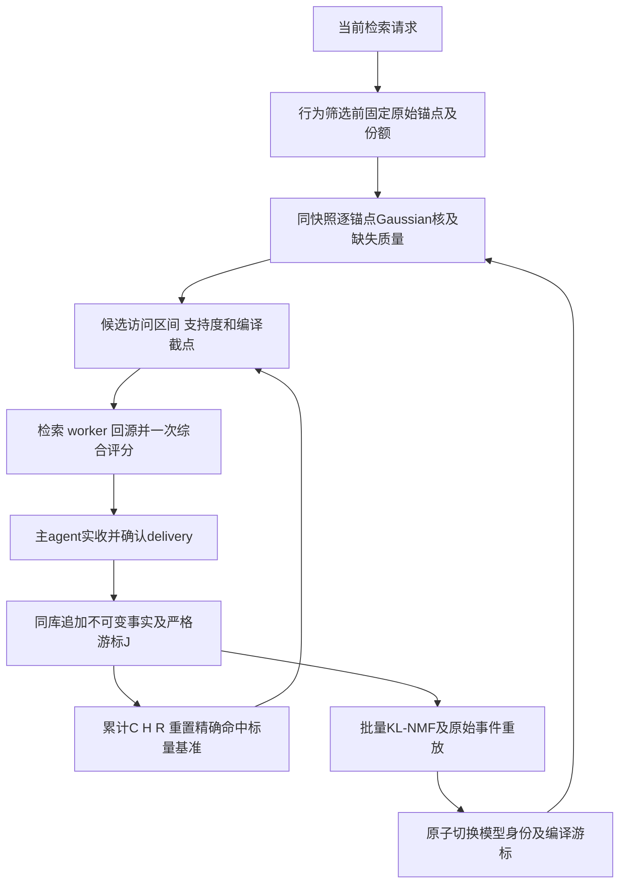

# 记忆系统长期目标架构

2026-11-17按用户决定采用Gaussian连续相似度，长期不用仅降至很低权重，始终保留，不因低权重退出或回收。N0—N4已接入；有限任务池已通过程序、普通安装及纯文件宿主实测，真实维护按小批验证并修复已观察的问题，见[实施结果](implementation-result.md)及[部署合同](../../system/deployment.md)。用户要求优先普适、结构简洁和未来维护，不以旧接口兼容约束设计。本页维护技术合同，[计划](plan.md)维护顺序，[进度](progress.md)维护实际状态；项目纲领不改。前后图以0.16为修改前基线，现行实现说明见[系统图](../../system/diagrams.md)。

维护组织的最新授权以[有限任务池与两段式Terra维护](maintenance-waves.md)为唯一合同：它替代下述既有协作组织中的逐组续派方式，来源、固定版本、唯一发布及恢复边界继续保留。实际安装、真实接受和仍待处置的范围沿进度，不从目标合同或任务提交推定已完成。

## 选定路线与取舍

采用**独立采集、有限语义工作集、程序编译提案、同库原子接受，以及由真实交付驱动的纯行为表示与连续相似度机会年龄**。语义知识由订阅agent创作；脚本维护确定性事实和数值状态。项目保留唯一SurrealDB、原证及知识版本、本地共享图文embedding和HTCondor资源边界。

| 决定 | 长期理由与被替代的方案 |
| --- | --- |
| 采集与语义维护独立 | 原件保全失败不冒充成功，也不阻止明确选择的既有原件维护；M2开关不再承担长期架构职责 |
| 作者写语义提案，程序编译唯一固定稿 | UUID、局部引用、依赖版本、private传播和hash由程序维护，减少协调者成为协议修理者 |
| 标准KL-NMF学习纯行为向量 | 复用成熟非负低维求解器；维数是容量，不解释为任务类别，不再导出另一套成员系数 |
| Gaussian模糊边界的连续机会年龄 | 独立锚点逐项计算Gaussian核再加权；保留正尾与正基线，不划类别或截断远处影响 |
| 很低权重仍可找回 | 不设低效用退出阈值、淘汰状态或记忆GC；低权重知识仍可经基础检索、原证和语义图找到 |
| 模型快照与可重放访问投影 | 固定空间内稀疏锚点质量累计＋每版本少量标量，重训重编译后切换，不迁旧基准 |
| 普通知识的概况与覆盖入口 | 复用已有多层摘要、节点、mandatory和未读指针，不恢复跨源“当前理解”短文及专用同步层 |

保留NMF，是因为非负输出直接适配当前核范围且可复用成熟求解器；Item2Vec的正对/噪声分布、两套导出向量及带符号相似度还需另定合同，不以已取消的视角映射作为排除理由。不先建DEC、ComiRec、GNN或贝叶斯推断平台。它们保留为研究依据，只有明确业务失败需要时再重新决策，不作为预排的建设阶段。NMF也有局部最优、长尾与数据偏置，选择依据是结构和维护职责，不是已证明业务效果更好。

## 修改前后的完整系统逻辑

[两版完整系统图与图例](forgetting-options.md#修改前后的完整系统)使用同一份节点、坐标和连线定义，未改动部分保持相同框图。修改前为已部署0.16，修改后为本页目标；主agent、subagent和代码执行用固定角色颜色，变化块另作标记。[图源说明](diagrams/README.md)维护生成与视觉检查结果。

基础检索保留词法、内容向量和已接受语义图。内容embedding与行为坐标是两种空间，分别有身份；自然语言问题不与行为z直接求语义余弦。mandatory独立交付。访问提示不硬过滤低权重、低频或新证据。低使用降低主动提示的优先程度，不构成事实错误或语义退役；细节、摘要和非mandatory地图入口都可变冷，但正文、版本、依据及检索资格继续保留。受限资料、派生模型和工作包沿项目分发边界保管，不因仅含数字或ID就自动可公开。

## 原件、知识与组织

1. **原件先独立保全。** 采集回执记录归属、截点、成功与未知；维护显式消费已有快照。便利入口可组合两者，但分别报告结果。原始聊天、确定性可读展开和业务材料按出处关联；相同字节或明确转换provenance可共享读取/编码，不抹去路径、出处、分类及原件身份。语义重复、替代与重要性仍由共读作者判断。
2. **确定性解析承担定位。** 在格式适配边界生成可反查的文本/图片视图，长单行支持精确行内/字段locator，不要求作者靠整行反复分块。保留原始字节、hash和版本；支持格式逐项交付，不以转换成功宣称语义接受。纯空白覆盖由程序计算。
3. **范围是实际工作集。** 发现范围、当轮纳入的已登记/新增/待处理对象、实际接受覆盖分别表达。全历史建设先形成有依据的粗层入口和未读清单，再按相关性细化；不把每种导出表示都变成独立深读义务。显式全范围维护仍须处置授权范围，不能只做粗层便宣布全文完成。
4. **来源组同时考虑语义和写目标。** 一个作者负责可完成的共读组、智能块、摘要/识图、关系和正常修稿。共享图写目标明确归属；非重叠文件不等于无写冲突。保留低频、新材料及少量随机共读，统计相似度不直接接受语义边。
5. **程序只编译已表达的语义。** 作者声明内容、位置、语义端点及实际依据；程序从固定prepare包解析局部符号、UUID、expected、依赖闭包及分类，生成不可变frozen。不得补造作者没有选择的事实或依据。语义冲突回必要共读作者，机械错误给具体对象/路径/位置，不靠昂贵协调者逐稿重读。
6. **有限任务池，单一发布责任。** 最新组织按[两段式Terra合同](maintenance-waves.md)：Terra规划有限独立语义任务，固定Luna池自主领取与提交；正常路径中Terra结束规划turn后，由最后正常退队者实际恢复同一身份，第二turn汇总编译并唯一发布。主任务保留真实句柄、恢复名额与stop权限；任务池执行终态、知识接受和维护完成分开。普通成功不逐稿全文重读或额外审计，错误形成有限修复波；依赖前一波新知识的任务留下一波，不建设通用依赖平台或常驻调度服务。

## 一个纯行为模型，不建立用途类别

原始事实为幂等`delivery_id → 实交付精确知识版本集合`。训练只投影到稳定逻辑材料ID并在篮内去重，不读取正文、标题、内容embedding、query、曝光、最终排名或访问分数。普通修订、改名和移动保持逻辑ID；拆分、合并或职责断裂由知识维护者建立新ID。用途先验可以跨普通版本学习，命中奖励、回源、适用性与语义边仍钉精确版本；新revision不继承旧hits，stale/retired不得被行为邻域复活。

训练使用保留的原始逻辑ID篮子，不因访问权重很低而排除ID或裁剪历史。语义上stale/retired的精确版本仍沿已有适用性合同处理；行为表示不改变事实和版本效力。

相同原始逻辑ID集合聚为篮子b，真实出现次数n_b，大小d_b；仅d_b≥2提供共用结构。选定频率忠实输入与无正则的标准KL目标：

```text
X_bi = 1[i∈b] · n_b / d_b
min A,Z≥0  Σ_bi [X_bi log(X_bi/(AZᵀ)_bi) − X_bi + (AZᵀ)_bi]
```

由`D_KL(nx || ny)=n D_KL(x || y)`，同篮每次质量为1的逐delivery目标可这样聚合：相同篮子的元素权重完全相同、A各行自由缩放且独立、A/Z正则均为0、rank固定时，固定Z的最优目标剖面与全局最优Z集合相同；不承诺初始化、局部解、迭代路径或数值输出相同。撤销旧`log(1+n_b)`默认压缩，它有意降低重复任务贡献且没有本项目证据。训练聚合始终不压缩真实事件钟或hits。KL零项仍约束重建质量，不代表已曝光负反馈；频率忠实也不消除选择偏差。

采用公开`NMF(solver='mu', beta_loss='kullback-leibler')`，固定初始化、停止条件及实现版本。先将Z的非零列作L2定标并补偿A；无贡献零列明确移除，再将有可靠共用证据的材料行L2归一为`phi_i≥0, ||phi_i||₂=1`。支持度单列；没有不同材料共交付伙伴、零向量或无训练数据时保持unknown/空行为模型，基础检索照常。不能把随机初值或极小非零载荷当已知用途。

r仅是表示维数，运行时没有类别数、类中心、成员系数或类别激活上限。按有限留出用途、邻域稳定性与资源选择容量，具体r及自动选择规则待N3落实；不声称标准NMF自行增删类别。列定标与固定种子也不消除NMF几何非唯一性；相同重建可有不同余弦，重训须把相似度变化纳入验证。

算法原证：[Lee/Seung](https://proceedings.neurips.cc/paper/2000/hash/f9d1152547c0bde01830b7e8bd60024c-Abstract.html)、[scikit-learn公开API](https://scikit-learn.org/stable/modules/generated/sklearn.decomposition.NMF.html)。连续规则的学术依据、反证与四项目源码比较见[专项调研](research/similarity-forgetting-20261117.md)，它不是现成遗忘算法或业务收益证明。

## Gaussian连续机会年龄与惰性投影

**定义。** 这是“相关用途的活动经过，但该精确版本没有再被交付”的连续降权政策。长期做A使B也缓慢降权是用户接受的目标；共同交付可能表达互补，落选可能仅因预算或未曝光，不据此写负偏好、事实错误或淘汰处置。只用一套年龄/强度，意味着A命中一份兼用于B的材料，也刷新其整体访问提示；不保留按用途独立奖励的承诺。

**锚点与混合。** 一个检索请求先固定独立基础锚点包，记录精确版本、逻辑ID、基础质量、知识截点及query/episode。原始包和份额在任何行为筛选之前确定，内部补检索不另造年龄事件，也不从最终选单倒推锚点。最短实现对去重逻辑ID等权；包大小/检索规则随策略冻结。mandatory的强制出现不自动成为锚点。基础检索和原证判断须保留少数用途证据，平均法不能保证消除通用锚点偏向。

非空原始包满足alpha_j≥0、Σalpha_j=1；unknown向量移出计算后不重归一。空包合法，其已知质量c=0。对同一冻结模型内的非负单位向量：

```text
rho_ij = phi_i · phi_j, 0 ≤ rho_ij ≤ 1
K_beta(i,j) = exp(−||phi_i−phi_j||²/(2 beta))
            = exp(−(1−rho_ij)/beta), beta > 0
c_t = Σ_{j: phi_j known} alpha_tj
l_it = Σ_{j: phi_j known} alpha_tj K_beta(i,j)
已知phi_i时 k_it ∈ [l_it, l_it+1−c_t]
未知phi_i时 k_it ∈ [0,1]
```

beta是带宽平方，对应官方[RBF核](https://scikit-learn.org/stable/modules/generated/sklearn.metrics.pairwise.rbf_kernel.html)的gamma=1/(2 beta)。逐锚点计算核后取份额平均，不是Gaussian(平均向量)，也不对平均向量重新单位化。unknown项使用保守[0,1]界；它尚无可靠几何坐标，不凭非负单位向量的正尾替它补造精确影响。空包同样保持缺证据区间，不当作已知零相似度；缺必填记录或损坏数值直接报错。

**每次实际交付。** 一个tick对应已确认非空不可变delivery；单材料包正常推进/奖励，空交付、搜索、回读、评分、维护及同delivery_id技术重试不推进。同episode的不同真实交付分别计数；记录episode供切分，不暗中合包。改变交付粒度会改变降权速度，ε/s以非空交付为单位。

每个未交付项增龄`ε+(1−ε)k_it`，0<ε<1。实交付精确版本在本次累计后清零年龄，篮内去重奖励一次，`h_v+=1`、`S_v=s(1+h_v), s>0`；未知锚点不取消实际奖励。首次接受时固定事实交付头J_enter，编译到该头后才确定C_enter及H/R基准；h=0、S=s是接受先验，不冒充命中。不能借用落后投影的值或在重训时把旧材料重新变年轻。成熟但仍作为依据实交付的材料继续刷新，不以文件未修改代替未使用。

**精确累计状态。** C为已编译非空事件数，J为严格提交游标，两者分开。一个模型快照sigma内，H按已知锚点的逻辑ID存稀疏累计质量，R存缺失质量：

```text
H_j(C) = Σ_{t≤C, j known anchor in t} alpha_tj
R_C = Σ_{t≤C} (1−c_t)
g_i(H_C) = Σ_{j: H_j(C)>0} H_j(C) K_beta(i,j)
```

已知phi的精确版本v以最后命中为tau_v；从未命中时用真实C_enter。只存`tau_v, b_v=g_i(H_tau), r_v=R_tau, h_v`。候选读取时：

```text
n = C−tau_v
e_lower = ε n + (1−ε)(g_i(H_C)−b_v)
e_upper = e_lower + (1−ε)(R_C−r_v)
u_v ∈ [ S_v/(S_v+e_upper), S_v/(S_v+e_lower) ]
```

有完整已知覆盖时区间退化为精确年龄；unknown phi用`e∈[εn,n]`，never-hit的n从C_enter起算。未命中版本的u明确标为先验。支持度、区间和编译截点同交检索 worker 一次综合评分，rank只排序/去重/预算。不把下界当精确值，不另建上下界选择agent。

首次接受基准取编译到J_enter时的H/R/C，尚未追到时为待编译。命中基准取**累计当次事件之后**的H/R/C，故年龄恰为0。固定phi时，H质量累计与逐项逐事件增龄在实数代数下等价；每版本无需保存H_tau全向量或历史前缀表。float64累计并核必要容差，不承诺浮点逐位相同。Gaussian不能精确替换成上一版r维M累计；本轮也不偷偷引入RFF近似或相似度截断。

**长期影响。** 若B与各已知A锚点正交，每次完整覆盖的增龄为`δ=ε+(1−ε)exp(−1/beta)`，未再命中后的权重为`S/(S+δn)`，半衰事件数为S/δ。一般缺证据情形仍有`e≥εn`、`u≤S/(S+εn)→0`。ε是最低增龄速度，不是权重下限；Gaussian正尾一般使实际最低速度更大。beta越大，远方向影响越强。ε、beta、s均未选成生产最优值；ε=0/1仅作边界对照。

## 事实、重放与模型切换



- **事实先提交。** 同库原子保存delivery和提交游标，记录原始锚点、候选/预算、query/episode、实际模型和策略；不加第二事件服务。同ID同内容幂等，内容变化报错。仅记录实际候选范围，不造全库曝光矩阵。首次接受截点是原知识接受的附属事实，不是新的交付。
- **投影可明确落后。** 一致读取`(sigma,J_compiled,C,H,R,版本基准)`，披露事实头与编译游标。以(sigma,J)乐观事务顺序推进；派生失败保留原错、已提交事实及未编译位置，不盲重试或伪称最新。
- **重训后全史重编译。** 冻结训练截点、ID输入、求解器/rank/尺度、支持度、锚点规则、ε/beta/s及工件hash；用原始事件和锚点在新phi下重建H/R及基准。首次接受截点一并重放。缺原始锚点的历史保持c=0/unknown，可训练真实共交付，不补造上下文。不按低权重过滤训练ID，不迁旧核值、旧M或旧标量基准。
- **原子切换与晚到请求。** 切换绑定新模型及已编译J；晚到旧模型请求保留其实际模型，再以原始锚点在当前模型编译，旧版命中不奖新版。按确认提交顺序计机会，晚确认在该位置重置，不回插物理时间，不漏账/双奖。
- **回放不等于回测。** 全史重训在当前模型下重解释历史，可改变旧相似度、年龄与排序，不承诺跨快照单调。回测按滚动全局截点和完整episode留出，只用当时已有模型、锚点、语料/版本及候选。

## 很低权重仍持续保留

有限正强度、有限事件数下数学权重u>0，长期未用时可趋近0，不设人为正下限。低权重不触发退出默认检索、正文/图/向量删除、训练库存过滤、forgotten状态或记忆GC；上一版这些流程全部撤下，为GC新增的请求保护登记也不再需要。已有发布owner、stop及未明发布保护继续沿原职责。

所有保留材料仍可经词法、内容向量、语义图和精确原证定位找到。检索 worker 结合任务、证据及访问区间决定本次交付；正常检索相关性/上下文预算可能不选中某条材料，但没有基于u的硬淘汰阈值或冷区。非mandatory摘要/地图入口可降低主动提示优先程度，未出现在本次brief不等于退出系统；mandatory继续独立交付。重新实际交付就刷新该精确版本，无须重新接受或恢复副本。

低权重保留意味着存储、版本历史和索引不会因遗忘自动缩小；维护是否深读仍按变化、覆盖和实际工作量决定，不给每条低权重记录额外创建维护任务。语义纠错、来源删除、stale/retired及用户明确删除继续沿各自既有合同处理，不由访问权重推断。

## 状态、规模与完成边界

| 权威/投影 | 保存什么 | 维护者 |
| --- | --- | --- |
| 原件及语义知识 | 来源/知识版本、依据、端点、private、覆盖与首次接受事实头 | 作者与现有单publisher事务链 |
| 不可变观察事实 | 实交付、精确版本、原始锚点、query/episode、实际候选/预算与策略 | 宿主确认，程序幂等记账 |
| 一个模型快照 | 非负phi、参数、支持度、训练截点及工件hash | 数值脚本批量生成 |
| 同空间访问投影 | 模型/编译J、C/H/R、每精确版本基准及真实hits | 程序增量编译或重放 |

设N个逻辑材料、V个保留精确版本、r维、K≤N个具有非零累计质量的已知锚点ID，单次a个锚点、d个精确命中、p个候选。H/R更新O(a+1)；精确重置命中基准为O(dKr)，首次接受m个版本形成基准为O(mKr)，候选访问提示O(pKr)，未知向量项只需标量界。当前状态O(Nr+K+V)，原始事实随历史增长。按批/分块计算核和累加，不存N×N相似矩阵；K可接近N，因此不能沿用线性核O(pr)的成本承诺。按当前a个锚点做全库精确行为候选发现约O(Nar)，与历史访问年龄查询是两件事。

稀疏KL-MU单轮主要约O(nnz(X)r+(B+N)r)，因子数组O((B+N)r)。T条事实顺序重放约O(T+Σ_t[a_t+d_t K_t r]+Σ_{首次接受v}K_enter(v)r)，需为未命中版本在真实接受头形成基准；另计原始事件字节读取成本。N=10万、r=32时phi的float32裸数组约12.8 MB；V=10万的四个8字节标量约3.2 MB；H的float64密集上界约.8 MB，均不含ID索引、数据库、事件、训练临时空间及查询算力，未做此规模性能实测。

不增加cluster表、永久用途ID、成员编辑器、跨空间对齐器、当前理解同步缓存或常驻模型agent。大数组打包为少量本机工件，权威元数据及事实仍在SurrealDB。轻统计直接运行，实际重计算复用Condor；embedding沿既有边界。若精确Gaussian出现真实资源瓶颈，再决定近似核及误差合同，不预建另一套平台。

验收覆盖冷启动、单/空/重复交付、partial/unknown锚点、Gaussian正尾、混合/通用材料、互补证据预算落选、首次接受/never-hit、精确版本及在途切换。逐事件与H惰性结果一致；长期A使B很低后仍能找回并实交付恢复，正文/历史/索引/训练ID无低权重退出，mandatory仍必保。固定模型测规则，固定规则测表示；代数等价不代替候选发现与实际业务收益。主动提示须让主agent看见未知领域的有效入口，不能以压低权重或更多unknown替代此目标。长期质量/成本沿真实使用反馈，不新建正式agent团队对照、监控或参数竞赛平台。
