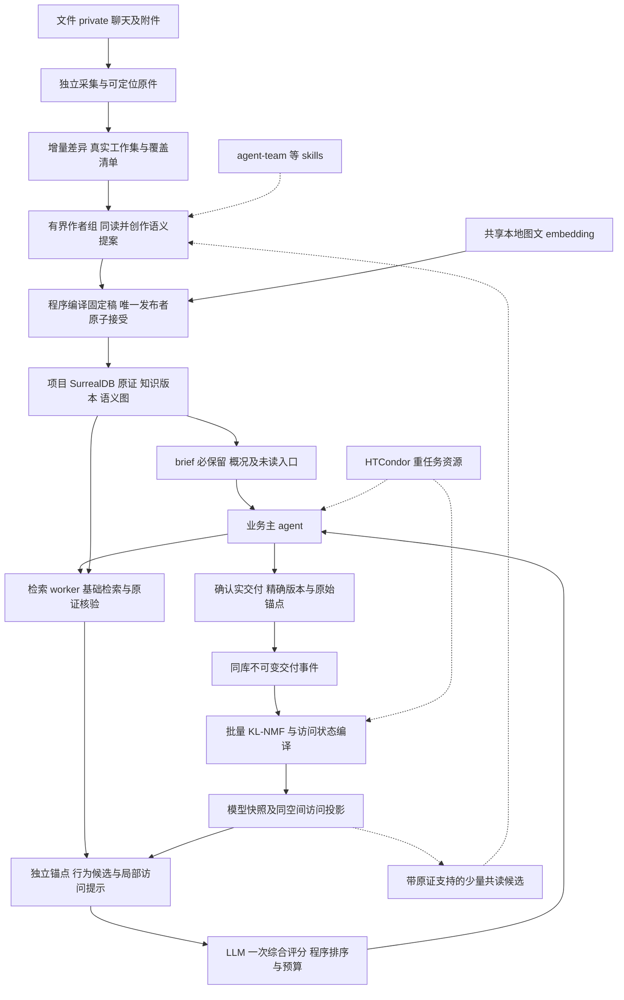
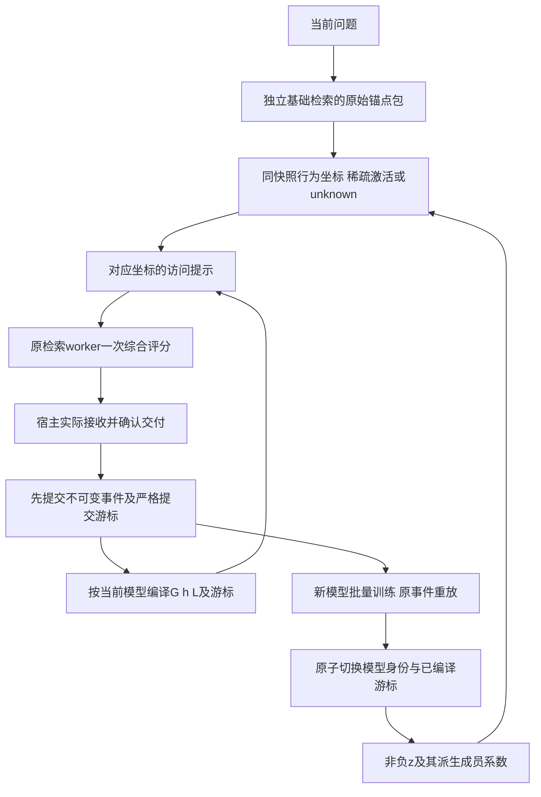

# 记忆系统长期目标架构

2026-11-17选定，尚未实现。用户要求优先普适、结构简洁和未来维护，不以旧接口兼容或旧数据迁移约束设计。本页维护技术决定与逻辑图，[计划](plan.md)维护实施顺序，[进度](progress.md)维护实际状态；项目纲领不改。修改前指当前已部署0.16，见[当前总体图](../../system/diagrams.md)，不是把先前候选当作既有功能。

## 选定路线与取舍

采用**独立采集、有限语义工作集、程序编译提案、同库原子接受，以及由真实交付驱动的KL-NMF行为坐标与局部访问投影**。语义知识由订阅agent创作；脚本维护确定性事实和数值状态。项目保留唯一SurrealDB、原证及知识版本、本地共享图文embedding和HTCondor资源边界。

| 决定 | 长期理由与被替代的方案 |
| --- | --- |
| 采集与语义维护独立 | 原件保全失败不冒充成功，也不阻止明确选择的既有原件维护；M2开关不再承担长期架构职责 |
| 作者写语义提案，程序编译唯一固定稿 | UUID、局部引用、依赖版本、private传播和hash由程序维护，减少协调者成为协议修理者 |
| 标准KL-NMF作为唯一行为主模型 | 同一非负因子既是材料向量又提供重叠访问坐标，省去独立聚类、视角注册与跨模型对齐 |
| 查询侧临时稀疏路由 | 当前问题经独立基础检索进入行为坐标；无需额外兴趣网络或永久任务分类目录 |
| 模型快照与可重放访问投影 | 因子编号只在快照内有效，重训后重新编译状态，消除迁钟和稳定簇ID协议 |
| 普通知识的概况与覆盖入口 | 复用已有多层摘要、节点、mandatory和未读指针，不恢复跨源“当前理解”短文及专用同步层 |

不选Item2Vec为主，是因为其正对/噪声分布、两套向量与独立视角映射增加维护面；不先建DEC、ComiRec、GNN或贝叶斯推断平台。它们保留为研究依据，只有明确业务失败需要时再重新决策，不作为预排的建设阶段。NMF也有局部最优、长尾与数据偏置，选择依据是结构和维护职责，不是已证明业务效果更好。

## 修改后的basePack总体逻辑



基础检索保留词法、内容向量和已接受语义图。内容embedding与行为坐标是两种空间，分别有身份；自然语言问题不与行为z直接求语义余弦。mandatory独立交付，行为热度不构成事实有效性或候选硬过滤；这里的遗忘只改变访问提示，知识失效/退役仍由语义维护决定。受限资料、派生模型和工作包沿项目分发边界保管，不因仅含数字或ID就自动可公开。

## 原件、知识与组织

1. **原件先独立保全。** 采集回执记录归属、截点、成功与未知；维护显式消费已有快照。便利入口可组合两者，但分别报告结果。原始聊天、确定性可读展开和业务材料按出处关联；相同字节或明确转换provenance可共享读取/编码，不抹去路径、出处、分类及原件身份。语义重复、替代与重要性仍由共读作者判断。
2. **确定性解析承担定位。** 在格式适配边界生成可反查的文本/图片视图，长单行支持精确行内/字段locator，不要求作者靠整行反复分块。保留原始字节、hash和版本；支持格式逐项交付，不以转换成功宣称语义接受。纯空白覆盖由程序计算。
3. **范围是实际工作集。** 发现范围、当轮纳入的已登记/新增/待处理对象、实际接受覆盖分别表达。全历史建设先形成有依据的粗层入口和未读清单，再按相关性细化；不把每种导出表示都变成独立深读义务。显式全范围维护仍须处置授权范围，不能只做粗层便宣布全文完成。
4. **来源组同时考虑语义和写目标。** 一个作者负责可完成的共读组、智能块、摘要/识图、关系和正常修稿。共享图写目标明确归属；非重叠文件不等于无写冲突。保留低频、新材料及少量随机共读，统计相似度不直接接受语义边。
5. **程序只编译已表达的语义。** 作者声明内容、位置、语义端点及实际依据；程序从固定prepare包解析局部符号、UUID、expected、依赖闭包及分类，生成不可变frozen。不得补造作者没有选择的事实或依据。语义冲突回必要共读作者，机械错误给具体对象/路径/位置，不靠昂贵协调者逐稿重读。
6. **短寿命团队，单一发布责任。** 小组可由单作者完成；复杂组使用协调者，必要时兼唯一publisher。容量是上限，按语义工作量启用人数，替代现行显式维护满队策略。主任务收阶段结果和关键阻塞；宿主执行真实派工、事件等待与取消，程序不能凭空启动订阅agent。仅看自有句柄；每组一次固定交付/回执，同稿FINAL不重做。长任务在自然终态真实换上下文，保留父stop及未明发布保护；不另建常驻调度服务。

## 一个行为模型，多个使用坐标

原始事实为幂等`delivery_id → 精确知识版本集合`。训练只投影到稳定逻辑材料ID并在篮内去重，不读取正文、标题、内容embedding、query、曝光、最终排名或路由。普通修订、改名和移动保持逻辑ID；拆分、合并或职责断裂由知识维护者建立新ID，行为脚本不猜等价。行为训练可跨普通版本获得用途先验；访问奖励、回源、适用性与语义边仍钉精确版本，新revision不继承旧hits。stale/retired不得被行为邻域复活。

相同逻辑ID集合聚为篮子b，真实出现次数n_b，大小d_b；仅d_b≥2提供共用结构。选定输入和标准KL目标：

```text
X_bi = 1[i∈b] · log(1+n_b) / d_b
min A,Z≥0  Σ_bi [X_bi log(X_bi/(AZᵀ)_bi) − X_bi + (AZᵀ)_bi]
```

采用成熟NMF实现的KL目标与乘法更新求解器，不自写confidence NN-ALS。固定初始化、收敛参数与输入合同；rank是容量超参，按留出用途与稳定性选最小合格值，不等于自动识别出的任务数量。列归一化Z并补偿A以固定尺度；材料行z_i及其归一化/支持变换m_i共同构成同快照坐标，m不是另一个可独立修改的状态源。没有共用证据的材料保持unknown，不用内容向量或随机初值补齐。

重复篮子的对数压缩、每篮归一化及访问坐标解释是本项目工程选择，不是原论文证明；它会压低高频任务的贡献，必须与逐delivery、每篮质量为1的频率忠实KL-NMF对照。真实hits始终按交付记，不受训练抽样或压缩改变。KL中X=0仍约束重建质量，不能说未观察项完全没有参与，也不等于已曝光后被否定；选择偏置、预算排除与替代关系仍未知。

算法原证：[Lee/Seung NMF](https://proceedings.neurips.cc/paper/2000/hash/f9d1152547c0bde01830b7e8bd60024c-Abstract.html)、[成熟实现的目标与稀疏输入](https://scikit-learn.org/stable/modules/generated/sklearn.decomposition.NMF.html)。[HPF](https://www.cs.columbia.edu/~blei/papers/GopalanHofmanBlei2015.pdf)提供非负隐式反馈比较思路，但本方案不引入其层次先验/变分推断。私有原文，可选：`private/sources/behavior-literature-20261117/README.md`（项目根相对路径）。

## 路由、访问与快照切换



- **原始锚点先固定。** 在任何行为支持门槛、成员过滤或路由截断之前，记录基础检索锚点的精确版本、原始质量、知识截点及query/episode引用。门控在最终筛选之前确定；不能从已选清单倒推出真实任务。行为训练仍只读ID篮子。高熵通用材料保留多视角用途，但不单独决定路由；混合问题保留少量各自可靠的锚点，避免平均后丢掉少数兴趣。
- **稀疏门控。** 少数可靠坐标g_tk非零，其余严格为0，不采用全量softmax尾巴。支持不足、全是通用锚点等返回合法unknown；缺规定输入或计算损坏明确报错，不伪装unknown。不额外调用调权agent，路由阈值和激活上限通过混合任务、unknown率及误激活验证。
- **局部访问。** 只有非空真实交付推进可靠激活的G_k；实际命中且属于该坐标的精确版本更新h_ik及L_ik，其他坐标不动。访问单元在第一次可靠实际命中时建立，此前及新revision为unknown，省去虚构出生锚点。已知单元可用`S=s(1+h)`、`u=S/(S+G−L)`给提示，s是策略参数；无日历衰减，不传播奖励，不乘旧全局w。当前g/m/已知u与覆盖程度一并交给tier1综合评分，rank不再调权。
- **模型与投影分清。** 不可变模型快照S固定训练截点、输入/算法/rank、z及路由参数；访问投影以`(S, committed_cursor)`固定其G/h/L进度，游标不是另一套模型epoch。查询从同一一致性读取得提示及身份/游标，不混用模型空间。投影按(S,C)乐观事务推进，竞争失败保留原错及未编译游标，后续沿事实接续，不盲目重试。派生状态可以明确滞后，不能伪称最新。
- **事实先于派生。** 同库原子追加真实交付并给严格提交游标，原事实不因模型重训丢失。访问编译按游标顺序处理；切换原子绑定新模型及其已编译游标，后续从该游标接续。晚到的旧模型请求保留其实际使用模型/路由，同时由原始锚点在当前模型下重编译访问状态，不搬旧g、不重复奖励。派生失败独立报原错和落后游标，保留已成功的事实，不新建owner/锁/事件服务。
- **重训重放。** 新模型批量读完整累计篮子，不仅在线微调近期A；按原事件及原始锚点，在新坐标下重算局部状态后切换。不稳定簇对齐、不迁旧钟、不重置为年轻。缺原始锚点的旧事件可用于共用训练，但访问编译保留unknown，不伪造补录。新事件合同为主，不建设旧日志迁移或双协议兼容。
- **边界。** 固定快照且纯A路由g_B=0时，B访问状态不变；跨快照不保证B的表示或排名不变。新模型用训练截点全史编译当前状态，不是历史无泄漏回测；回测须滚动截点，仅用当时已有的模型、锚点、知识和完整episode。

## 状态与维护负担

| 权威/投影 | 保存什么 | 维护者 |
| --- | --- | --- |
| 原件及语义知识 | 来源/知识版本、依据、端点、private、处置覆盖 | 作者与现有单publisher事务链 |
| 不可变观察事实 | 实交付、精确版本、原始锚点、query/episode、候选/预算、当时策略 | 宿主确认，程序幂等记账 |
| 一个模型快照 | 非负z、参数、支持度及训练截点 | 数值脚本批量生成 |
| 同空间访问投影 | 当前模型身份、编译游标、稀疏G/h/L | 程序增量编译或重放 |

不增加独立cluster表、永久任务语义ID、m编辑器、坐标迁移器、当前理解同步缓存或常驻模型agent。大数组按模型打包为少量可核hash的项目本机工件；权威元数据和事件仍在同一SurrealDB，不引入第二数据库。检索不逐次全史重放或逐文件更新全部材料；机械盘I/O、模型大小和重建耗时须在实际交付中记录。重计算达到重任务规模时复用Condor；轻统计直接运行，embedding服务沿既有管理员预留。

检索的候选发现、低频/新证据、语义适用性及实际任务结果共同验收。A→大量A→B、混合问题、通用材料、单材料/空交付、版本变化、因素拆并/rank变化及在途交付切换均需必要回归。分开固定模型比较访问规则、固定规则比较模型变化；不靠全部unknown或缩减覆盖取得空洞隔离。长期收益沿用户真实使用反馈维护，不新建正式agent团队对照、监控或参数竞赛平台。
