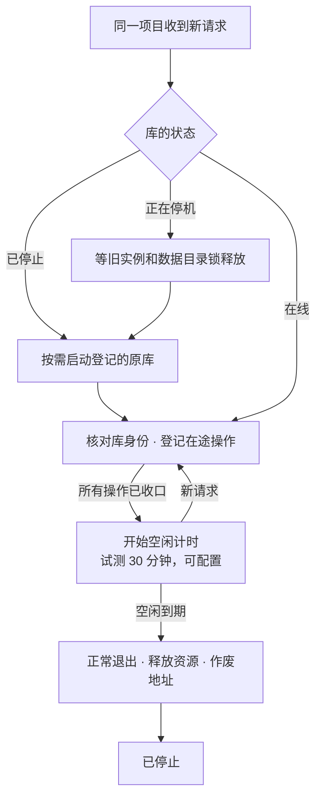

# Windows 用户级记忆运行计划

2026-11-19。目标是在 Windows 桌面会话中，由 Codex agent 按需启动已接入的项目 SurrealDB 和共享 embedding，包括重启并登录后的首次使用。接入可以由普通用户一次完成。日常启动可以经 Auto Review，全程无需用户启动进程、点击批准或处理 UAC。Windows 登录预启动可选。HTCondor 留在原有部署路线。

## 真实使用依据

| 观察 | 对产品的要求 |
| --- | --- |
| 一个已接入的 Windows 业务项目使用 basePack 0.18.7、SurrealDB 4.0.0 和普通用户手动启动的库。11 月 19 日北京时间 16:10 前，`memory brief` 和检索交付成功。Windows 于 16:14:19 重新开机。16:24 开始的下一业务轮中，brief 和 `/ready` 均连接被拒，正常主机环境也确认项目端口无监听。 | 验收重启后首次访问能由 agent 启动原库并读回既有知识。 |
| 该项目早期在受限工具内启动隐藏进程，返回 PID，下一次独立调用仍拒连，两份日志为空。换到获准的普通用户上下文运行原 launcher 后，独立调用通过 `/ready` 和 brief。11 月 19 日重启后也以原 launcher 手动恢复了原库，随后读回记忆并完成含五项结果的检索交付。basePack 自用项目 11 月 12 日也有同类重启故障。 | 启动归 Windows 托管。验收跨工具调用和聊天边界，检查实际读回。PID、任务状态及混合 shell 命令的退出码只作诊断。 |
| 同一业务项目还遇到 WebSocket Origin 403 和 Codex 聊天采集 SQLite code 14。前者发生于数据库可连时，后者在这次数据库恢复后仍有记录。重启前与数据库恢复后均有成功的 hybrid 查询，故障期间缺少独立的 embedding 探测。 | 验证 WebSocket Origin 校验及采集错误的独立诊断。用户级 embedding 针对原 SCM 部署依赖，单独验证。 |
| 本机 Codex 沙箱读取任务计划程序即返回拒绝访问。经过 Auto Review 在沙箱外执行同一只读检查后，仍以非管理员权限读取成功。 | 普通用户注册和补启动是可测试的设计。实际写入任务及启动已登记任务需要通过目标宿主验收。 |

业务项目原聊天和运行记录留在原项目。另见 [本仓库的 11 月 12 日恢复记录](../../system/environment.md#2026-11-12-重启后的项目记忆库恢复)及[现行部署合同](../../system/deployment.md)。

## 产品与权限边界

- **项目数据库。** 每个已接入项目登记一个 SurrealDB 任务，同一项目的多个聊天共用一个进程。固定端口基线沿用回环地址、独立 store、原账户和密码文件，WebSocket Origin 按实际 endpoint 校验。就绪后用原凭据核对 UUID、schema 和任务的 store 绑定。接管已有库须确认实际 store 路径及凭据文件，首次建库沿现有显式初始化流程。
- **共享 embedding。** 每个 Windows 用户登记一个共享任务，复用现有 `embedding … serve`。同账户项目沿同一机器配置 endpoint 连接，模型、环境、缓存和日志由运行账户按需要读写。默认按单账户桌面使用验收。回环端口由主机共享，绑定冲突时报告实际占用，不能接管别的实例。沿用既有模型、预处理和精度，同一 `embedding_identity` 继续使用原索引。brief 仅读数据库，向量检索或编码才检查 embedding。
- **一次性接入。** 用户显式启用托管时，由普通用户会话登记任务。Codex 可以为已授权的登记请求一次沙箱外审批，拒绝时给出普通用户终端的接入入口。执行入口与模块加载来自工作区外的安装环境，项目侧只提供已登记的数据配置。密码由启动进程从原凭据文件读取。移动、升级或卸载走显式接入入口。
- **日常启动。** 普通命令先使用健康实例。配置了托管的端点拒连时，客户端根据接入信息将组件和固定任务目标交给调用 agent。由 agent 通过宿主执行一次限定到该任务的启动调用，沙箱受限时交 Auto Review。启动入口核对任务登记、启用状态及绑定，启动中只等待，多个聊天的请求由任务计划程序合并。服务可用后，由 agent 继续原操作。任务缺失或停用、配置错误、审批拒绝或不可用均报告原始原因。

## 实施顺序

1. **验证权限与生命周期。** 在隔离实例中注册当前用户的可按需运行任务，使用交互令牌和普通运行级别。分别验证普通用户终端注册、Auto Review 注册及 Auto Review 触发已登记任务。设置单任务单实例、取消常驻任务的默认时限，并为异常退出配置有限重启。按需启动路径在关闭登录触发器时仍须可用。保留实际审批结果、任务运行账户和日志。
2. **接通项目数据库。** 复用项目配置、原生 launcher 所需数据和既有 UUID／schema 检查，加入可重复执行的用户任务登记和状态入口。让生成的项目启动指引从首个 `memory brief` 接续日常启动。任务启动后限时等待 `/ready`，再用原凭据运行 brief。端口冲突、认证或 UUID/schema 不匹配保留原错，未明提交沿现有回执核查。数据库停服由托管入口负责，`memory stop` 仍用于维护波次。动态端口和空闲停机沿[下一轮项目库托管](#下一轮项目库托管)接续。
3. **接通共享 embedding。** 复用现有 `serve`、`status`、HTTP 客户端和模型配置。编码或向量检索触发共享实例的启动，等待 `/health` 与 `/info` 确认后端和模型身份。客户端等待结束后共享推理按原语义继续。用户任务模式通过 `embedding stop` 操作对应任务，由已接入的 Windows Job Object 回收工作进程。停止、注销及异常退出用例检查端口、LitServe worker 和 GPU 显存释放。正式切换结果见[进度](progress.md#正式共享-embedding-切换)。
4. **迁移既有实例并保留回退。** 先用隔离库和测试端口验收，取得正式切换授权后再接管旧库与共享设施。切换前记录原端口、启动配置和服务定义，排空在途请求与维护发布。停原数据库进程并验证端口及 store 已释放后接管原库。若沿用旧 embedding 端口，管理员一次性停用原 SCM 实例，核实 worker 退出和显存释放后再启动用户任务。以身份与业务冒烟结果确认切换。回退时先停用户任务并核实资源释放，再恢复旧启动方式。同步产品接入、管理员说明、实际部署记录和生成指引的模板。

## 验收与交付

| 场景 | 完成条件 |
| --- | --- |
| 普通用户新接入 | 受支持的 Windows 普通账户安装到用户可写位置，无管理员/UAC，隔离项目的记忆读写和图文编码跑通。单独记录 Auto Review 对首次注册的实际结果。 |
| Agent 启动项目库 | 先关闭两个测试任务的登录触发器，保留已登记、启用的状态。真正重启 Windows 并登录，确认两个实例均停止。新 Codex 聊天的首个 brief 触发数据库启动，经实际 Auto Review 后读回重启前的 mandatory 和既有知识，无人工点击或 UAC。此过程 embedding 保持停止。 |
| Agent 启动 embedding | 同一聊天随后发起真实向量检索或编码。实际 Auto Review 允许启动共享实例，核对模型身份后完成原操作，无人工点击或 UAC。再次运行时直接使用已就绪实例。两个聊天并发、两个项目共用时，每库一个进程，共用一个 embedding worker。 |
| 故障和停止 | 受控异常退出后可恢复，启动等待有上限。单独验证审批失败、停用、端口冲突、凭据与库身份不符时的诊断。验证停止或注销后的进程树、监听与显存回收。 |
| 旧实例接管与回退 | 实际检查旧库知识、UUID、凭据和既有 embedding 身份；实际运行一次共享图文编码和旧向量查询。隔离验证回退路径，检查原安装方式可恢复。 |

接手者在本任务目录记录实际版本、Windows/Codex 权限配置、审批结果及检查回执。两个设施都通过真实宿主的自动启动用例，才算完成日常无人参与启动。安装及运行文档以实际验收边界为准。

两项设施已通过整机重启后的隔离按需启动，用的是已有聊天续接。新聊天触发列入下一轮联验，共享 CUDA embedding 正式切换已验证。实际覆盖见[进度](progress.md)。

## 下一轮项目库托管

空闲停机和动态端口共用已登记的 Windows 用户任务、项目库绑定和启动入口。2026-11-20 用户授权将动态端口作为产品可选接入，并先指定单个存量库以动态端口试点。固定端口保留为回归基线。候选包、试点和发行顺序沿[重建总览](../20261106-rebuild/plan.md#下一轮实施与联验)。[现场观察](progress.md#下一轮项目库托管)

试点通过后，用户授权把同一 0.18.8 候选包推广到其余四个现用项目，包括本开发仓。schema 3 的开发库接管原 store。三个旧项目库先在各自项目的独立物理副本完成历史桥接、逐表验证及实际回读，再排空原服务并切换。所有项目核对原 UUID、凭据、原件入口、空闲停机和按需唤醒，保留原版客户端和可启动的旧库恢复路径。正式空闲阈值为 30 分钟。

1. **空闲停机与唤醒。** 托管入口统一协调同一项目的新请求和开始停机的时机。一次业务操作的在途范围覆盖所需查询和事务、维护发布或原生导入导出。在途操作和结果未明的写入收口后才开始按项目计时，先以 30 分钟试测，计时留在内存。健康探测、SurrealDB 心跳和后台租约排除在业务活动之外。仍有无法跟踪的直连客户端时使用常驻模式。正常退出须由无窗口任务通知数据库完成，并核对端口与 store 锁释放。Job Object 的进程树回收另行验证。正常退出失败时保留故障和日志，交显式恢复。
2. **动态端口。** 增加可选的 `127.0.0.1:0`，由 Windows 在绑定时选择端口。地址设置保存监听方式，托管入口识别本次受管进程的实际地址，核对就绪和项目绑定后供客户端使用。实例退出时作废地址，下次启动重新解析。同一次操作的 HTTP 与 WebSocket 共用实际地址，并按明确约定校验 Origin。已有库核对 UUID 和 store，新库沿 `memory init` 建立身份。备份导出和恢复各自取得正确实例的地址并覆盖完整操作周期。恢复副本即使保留同一 UUID，也须使用独立目标且与原库绑定分开。`config show` 与本地维护控制可在库停止时运行。
3. **固定端口核心验收。** 新聊天从已停止状态自动读写原库，两个项目并行启动均命中各自的库，同一项目的两聊天合用一个进程。覆盖注销清理、长操作继续运行、停机时新请求等待后唤醒、发布事务与原生备份恢复。正常退出后核对监听、锁释放及周期 WAL 写入停止。以机械盘代表性存量库比较同等空闲窗口的磁盘活动时间和首次调用耗时。动态模式另测并发获分不同端口、退出后旧地址失效、合法 Origin 发布及错误 Origin 403，并通过实际导出和隔离恢复核实实例绑定。

### 空闲停机循环

参考 [Windows 登录任务](https://learn.microsoft.com/en-us/windows/win32/taskschd/starting-an-executable-when-a-user-logs-on)、[任务运行权限](https://learn.microsoft.com/en-us/windows/win32/taskschd/security-contexts-for-running-tasks)、[任务设置](https://learn.microsoft.com/en-us/windows/win32/taskschd/tasksettings)、[Codex Auto Review](https://learn.chatgpt.com/docs/agent-approvals-security#automatic-approval-reviews)及[现有管理员部署](../../../experiments/20261106-basepack/docs/administrator.md)。
