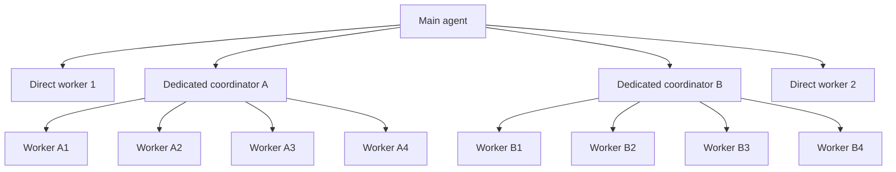
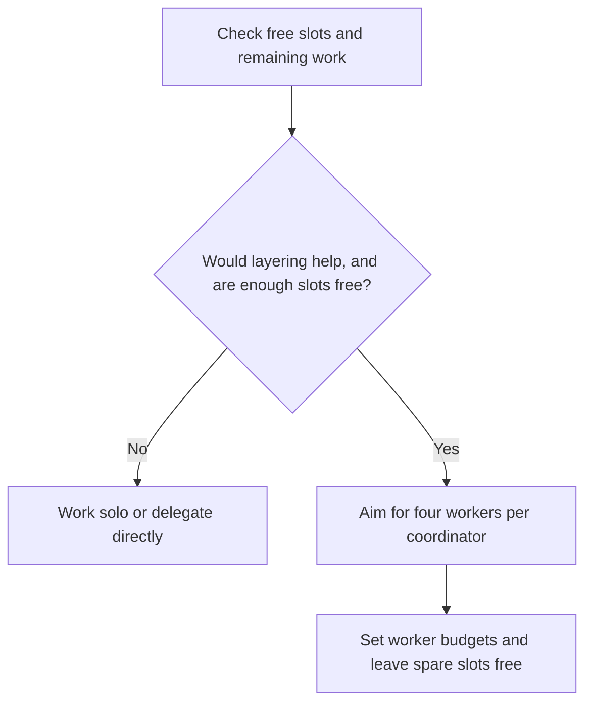
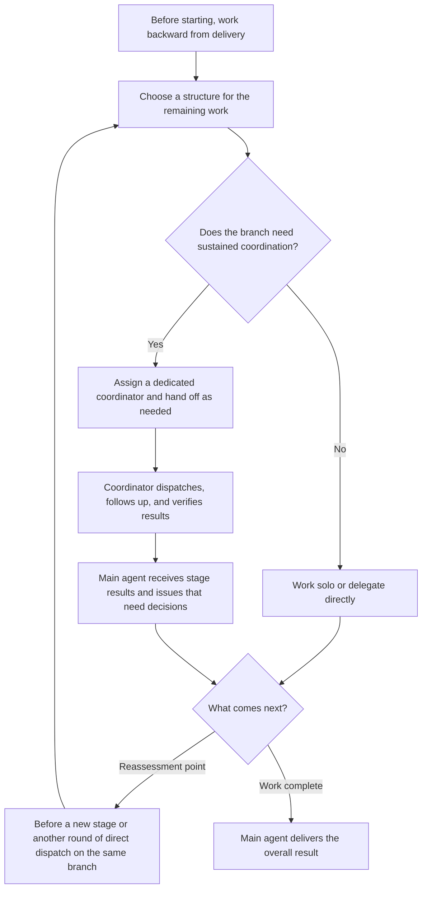
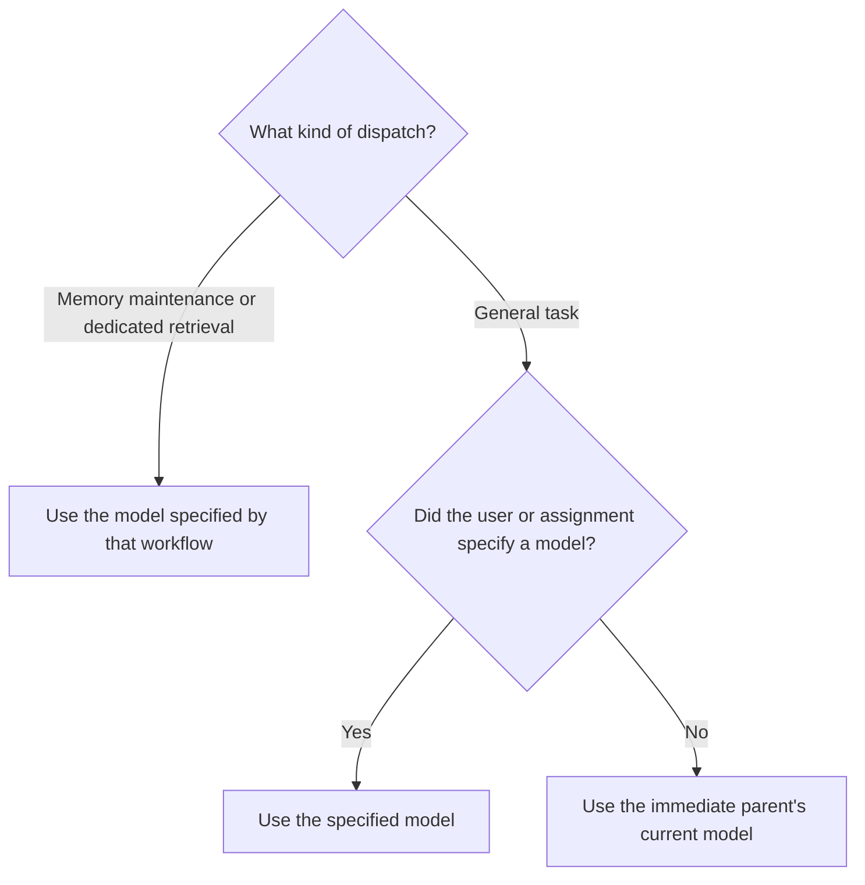

# Agent team diagrams

## Default structure with 12 free slots

The main agent owns the goal, key decisions, and overall delivery. Each coordinator manages dispatch, dependencies, follow-up, verification, and integration for its branch. Workers carry out the assigned work. The 12 slots count subagents at every level.

## Size teams to available slots

The main agent sizes teams to the host's free slots and the remaining work. Each coordinator dispatches workers within its assigned budget.

## Reassess the team and hand off a branch

Record active tasks and handles, dispatch authority, dependencies, and open issues in the handoff. If the host cannot transfer handles, the original parent collects the in-flight results before handing over further dispatch. The original parent retains lifecycle and stop authority for agents it created. Assign one dispatcher per branch.

## Choose a subagent model

